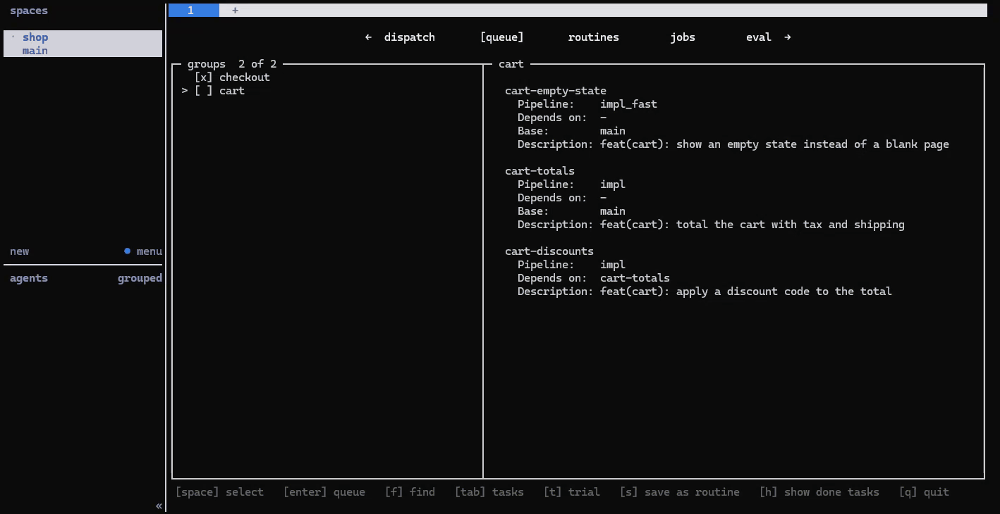
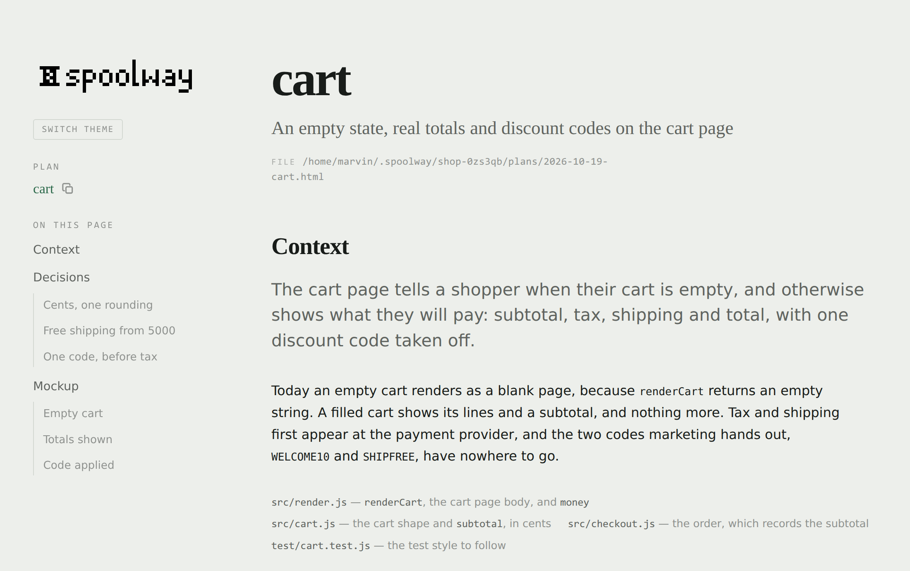
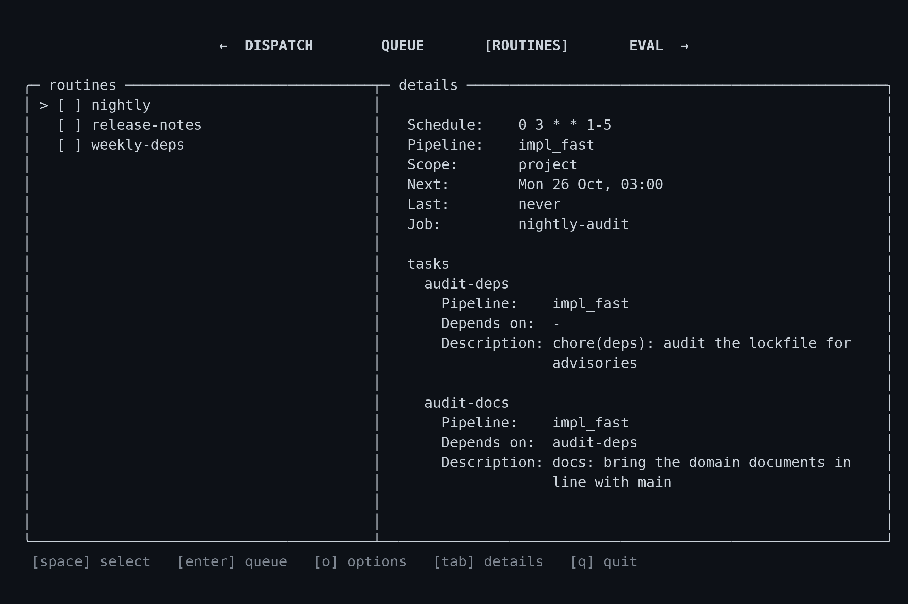
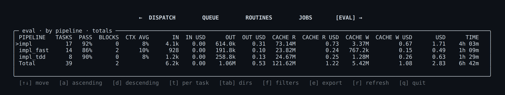

<p align="center">
  <picture>
    <source media="(prefers-color-scheme: dark)" srcset="docs/logo/lockup-a-mark-left-invert.png">
    
  </picture>
</p>

<p align="center">
  <a href="LICENSE"></a>
  <a href="https://github.com/marvingygas/spoolway/actions/workflows/ci.yml"></a>
  <a href="https://github.com/marvingygas/spoolway/releases/latest"></a>
</p>

spoolway is a descriptive agent workflow builder run by a minimal command line state machine.
It turns coding agents into pipelines you can reason about. Determinism where possible.
**Terminal native. Built for herdr.**

Create YAML pipelines that mix agents and commands, cloud and local models. Plan the work
however you like, then cut spoolway tasks and assign each to a suitable pipeline.
Measurable, comparable, repeatable.



Supported providers:

- **`claude`**
- **`codex`**
- **`pi`**

## Why

Running one coding agent is easy. Running five is hard: which one is done, which one is
stuck, and which one is rewriting a file another one needs. The order lives in your head.

spoolway keeps that order for you. Its dispatcher has no model inside, so scheduling does not
add model costs or depend on an agent's judgment.

## How does it work?

spoolway gives each agent a system prompt that tells it how to report its outcome with
`spoolway report`. The task carries context between steps. Through herdr, agents can
interact with one another across harnesses.

An agent can report four outcomes:

| Outcome | What happens |
|---|---|
| `pass` | Moves to the step's `on_pass` destination. |
| `fail` | Moves to `on_fail` or to `blocked` if none is set. |
| `block` | Moves to `blocked`, usually handled by a bigger model you configure. |
| `pause` | Stops the pipeline. It won't resume without you. Only gates or the blocked agent can pause a pipeline. |

A gate can pause a task for a person after a step reports.

## Features

- **A dispatcher with no model in it.** A TUI dashboard gives an overview of your queued tasks.
- **Define agents or commands.** Each step names its own agent and model.
- **A worktree per task.** Every task works on its own branch in its own checkout.
  Made visible through herdr.
- **Session context configuration.** Set thresholds for when to re-prompt a session,
  auto-compact, or when to escalate to blocked state.
- **Unattended runs.** When a task blocks, a configurable prompt takes over.
  It pauses the task for you only when it cannot resolve the issue.
- **Trials.** Fork a group into one full copy per pipeline you tick, and compare
  the arms in eval.
- **Routines.** Keep the tasks you run more than once in `.spoolway/routines/`.
- **Jobs.** Run a routine on a cron schedule. A running dispatcher fires it.
- **Eval built in.** Every lane's spend and outcome go into a ledger. Raise a pipeline's
  `version:` when you change it, and compare pass rate and price across versions.

## Install

spoolway runs on Linux (x64, arm64, musl) and macOS (Apple Silicon, Intel).

### npm

```
npm install -g spoolway
```

The package is a small wrapper around a prebuilt binary.

### Standalone

One file that needs nothing else:

```
curl -fsSL https://github.com/marvingygas/spoolway/releases/latest/download/install.sh | sh
```

It installs to `~/.local/bin`. See
[Standalone download](docs/installation.md#standalone-download) for the file per platform.

### From source

In a clone of this repository:

```
cargo install --path .
```

### herdr plugin

```
herdr plugin install marvingygas/spoolway
```

### Updating

| Command | What it does |
|---|---|
| `spoolway update` | Installs a newer release. A standalone binary never updates itself: run the install line again. |
| `spoolway sync` | Run in each project after an update. Lists the files the new release rewrites and applies them when you confirm. |
| `spoolway whats-new` | Prints the release notes offline. |

Platform notes and requirements in full: **[Installation and setup](docs/installation.md)**.

## Quick start

### 1. Set up

```
spoolway init
```

`init` asks where the project's setup should live. There are two choices.

| Setup | Where it lives | Use it when |
|---|---|---|
| `repo` | `.spoolway/` in the checkout, tracked by git | The whole team should share the pipelines and prompts. |
| `home` | A workspace under `~/.spoolway/` | Work with spoolway without touching repo code. |

See **[Home mode](docs/concepts.md#home-mode)**.

### 2. Plan

Use `/spoolway-plan` if you want help shaping the work first. It writes the agreed plan as an
HTML page under `~/.spoolway/<label>-<id>/plans/`. Verify the agent and you have a shared understanding.
See **[Planning](docs/planning.md)**. This step is optional.



### 3. Create queueable tasks

Use `/spoolway-tasks` to cut an agreed plan or any other defined scope into Markdown tasks.
It assigns each task to a suitable pipeline and writes the tasks to
`~/.spoolway/<label>-<id>/pending/`. You can create specialized pipelines for different kinds
of work. See **[Tasks](docs/tasks.md)**.

### 4. Queue

`spoolway` opens on the queue tab, which groups pending tasks. Select a group and press
`enter` to queue it. The tab strip runs dispatch, queue, routines and eval, and `←` and
`→` move between them.


### 5. Dispatch

To start dispatching, spoolway must run in herdr.

`←` from the queue tab opens the dispatch tab. Press `enter` there to start dispatching.


See **[The dispatcher](docs/dispatcher.md#states)** for what each state on the board means.

### 6. Calibrate

The `/spoolway-calibrate` skill reads your archived tasks, their step-level evaluation results
and the spend ledger. It compares them with the prompts, pipelines and settings that produced
them. The comparison explains review failures, blocked sessions and wasted loops. This is the
feedback loop that enables improvement of your workflows over time.

## The pipeline is a file

```yaml
# .spoolway/pipelines/default.yml
steps:
  - id: implement
    description: Write the code to satisfy the task's acceptance criteria.
    agent: pi
    prompt: implementer
    model: Ornith-1.5-35B-A3B
    session: true
    loop: 2
    on_pass: review

  - id: review
    description: Check the diff against the acceptance criteria and project standards.
    agent: claude
    prompt: reviewer
    model: claude-opus-5
    effort: high
    session: true
    on_pass: document
    on_fail: implement

  - id: document
    description: Bring the domain documents in line with what this task changed.
    agent: pi
    prompt: archivist
    model: Ornith-1.5-35B-A3B
    on_pass: create-pr

  - id: create-pr
    description: Push the branch and open its pull request.
    agent: claude
    prompt: create-pr
    model: claude-opus-5
    on_pass: done
```

See **[Pipelines](docs/pipelines.md)**.

## Try changes without committing them

In a repo-mode project, the tracked `.spoolway/` is shared with everyone. You can still change
things on your own machine first. There are two ways:

### Overrides

Apply changes that only affect you. An override patches a tracked pipeline, prompt or config value. It lives in `~/.spoolway/<project>/overrides/`. Use it to apply changes for making your own setup compatible (e.g. use your local LLM to replace certain steps).

### Private pipelines

A private pipeline is a whole new pipeline that only your machine sees. It lives in
`~/.spoolway/<project>/local/` with its own prompts and task skeleton. Use this to copy pipelines or prompts to try something new without having to update the repository.

Tip: the `/spoolway-config` skill activates whenever you want to change something in the spoolway config.

See **[The overrides layer](docs/configuration.md#the-overrides-layer)** and
**[Private pipelines](docs/pipelines.md#private-pipelines)**.

## Routines and jobs

A routine is a saved task or group of tasks that you can queue again. It lives in
`.spoolway/routines/`.
On the queue tab, press `o` on a group and pick `save as routine` to save it there. The
routines tab lists what is saved. Select a routine and press `enter` to queue it.




A job runs a routine on a schedule. It has three parts: a cron expression, a pipeline, and a
routine saved under `.spoolway/routines/`.

A job is a few lines of TOML in `~/.spoolway/<label>-<id>/jobs.toml`:

```toml
[jobs.nightly-audit]
schedule = "0 3 * * 1-5"   # weekdays at 03:00, local time
pipeline = "impl_fast"
routine  = "nightly"       # a top-level folder under .spoolway/routines/
```

The routines tab shows a routine's job above its tasks. Press `o` on the routine to edit,
pause or delete it.

## Trials

A trial answers one question: which pipeline fits this group best? On the queue screen, press
`o` on a group and pick `trial`, tick any number of pipelines to compare, and tick any steps to
skip. Each ticked pipeline gets one full copy of the whole group, and all arms share one trial
id. Compare them with `spoolway eval --by task --trial <id>`, or open the trial from the eval tab's trials
table. An arm runs every step you leave in, so tick a step such as `create-pr` to skip it. When the last
arm finishes, every arm's copy is removed. The source group and the ledger rows stay.

## Issue tracker

Event hooks can sync tasks with an issue tracker.

| Event | When it fires |
|---|---|
| `fetch` | `spoolway issue show <ref>` reads one issue out of the tracker |
| `open` | `spoolway queue add` opens a ticket per task |
| `queued` | A task arrives in the queue |
| `started` | A queued task is ready and about to leave `queued` for its entry step |
| `blocked` | A task comes to rest on `blocked` |
| `paused` | A task arrives on the persisted `paused` stage |
| `done` | A task finishes |

**The two shipped scripts are editable samples.** Choosing a tracker in `spoolway init` copies
`github.sh` and `jira.sh` into `.spoolway/hooks/`, where they belong to your project. Change
them, replace them, or leave issue tracking disabled.

See **[Issue Tracking](docs/configuration.md#issue_tracking--a-hook-fired-on-four-task-events)**.

## Configurable per project


```toml
[dispatch]
lane_quiet = "15m"           # silence before a lane is reminded to report
auto_commit = true           # commit a lane's leftover work when its step settles
priority = "group"           # fill a free slot from a group already running first; "any" weighs every ready task; "reserve" also holds a slot for each started group
lane_child_ceiling = "1h"    # how long a lane's running child process excuses it from reminders
visible_lanes = 3            # a task's most recent lanes kept open, or "all"
hide_commands = false        # true runs command steps without a pane
lane_layout = "panes"        # every step a pane of one tab; "tabs" gives each step its own tab

[unattended]
enabled = false              # the overnight switch
max_output_tokens = 0        # output-token ceiling for a run with nobody watching; 0 is none
max_cost_usd = 0.0           # dollar ceiling for the same run; 0 is none
blocked_agent = "claude"     # who staffs `blocked` when nobody is at the keyboard
blocked_model = "claude-opus-5"
blocked_effort = ""
blocked_session = true       # the unblocker carries its own earlier session forward
blocked_prompt = "unblocker"

[housekeeping]
update_check = true          # show a newer release in the dispatcher header
calibrate_window = "14d"     # how far back `/spoolway-calibrate` reads
retention_days = 30          # how long run records, logs and scratch space are kept; 0 keeps everything
archive_retention_days = 0   # how long finished tasks are kept; 0 keeps every one

[watch]
dirs = []                    # extra directories whose own agent sessions count as this project's spend

[issue_tracking]
hook = ""                    # a script in .spoolway/hooks/, e.g. "github.sh"; blank runs none
project_key = ""             # handed to the hook verbatim, e.g. owner/repo
key_in_names = true          # prefix branch and worktree names with the tracker's slug

[agents.claude]
kind = "claude"
# concurrency = 3            # most lanes of this profile at once; unset is no cap
session_reuse_ctx = 20       # % of the window before a carried session restarts fresh
session_blocked_ctx = 40     # % of the window at which a running lane is stopped and blocked; 0 is off
permission_mode = "auto"

[agents.codex]
kind = "codex"
session_reuse_ctx = 20
session_blocked_ctx = 40
permission_mode = "never"

[agents.pi]
kind = "pi"
session_reuse_ctx = 20
session_blocked_ctx = 40

[models."Ornith-1.5-35B-A3B"]  # a local model, served by llama.cpp; [models] is empty by default
context_window = 100096
slots = 0                    # parallel lanes the local server can hold; 0 leaves the profile in charge
local = false                # true when it runs on hardware you own
```

See **[Configuration](docs/configuration.md)**.

## Eval every run

When a lane finishes, its transcript is read and written to a ledger: tokens, cost, wall
time, and what the lane reported. `spoolway eval` shows what each pipeline costs to run, by
pass rate and price.

```
spoolway eval
```

`spoolway eval` prints the lanes table, grouped by pipeline. `spoolway eval --by version`
compares a pipeline's versions. Bare `spoolway`'s eval tab opens the same table interactively:
`tab` cycles to the directory table and the trials table, `t` switches between totals and per-task
figures, `f` filters, and `e` exports CSV.



## Documentation

See **[Documentation](DOCS.md)**.

## License

MIT. See [LICENSE](LICENSE).
