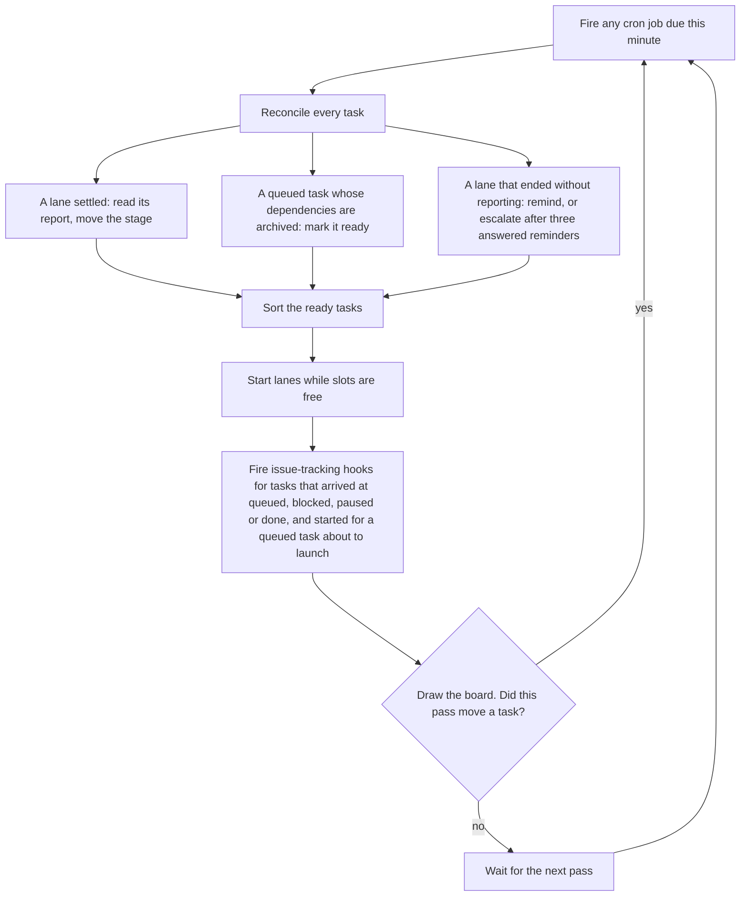
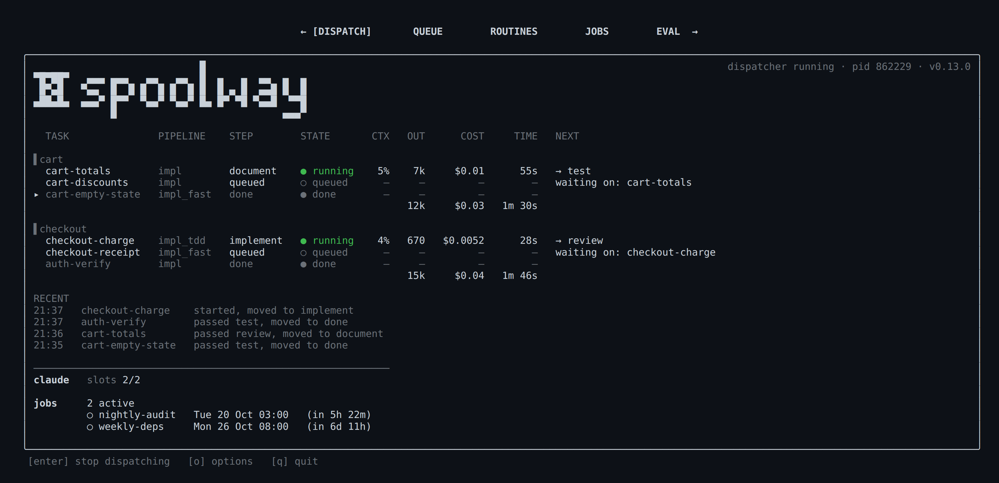
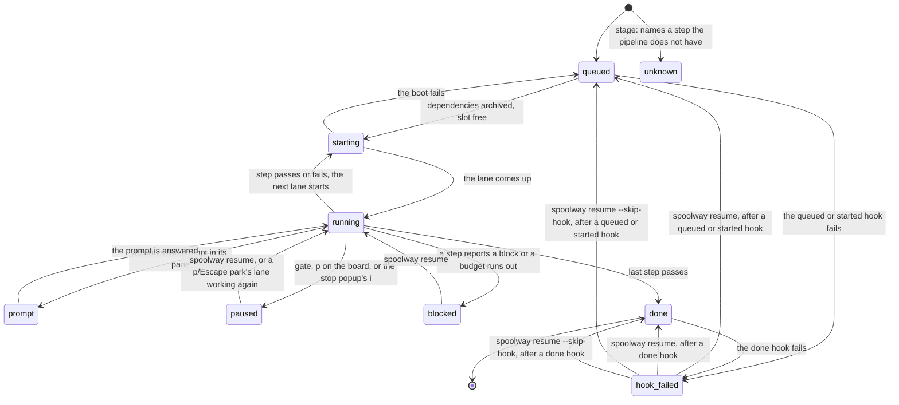

# The dispatcher

The dispatcher moves tasks through their pipelines. It uses no model. Every decision is a
lookup in a task file or in the list of live lanes.

## Running it

```
spoolway dispatch                 # runs until the queue is empty, printing a line per pass
```

`spoolway dispatch` asks herdr which pane it is running in and refuses to start outside one,
whatever flags are given:

```
$ spoolway dispatch
spoolway: Open herdr and start spoolway there:

  herdr
  spoolway
```

An internal headless backend exists for automated tests only. It is not a supported runtime
or an alternative to installing herdr. See [Testing](testing.md).

One `spoolway` serves the whole project at a time: a dispatcher started with `spoolway
dispatch`, or a screen opened with bare `spoolway`. Every pass re-reads the queue, so a task
queued while a dispatcher runs is picked up on the next pass. A second `spoolway dispatch`
while either is up prints the same line and exits without drawing a board:

```
$ spoolway dispatch
Dispatcher already running
```

Queueing a batch from the queue screen while another dispatcher holds the lock works the same
way: the batch is written, and the running dispatcher picks it up on its next pass. See
[`spoolway queue`](cli-reference.md#spoolway-queue).

Before the first pass, an [overrides layer](configuration.md#the-overrides-layer) screen, then
a warnings screen holding `spoolway doctor`'s cheap findings, each holds for a key, whenever
either has something to say. See [`spoolway dispatch`](cli-reference.md#spoolway-dispatch). Once
the run has taken the lock, a failure to find or open its own workspace gets a notice of its
own.

| Exit code | Meaning |
|---|---|
| 0 | The run dispatched and stopped on its own. |
| 3 | The queue was empty and no job is enabled. |
| 4 | Another dispatcher or screen already holds the project. |
| 1 | Any other error. |

### When it stops

The run stops when the queue is empty. A `paused` or `blocked` task keeps the run alive,
because it is waiting on a person. A queue file that does not parse keeps the run alive too. Each
pass names the file until it is fixed or moved out of the queue. While any job is enabled, the run also stays up on an empty
queue and prints when the next job fires. A job store that will not parse keeps the run up too.
See [Jobs](jobs.md).

### A dependency with no task

A queued task that names a dependency in `depends_on` with no task in the queue and none in the
archive never becomes ready. Each pass prints a problem for it, in place of `nothing to do`:

```
! `leaf` depends on `d1`, which is not a task — remove it from `depends_on` or restore the task
```

A task that is already past `queued` is not named. A dependency whose queue file does not parse
counts as a task that is still waiting, so it is not named.

`ctrl-c` stops the run the same way. A stop tears nothing down. Every worktree, pane, tab and
lane stays where it is, and the next run picks it back up. Before it exits, the run banks each
still-running lane's spend in the usage ledger and forgives that lane's launch counter, so the
next run does not treat a lane that survived the stop as a failed launch. A second `ctrl-c`
kills the process at once.

### When the lock file is lost

The run records itself in `dispatch.pid`. At the start of every pass it reads that file again.
If the file is deleted, or no longer names this run, the run prints one line and exits with code 0:

```
  ! dispatch.pid no longer names this dispatcher (pid 4711); another one holds it. Stopping, so two dispatchers never work one queue.
```

The same line goes to the problem log. Under the screen it is printed without the `  ! ` prefix.

The run moves no task and stops no lane before it exits. A dispatcher that holds the lock
carries the running lanes on. Do not delete `dispatch.pid` while a dispatcher runs. A lock left
by a process that no longer exists is cleared on the next start.

## What a pass does

A pass reads two things: each task file's stage, and the list of live lanes. Before it reads the
queue, it deletes any half-written task file in `queue/` whose writer has stopped running.



A key also answers inside a pass, not only during the wait between passes: the dispatcher checks
stdin between each task, during and between each lane start, the sweep and the archive, so a busy
run reads the keyboard at the same rate as an idle one.

Between two passes the wait is not empty. The dispatcher slices the wait into one-second
stretches and draws a frame at the top of each one, so the board redraws every second on every
target. On Linux, the dispatcher also watches the commands directory for the whole wait,
alongside the keystroke it already listens for. A file landing there, such as a background
command step finishing, ends the wait immediately and starts the next pass, which is what routes
that step. A pass also draws on the same once-a-second cadence between the checkpoints in its
own work, so the board keeps redrawing through a slow pass too.

A task that `spoolway queue unqueue` moves to the pending directory or deletes while a pass runs is dropped
by that pass. The pass does not write its task file back. It starts no command and sends no
briefing for the task, and it removes the checkout and the branch it cut for it, unless that branch
holds commits. A lane already booting for the task is stopped.

A model's `slots` caps lanes on that model, and a profile's `concurrency` caps lanes on that
profile. See
[`[models."<glob>"]`](configuration.md#modelsglob--what-a-model-costs-and-how-big-its-window-is).

The `slots` cap belongs to a `[models]` row. Every model name that matches the same row shares
its count. With `[models.qwen3] slots = 1`, a step on `qwen3` and a step on `local/qwen3` share
one slot. A row keyed by a glob such as `qwen3-coder*` shares its slots across all the names it
matches. A task that waits prints the row, as in `waiting for a qwen3 slot (1/1)`. A model with
no `[models]` row that sets `slots` is not capped.

Only the lane on a task's current step counts against those caps, from the pass that starts it.
A lane whose task has moved to another step counts for nothing, even while it is `Working`, the
same as a session you started by hand. Typing into one on a local model may make the server swap
weights. The footer counts lanes by the same rule.

A task with a `depends_on` is cut from its first dependency's branch. A task without one is cut
from `base:`. A `starts_from:` set in the task file wins over both. When the branch to cut from
exists nowhere, the task pauses instead, as
[A start branch that does not exist](tasks.md#a-start-branch-that-does-not-exist) describes. A task file that does not parse, or that holds an id another file holds, is skipped and named under the board. See [When it stops](#when-it-stops).

### A quiet pass

A pass in which nothing changed does little work. It starts no `git` process, and it asks herdr
for the list of agents once.

| Work | When the dispatcher does it |
|---|---|
| Load the config and write `dispatch-config.toml` | Only when `config.toml`, `overrides/config.toml` or `dispatch-config.toml` has changed |
| Write `lanes.json` | Only when the lane records differ from the file. A pass that fails still saves the records it changed |
| Ask herdr for workspaces, panes, agents and tabs | When a lane has started or ended, and at least once every 60 seconds. Every other pass asks only for the list of agents |
| Rename a tab | Only when herdr shows a name other than the one the dispatcher wants |

A lane that ends is noticed on the next pass, because the list of agents no longer shows it.
That pass also asks herdr for workspaces, panes and tabs.

## What runs next

When more tasks are ready than there are free slots, the pass sorts them:

1. Fewest steps left on its pipeline first.
2. Then the group with the least work left.
3. Then the task the most other tasks wait on.

With `dispatch.priority = "group"`, the default, a task from a group that has not started yet
ranks behind every task from a group that is already running. It still takes a slot when no
running group has ready work. With `dispatch.priority = "any"` only the three rules apply.

A task that reaches a command step whose id some pipeline marks `serial: true` waits there
unstarted while another task's run of that step id, on any pipeline, is going. The task's own
pipeline need not mark it. The wait is out of the sort above. Its run starts on the first pass
after that run exits, alongside whichever other ready task the sort picks first.

## What a lane is sent

A lane starts with a system prompt and a typed opening. The system prompt holds the step's
prompt file and the report contract: the exact `spoolway report` calls and what they do. It is
written to `~/.spoolway/<project>/system-prompts/<lane>.md`. `spoolway prompt contract` prints
the system prompt for a sample task.

The opening is one message naming the task file's path. A step that lists `skills:` opens with
one message per skill, in the order listed, and then that message. The first message is typed
when the lane starts. The unsent ones are saved with the lane in `lanes.json`.

A later pass types the next message when the lane's turn has ended. It types nothing into a
lane that is working or waiting on a permission prompt. A step with several skills therefore
takes one pass per skill to open.

## Reading the state

The dispatcher runs a pass every ten seconds. That rate is not configurable, and stays the floor
under how long a quiet run can go without a pass: a change in the commands directory
wakes the next pass sooner, as described above. A resume or `queue add` of an agent step waits out
the ten second floor. A pass that moves a task to a new stage, frees a
lane or archives a task runs the next pass at once instead of waiting for the next one. A long
run of such passes in a row eventually waits anyway.



The header sits in the top-right corner of the board, on the first line of the wordmark. On a pane too narrow for both, it takes its own right-aligned row above the wordmark. On a pane too narrow for the wordmark, it stays at the left margin. A header wider than the pane is cut short with `…`.

The wordmark's spool turns once a second while a dispatcher is running, even when no task is running. With no dispatcher, it turns only while steps are still finishing.

The header names the running dispatcher's version, next to its pid. If a
`spoolway` executable on `PATH` reports a newer version, the header adds `(restart to use latest
installed version)`.
Otherwise, if npm has published a newer release, the header adds `(<version> available)` in
yellow, for example `v0.9.0 (0.10.0 available)`. The notice is the same for every install. The
check is off when `housekeeping.update_check` is `false` or `SPOOLWAY_SKIP_VERSION_CHECK` is set.

Bare `spoolway`'s dispatch tab draws the same board, under the tab strip, from a `spoolway
dispatch` child the tab starts on `enter` and stops with the next `enter` — the tab runs no
pass itself. Its header names the pid of that child, or reads `dispatcher stopped`
with no pid once it has stopped, next to a count of the steps still working: `dispatcher stopped
· 3 steps finishing` (`1 step finishing` for one), left out once none are. The wordmark's spool
turns while that count is above zero. On `enter`, before the child's first pass has claimed
anything, the tab covers the board with a keyless `Starting dispatcher` popup. See
[`spoolway`](cli-reference.md#spoolway).

`enter` over a running dispatcher stops it at once when no agent lane or command step is
running. Queued tasks and scheduled jobs do not count as running. When at least one agent lane
or command step is running, `enter` opens the stop popup instead:

```
╭─ stop dispatching ──────────────────────────────────────────────────╮
│                                                                     │
│  No new steps will be started.                                      │
│  Interrupting stops agents and commands. When resumed, agents pick  │
│  up where they left off and commands restart.                       │
│                                                                     │
│  > let running steps finish                                         │
│    interrupt them now                                               │
│                                                                     │
│  [enter] confirm   [esc] close                                      │
╰─────────────────────────────────────────────────────────────────────╯
```

`↑` and `↓` move the cursor between the two answers, and it opens on the first. `enter` on `let
running steps finish` stops the child the way `ctrl-c` does: nothing is interrupted, and every
lane keeps running. `enter` on `interrupt them now` interrupts every live agent turn and kills
every running command step first, parking each of those tasks on `paused` with a mark saying
the stop parked it, then stops the child. `esc` leaves the dispatcher running. A second `enter` while a stop is already going does
nothing: there is nothing left to ask.

Starting dispatching again, from the tab or with `spoolway dispatch`, resumes every task the
stop parked, back onto the step it was on, before its first pass.

Rows are grouped by `group:`. A `▌<group>` line opens each block, and a total line closes it.
The total is the group's banked spend: every step that has settled, across every task in the
group, added up as soon as each one banks. It does not include a running step's unbanked
figures, so it can read lower than the row above it. A group with nothing banked yet closes
with no figures at all.
When the group has an issue behind it, the group name is a link to that issue. A group whose
first task stacks onto another group's own last task reads `▌<group>  after <group>`. See
[Stacking one group on another](tasks.md#stacking-one-group-on-another).

### A full board

When the queue has more rows than the pane can show, `RECENT` gives way first. It shows only when
the whole task table fits, in the rows the table leaves. The wordmark, the column header, the
slots, the jobs and the key line keep their rows.

A table that still does not fit scrolls under the cursor, in `spoolway dispatch` and in the
dispatch tab alike. It takes every row between the column header and the rule. The view keeps
the cursor's row on screen, and the total line under it when the cursor is on a group's last
task. `↑` and `↓` walk every task, so every task can be reached and seen.

The table's last row is a marker counting the tasks out of view, such as `↑ 7 tasks above · ↓ 18
tasks below`. It counts task rows only, never group lines, total lines or blank rows. It names
one side alone when tasks are hidden on that side only, and it is left off when no task is
hidden. On a narrow pane it shortens to `↑ 7 above · ↓ 18 below`, then to `↑ 7 · ↓ 18`.

When the view starts partway through a group, that group's `▌<group>` line is drawn on the
view's first row, in place of a task or the group's total line. A task it covers counts as
above. The cursor never lands on this line.

A pane too short for the wordmark, the footer and the key line together gives the table no rows
at all. The frame is then cut from the bottom so it never scrolls the terminal.

### The empty board

With no task on the queue, the board clears to a calm screen. The header stays in the top-right corner. The wordmark sits in the middle of the pane, with a bold greeting under it and a dim `Nothing queued` under that. The pane's key line shows only `[enter]` and, inside bare `spoolway`'s dispatch tab, `[q] quit`.

```
Good afternoon, Marvin.
Nothing queued
```

The greeting follows the local hour and ends in a full stop.

| Local time | Greeting |
|---|---|
| 05:00 to 11:59 | `Good morning` |
| 12:00 to 17:59 | `Good afternoon` |
| 18:00 to 21:59 | `Good evening` |
| 22:00 to 04:59 | `Working late` |

The greeting adds a comma and the first word of `git config user.name` for the board's repo. With no git, no name set or a blank value, it reads `Good afternoon.` instead. The board reads the name once, when it opens.

While a dispatcher holds the lock and at least one job is enabled, the job ledger follows `Nothing queued`, after one blank row. It uses the busy board's own words and order, and is centred as one block. Jobs fire only inside a dispatcher's pass, so a board with no dispatcher running lists no jobs. When a job fires and queues its routine, the board switches back to the busy layout by itself.

```
Good evening, Marvin.
Nothing queued

jobs   2 active
       ○ nightly-audit   Sun 11 Oct 03:00   (in 5h 12m)
       ○ weekly-deps     Mon 12 Oct 09:00   (in 1d 11h)
```

An empty board draws none of the following, and each returns once a task is on the board: the rule, the slots lines, the `pipelines` notice and the parse warning. The keys that act on a row are left off the key line. The wordmark turns while a dispatcher is running, and holds still otherwise.

An empty board draws no `RECENT`, whether a dispatcher is running or not. The board still remembers it, and shows it again once a task is back. The wordmark, the two lines and the job ledger are centred together. A pane too short for all of them drops the whole job ledger first, then the wordmark, and always keeps the two lines. Once the wordmark is gone the job ledger stays gone.

### Columns

| Column | What it shows |
|---|---|
| TASK | The task id. For a copy of a routine, the routine's name. See [Routines](planning.md#routines). |
| PIPELINE | The pipeline the task runs on. |
| STEP | The current step. For a starting task, the step the dispatcher is booting a lane for, ahead of the task file's own stage. For a paused row, or a blocked row no unblocker lane is working, the step the stop came from, and OUT, COST and TIME read that same step. For a `hook_failed` row, the stage the hook stopped the task on, `queued` or `done`. When the task file records no such step, the row shows `paused` or `blocked`. `↻ <n>` is how many times the task has arrived at that step, whichever route carried it there. It appears from the second arrival on and always draws dim. |
| STATE | One of the states below. |
| CTX | How full the lane's context window is, as a percentage of the model's `context_window`. |
| OUT | Output tokens this step has produced. |
| COST | What this step has cost. |
| TIME | How long the lane's pane has been busy on this step. A paused or blocked row's TIME does not grow. |
| NEXT | For a running or starting task, the step it goes to on pass. For one with a scheduled pause, `→ paused after <step>`. For a queued task, what it waits on, the issue hook it is running, such as `` `started` hook running 2m (stopped at 10m)``, or that a dependency it names is not a task. For a command step that has exited non-zero, the destination of its failure: the step's `on_fail`, or `blocked` when it names none, or the exit of its destination's spent `loop:`. For a paused task, the outcome the pause caught and where a resume sends it, key first: `[r] review failed → implement`; a caught pass reads `[r] → e2e`. A task parked before it ever started reads `→ queued — [r] resumes it`. A task the dispatch tab's stop popup parked reads `→ <step> — resumes when dispatching starts`. A paused task whose resume has no step to name reads `[r] resume`, which includes a task parked on a step the pipeline does not define, or `no step named` while a dependency or its own lane is busy. A `hook_failed` task reads `[r] rerun hook  [k] skip hook`. A blocked task waiting for a person reads `[r] → <step>`, naming the step a resume sends it back to. When that step is not in the pipeline, it reads ``[r] pick a step — `<step>` is gone``. While a dependency or the task's own lane is busy, the row reads `→ <step>` with no key. For a lane holding a permission prompt, `press a key in pane \`<task> · <step>\``. NEXT never names a step the task walks past. When a pass or a resume leads onto one, NEXT names the first step after it that the task runs. |

`spoolway eval --by task` gives the task's whole bill.

### States



| State | Meaning |
|---|---|
| `queued` | Waiting for its dependencies and a free slot. |
| `starting` | The dispatcher has claimed a slot and is booting the lane. herdr does not list it until the boot is well along. The logo turns the same as it does for `running`. |
| `running` | A lane is working the current step. |
| `prompt` | A live lane's pane is holding a permission prompt. Read fresh off the lane list every redraw, and gone the instant the prompt is answered. Not resumable: the task has not stopped. |
| `silent` | A live lane has not answered the last reminder the dispatcher sent it. Drawn `● silent · <time>`, counted from the model's last turn. A lane with no model turn counts from its last write before the first unanswered reminder. The task stays on its step and the lane is reminded again. A usage limit clears by itself, and the row reads `running` once the lane writes a turn. A lane that will never answer, such as a dead pane, stays silent: restart the step with `restart` in the board's options menu. See [A lane that settles without reporting](#a-lane-that-settles-without-reporting). |
| `paused` | The task's own stage is `paused`: a gate, or a `pause` from the options menu or the dispatch tab's stop. |
| `hook_failed` | The task's own stage is `hook_failed`: an issue-tracking hook failed on `queued`, `started` or `done`. Drawn `● hook failed`. NEXT reads `[r] rerun hook  [k] skip hook`. |
| `waiting` | The task cannot start its step yet. NEXT names why, for example `serial: after <task>`. See [Background and headless](pipelines.md#background-and-headless). |
| `blocked` | A step reported a block, a launch failed, a loop budget ran out, or, in an unattended run, the dispatcher stopped a lane that ended without reporting or crossed a ceiling. Read the latest `## Status Log` entry that contains `→ blocked`, and the entries just above it, for the reason. A failed launch or a spent `loop:` logs its reason on the entry above. `## Blocker` holds a stop the dispatcher made. Entries above a `Cleared` line belong to a stop that is over. |
| `unknown` | The task file's `stage:` names a step the task's pipeline does not have. `spoolway resume <task> --stage <step>` puts it on a step the pipeline has, and the refusal says so. Or correct `stage:` in the task file. A task whose `pipeline:` is missing, or names a pipeline that does not exist, also reads `unknown`. NEXT says which, and the other rows are drawn as usual. The dispatcher does not start such a task. |
| `done` | Finished and archived. The row stays, dimmed, until the whole group is done. A group with a live copy of a routine draws no `done` rows. |
| `finished` | Only on a stopped dispatch tab: a step whose lane has settled, or whose command run has exited, with nothing up to move it on. TIME stops where the board first saw it settle. NEXT reads `moves on when dispatching starts`. The same step reads `running` while a dispatcher is up, since it moves on within the pass that settles it. |

### Recent moves

`RECENT` says what each task last did, one sentence per task, newest on top.
A cause in brackets follows when the route alone does not explain the move.

`RECENT` names a copy of a routine by its routine, such as `release-spoolway` for the task
`release-spoolway-8`, both while it runs and once it has finished. It keeps one line per routine,
for the latest move of any of its copies. Any other task keeps one line per task id.

The board's popups name a copy of a routine the same way. The options menu and the `resume`,
`pause`, `restart` and `unqueue` panels put the routine's name in their title in place of `<task>`.
A panel's body still names a file by the task's id.

| Line | When |
|---|---|
| `started, moved to <step>` | The task left `queued` for its first step. |
| `passed <step>, moved to <step>` | The step passed, or a command step exited zero. The move may go past steps the task walks past, such as `passed test, moved to document`. |
| `failed <step>, moved to <step>` | The step failed, or a command step exited non-zero. The move may go past steps the task walks past. |
| `skipped <step>, moved to <step>` | The task passed over the step without running it, or the step sent no report. |
| `resumed, moved to <step>` | The task left `paused` or `hook_failed`. |
| `skipped <event> hook, archived` | A person skipped the failed `done` hook, from the board's `k` or with `spoolway resume --skip-hook`. |
| `skipped <event> hook, moved to <step>` | A person skipped the failed `queued` or `started` hook. The step is `queued` until the dispatcher starts the task, then the step it starts on. |
| `unblocked, moved to <step>` | The task left `blocked`. |
| `unblocked by its lane, moved to <step>` | The `blocked` lane reported a pass. |
| `left <step>, moved to <step>` | The task file does not say how the task left the step. |
| `passed <step>, moved to paused (gate)` | The step has `gate: true`. |
| `passed <step>, moved to paused (scheduled)` | A scheduled pause took effect at the step. The same cause follows `failed <step>` and `reported a block on <step>`. |
| `passed <step>, done hook failed: <reason>` | The issue hook for `done` exited non-zero, ran 10 minutes without exiting, or was killed three times in a row. |
| `<event> hook failed: <reason>` | The issue hook for `queued` or `started` exited non-zero, ran 10 minutes without exiting, or was killed three times in a row. |
| `stopped on <step>, moved to paused (manually)` | A person picked `pause` from the board's options menu, or pressed Escape in the lane's pane. |
| `stopped before starting, moved to paused (manually)` | A person paused the task before it started. |
| `stopped on <step>, moved to paused (dispatching stopped)` | The dispatch tab's stop popup parked the task. |
| `stopped on <step>, moved to paused (escalated)` | The dispatcher stopped the lane in an attended run. The task file's `## Status Log` gives the exact reason. |
| `stopped on <step>, moved to blocked (escalated)` | The dispatcher stopped the lane in an unattended run, and the unblocker takes the task. The `## Blocker` section gives the exact reason. |
| `stopped before starting, moved to paused (branch <name> missing)` | The branch the task starts from does not exist. |
| `stopped on <step>, moved to paused` | The task file names no cause for the step the task left. A cause counts only when the file names that step. |
| `passed blocked, moved to paused` | The `blocked` lane reported a pass and the task still stopped on `paused`. This is the unblocker lap limit, or the dispatcher stopping a later `blocked` lane. The `## Status Log` gives the exact reason. |
| `reported a pause on blocked, moved to paused` | The `blocked` lane reported a pause. |
| `reported a block on blocked, moved to paused` | The `blocked` lane reported a block. The same holds for `failed blocked` when it reported a fail. |
| `stopped on blocked, moved to paused (escalated)` | The dispatcher stopped the `blocked` lane, in any run. The `## Status Log` gives the exact reason. |
| `reported a block on <step>, moved to blocked` | The lane for the step reported a block. |
| `failed <step>, moved to blocked (loop limit on <step>)` | The step failed, and the step it routes to has used its `loop:`. The same cause follows `passed <step>` and `skipped <step>`. |
| `could not launch <step>, moved to <step> (3 attempts)` | The launch was refused three times in a row. |
| `could not launch <step>, moved to <step> (lane died at launch)` | The lane started and left nothing behind. |
| `could not launch <step>, moved to <step>` | The launch failed and the task file does not say why. A pane that never got ready reads this way. |
| `passed <step>, moved to blocked (uncommitted work)` | The last step passed, and the worktree held work that could not be committed. |

Errors from a pass go to `~/.spoolway/logs/<project>.log`.

### Keys

The key line under the board reads `[enter] start dispatching   [o] options   [q] quit`. It
reads `stop dispatching` while the dispatcher is running, and `q` shows only inside the dispatch
tab. `[r] resume` joins it, between the `enter` pair and `[o] options`, only while the `▸`
cursor sits on a row it can resume.

| Key | What it does |
|---|---|
| `↑` `↓` | Move the cursor. It starts on the first row of the first group and walks every row the board draws, done ones included. If its row leaves the board, such as its group finishing, the cursor falls back to the first row with no key pressed. |
| `o` | Open the options menu of the row under the cursor. See [Options menu](#options-menu). |
| `r` | Open the resume picker for a paused or blocked row whose dependencies have finished. The picker lists every step the task runs, preselects the natural next step, and `enter` resumes the task there. A row parked before it ever started resumes at once with no picker. A `hook_failed` row also resumes at once and runs its hook again. See [Resume picker](#resume-picker). |
| `k` | Open the skip panel for a `hook_failed` row. Does nothing on any other row. See [Skip panel](#skip-panel). |
| `ctrl-c` | Stop the run. |

Every menu and panel these keys open lists its answers under its text, with `>` on the
cursor's row. `↑` and `↓` move the cursor, `enter` runs the answer under it, and `esc` closes it
with nothing changed. No letter answers a menu or a panel. The cursor opens on the first answer,
such as `open task` or `pause now`, and on the `(next)` step in the resume picker.

### Options menu

`o` opens a menu titled with the task's id, or with the routine's name for a copy of a routine. It
lists only what that row can do right now, always in this order, and the cursor opens on the first
item:

```
╭─ cart-empty-state ──────────────╮
│  > open task                    │
│    open plan                    │
│    pause                        │
│    restart                      │
│                                 │
│  [enter] confirm   [esc] close  │
╰─────────────────────────────────╯
```

| Item | Listed on | What it does |
|---|---|---|
| `open task` | Every row, `done` ones included. | Open the task file in your editor. See [Editor](#editor). |
| `open plan` | A row whose task sets `plan:` to a value that is not empty. | Open the plan page `plan:` names in your default browser. |
| `pause` | Every row but a `paused` or `done` one, a `blocked` one included. | Pause the row. Asks first if it would interrupt a running agent turn or command. See [Pause panel](#pause-panel). |
| `restart` | A row `spoolway restart` accepts. | Open the restart panel. See [Restart panel](#restart-panel). |
| `unqueue` | A `queued` row. | Take the task, and every unstarted task that depends on it, out of the queue and write their tasks back to `~/.spoolway/<project>/pending/`. A copy of a routine is deleted instead, when its routine file still exists. Asks first. For such a copy the panel is titled with the routine's name, says the copy is deleted, names the routine file that stays (relative to the repository root), and says the routines tab queues it again. When several tasks go, the panel lists the ones going back to the pending directory apart from the routine copies being deleted, each group with its own closing line. |

So a running row lists `open task`, `pause` and `restart`. A paused row that can be resumed
lists `open task` and `restart`, and is resumed with `r`. A queued row lists `open task`, `pause`
and `unqueue`, and a done row lists `open task` alone. A row whose task sets `plan:` also lists
`open plan`, directly under `open task`. A row whose task file is gone opens the menu with
`nothing to do here` over `[esc] close`.

`open plan` reads `plan:` alone, never `source:`. The menu lists it without checking that the
page exists. Picking it starts the browser in the background, so the board keeps drawing and
nothing waits on the browser. macOS uses `open`, WSL uses `wslview` or else `explorer.exe`, and
any other Linux uses `xdg-open`. When the page is gone, or the platform's program is not on
`PATH`, a popup titled `open plan` says what went wrong and what to do, and `enter` closes it.
The queue screen's tasks pane lists `open plan` the same way. A plan row on that screen lists it too, and opens its own page. The routines pane does not.

`enter` runs exactly what the item names, through the same check that decided the list. A row
that changed state while the menu was open gets nothing done to it. Resume is never in the menu.
The board has no key that unqueues every task at once: `spoolway queue unqueue --all` does that
from a shell.

### Editor

`open task` runs one editor, chosen in this order. The first one that is set wins.

| Order | Source |
|---|---|
| 1 | `command` under `[editor]` in `~/.spoolway/editor.toml` |
| 2 | `$VISUAL` |
| 3 | `$EDITOR` |
| 4 | `vim` |

The same choice serves every item that opens a task file in the terminal screens. These are
`open task` on the board and on the queue screen's tasks and routines panes, and `open` on the jobs
routine picker. `spoolway config edit` and `spoolway config override` do not use it. They wait for
the editor to close and then check the file, so they keep their own order: `$VISUAL`, then `$EDITOR`, then `vi`. Setting `editor.toml` does not change them.

`editor.toml` is written by hand. This example opens tasks in Notepad:

```toml
[editor]
command = "notepad.exe"
```

| Key | Default | What it controls |
|---|---|---|
| `command` | none | The command to run. It may hold flags, such as `code --wait`. The task path is added at the end. |
| `window` | `true` when the program ends in `.exe`, otherwise `false` | `true` starts the editor in the background with no pane. `false` opens it in a pane. |

A window editor runs in a session of its own, so quitting spoolway leaves it open. It starts on
every backend, the headless one included. A terminal editor opens in a pane, and the headless
backend has no pane to open it in.

On WSL, a command whose program ends in `.exe` receives the Windows form of the path, such as
`\\wsl.localhost\Ubuntu\home\you\...`. Other commands receive the Linux path.

Some `.exe` programs want the Linux path instead. To keep it, point `command` at a small wrapper
script whose name does not end in `.exe`. The script runs the program itself and passes the path on.
The wrapper also loses the `.exe` default for `window`, so set `window = true` if the program draws
its own window.

`spoolway doctor` reports the choice. With `--verbose` it prints one `editor` row that names the
program, where it came from, whether it opens its own window, and whether paths are converted for
Windows. When the setting cannot work, doctor prints a note with the same fix the popup gives. The
note covers a program that is not on `PATH`, an `editor.toml` that does not parse, and a missing
`wslpath` on WSL. On the headless backend it also covers a terminal editor, which has no pane to
open in. It is never a failure and does not change the count of checks passed. The
warnings screen shown before a run does not include it.

`open task` refuses and starts nothing in these cases:

| Case | What the refusal says |
|---|---|
| `editor.toml` does not parse, or holds a key other than `[editor]` `command` and `window` | The error names the file and the parser's own message. The next editor is not tried. |
| The command is empty | The error says the command is empty and names the fix. |
| The program is not on `PATH` | The error names the program and says to fix `command` or delete the file. |
| The Windows path conversion fails | The error names the task path and says why the conversion failed. |
| A terminal editor is chosen on the headless backend | The error says the backend has no pane to open a command in. |

A refusal shows in a popup titled `open task`. The popup holds the whole error, including its fix,
and closes with `enter` alone. It appears on the board, the queue screen's tasks and routines
panes, and the jobs routine picker, and the text is the same on each. The board keeps redrawing
and the dispatcher keeps running while the popup is open.

### Resume picker

`r` on a held row opens a picker titled `resume <task>`. It lists the steps of the task's pipeline in pipeline order, except `blocked` and `done`. The line above the list says where the task stopped. A blocked or paused task ends the list with a `done` row.

A step the task walks past is left out: a `first:` step when the task is not its chain's root, a `last:` step when a task above it in its group runs a `last:` step of its own, and a step its own `skip:` names. `spoolway resume --stage` refuses those steps, so the picker does not offer them. Two hidden steps are still listed. One is the step the task stopped at, so the person sees where the task is. `enter` on that row is refused unless it is also the `(next)` row. The other is the `(next)` row when a plain resume lands on a hidden step, which happens when that step has no `on_pass`.

```
paused at review — it passed

  reproduce   on fail
  review      paused
> document    on pass (next)

[enter] confirm   [esc] close
```

| Label | Meaning |
|---|---|
| `paused`, `blocked` | The step the task stopped at. |
| `on pass`, `on fail` | The steps a pass or a fail of the stopped step lands on. A route onto a hidden step is followed past it, so these name the step the task would really run next. |
| `(next)` | Where `spoolway resume <task>` sends the task, past any hidden step. The cursor starts here. After a caught `--fail`, this is the stopped step's `on fail` step. |

When a plain resume goes to `blocked` or `done`, one extra `blocked (next)` or `done (next)` row sits under the steps. When the stopped step is not in the pipeline, the header names it, no row reads `(next)`, and the cursor starts on the first step.

| Key | What it does |
|---|---|
| `↑` `↓` | Move the cursor. A long list scrolls, with `▲ n more` and `▼ n more` lines. |
| `enter` on the `(next)` row | The same as `spoolway resume <task>`. |
| `enter` on any other row | The same as `spoolway resume <task> --stage <step>`. |
| `enter` on the `done` row | The same as `spoolway resume <task> --stage done`. See [Closing a stuck task](tasks.md#closing-a-stuck-task). |
| `esc` | Close the picker and change nothing. |

The `done` row has no note and sits under the steps after a blank line. The cursor never starts on it, unless a plain resume already lands on `done`.

An `enter` the resume refuses leaves the picker open and prints the reason above the list. When the task has moved on since the picker opened, `enter` resumes nothing and says so. Press `esc` and `r` again to see where the task stands.

### Pause panel

`pause` from the options menu of a row with a running agent turn or command opens a panel titled
`pause <task>`. It names the step it would abort and lists two answers:

```
╭─ pause cart-empty-state ────────────╮
│  Pausing aborts the step it is on:  │
│                                     │
│  implement    agent    2m 21s       │
│                                     │
│  > pause now                        │
│    pause when implement finishes    │
│                                     │
│  [enter] confirm   [esc] close      │
╰─────────────────────────────────────╯
```

When the board cannot route the task for an `r`, the picker lists no steps and shows the reason. Its key line offers only `esc`, which closes it.

Pausing an agent turn sends Escape to the pane, so a resume picks the session back up. Pausing
a command step kills the run, and the command runs again in full on resume. On a command step
the panel says so in two lines above the answers: `Pausing terminates the command's process.`
and `Resuming restarts the command.`

`pause when <step> finishes` interrupts nothing. It writes a `gate_at` for the step the panel
named, so the named task pauses itself once that step reports, whatever it reports. For a
command step, the task pauses once the command exits, whatever the exit code. On a row that
already has a scheduled pause, the same answer reads `cancel the scheduled pause` and clears
it.

### Restart panel

`restart` from a row's options menu opens a panel titled `restart <task>`. The panel has one form for an agent step and one for a command step.

The agent form names the step, the lane and the session that a restart throws away. The session row is left out when the task has no session on record.

```
╭─ restart login ─────────────────────────────────────╮
│                                                     │
│ step      review                                    │
│ lane      login · review                            │
│ session   32b0d7bd — abandoned, already banked      │
│                                                     │
│ The lane is torn down and `review` is briefed from  │
│ scratch. Its conversation is not kept.              │
│                                                     │
│ > restart                                           │
│                                                     │
│ [enter] confirm   [esc] close                       │
╰─────────────────────────────────────────────────────╯
```

The command form is drawn for a command step, which has no lane and no session. It names the step and the run instead. The `run` row gives how long the command has been running, and is left out when no run is going, as on a paused or blocked task. The closing sentence says the command's process is ended and the step runs again from the start, with its log kept as the previous log. When no run is going there is no process to end, so the sentence only says the step runs again from the start and its log is kept.

```
╭─ restart solo ──────────────────────────────────────────╮
│                                                         │
│  step      build                                        │
│  run       command · 4m 12s                             │
│                                                         │
│  The command's process is ended and `build` runs again  │
│  from the start. Its log is kept as the previous log.   │
│                                                         │
│  > restart                                              │
│                                                         │
│  [enter] confirm   [esc] close                          │
╰─────────────────────────────────────────────────────────╯
```

| Key | What it does |
|---|---|
| `enter` on `restart` | The same as `spoolway restart <task>`. |
| `esc` | Close the panel and change nothing. |

The options menu lists `restart` only for a task that `spoolway restart` accepts, judged on the pipelines the running dispatcher loaded. A queued, done or hook-held row does not list it. When those pipelines refuse the task, the panel opens with the refusal in it and `enter` restarts nothing. A restart the command refuses leaves the panel open and prints the reason under the closing sentence, above the answer. When the task has moved to another step since the panel opened, `enter` restarts nothing and says so.

### Skip panel

`k` on a `hook_failed` row opens a panel titled `skip the <event> hook?`, where `<event>` is the hook that failed. The panel says where the task goes without that hook. It has one answer.

For a failed `done` hook the panel names the archive and the worktree removal. A line about the ticket follows when the task has a `ticket:`. The answer is `skip and archive`.

```
╭─ skip the done hook? ────────────────────────╮
│  release-spoolway is archived and its        │
│  worktree removed.                           │
│  Ticket #1025 stays as it is.                │
│                                              │
│  > skip and archive                          │
│                                              │
│  [enter] confirm   [esc] close               │
╰──────────────────────────────────────────────╯
```

For a failed `queued` or `started` hook the panel names the step the task starts on, and the answer reads `skip and start <step>`.

| Key | What it does |
|---|---|
| `enter` on the answer | The same as `spoolway resume <task> --skip-hook`. The board prints nothing over itself. RECENT reads `skipped <event> hook, archived` or `skipped <event> hook, moved to <step>`. |
| `esc` | Close the panel and change nothing. The task stays on `hook_failed`. |

When the dispatcher's copy of the pipelines refuses the task, the panel opens with the refusal in it, and the step is read from the board's own copy. When no copy can place the task, `k` shows the refusal in a popup instead. A skip that is refused leaves the panel open and prints the reason above the answer. When the task is no longer held by the hook the panel named, `enter` skips nothing and says so.

### Footer

A board with at least one task ends with a footer. One line per agent profile: `<profile>   slots <live>/<cap>`. A model with its own `slots` gets
its own figure appended after the profile's, model name then `<live>/<cap>`, so a profile
running a pooled model reads `pi   slots 2/3   Ornith-1.5-35B-A3B   1/2`. A line `pipelines  <files> changed since this run started — restart the dispatcher
to use it` appears while a pipeline file differs from the copy the dispatcher loaded. See
[Editing a pipeline while it runs](#editing-a-pipeline-while-it-runs). Then the job ledger lists every enabled job with its next firing:

```
jobs    2 active
        ○ nightly-audit       Sat 12 Sep 03:00   (in 6h 48m)
        ○ release-readiness   Mon 14 Sep 08:00   (in 2d 12h)
```

`spoolway queue list` prints the same table from another terminal, and `spoolway lane <lane>`
shows what one lane is doing.

## Editing a pipeline while it runs

The dispatcher reads the pipelines once, when it starts. Configuration is reloaded whenever its files change,
with a few exceptions; see the end of this section. Right after it takes the project's
lock, it writes a copy of what it loaded to `<home>/dispatch-pipelines.json`. A dispatcher
that starts later replaces that copy.

While a dispatcher is running, these commands route a task on that copy and not on the files:

- `spoolway report`
- `spoolway resume` and `spoolway queue resume`
- `spoolway queue route`
- `spoolway restart`
- the `r` picker and `restart` in the board's options menu
- `spoolway queue add`
- the NEXT column of the board and of `spoolway queue list`

Each reads only the pipelines its own tasks name. With no dispatcher running, they read the
pipeline files.

`spoolway queue route`, `spoolway queue list` and the board therefore name the step that
`spoolway resume` takes. A task whose pipeline the running dispatcher did not load shows as
`unknown`, with NEXT telling you to restart the dispatcher. While a dispatcher runs,
`spoolway queue list` still answers when a pipeline file does not parse.

An edit to a pipeline file changes nothing until the dispatcher restarts. A pipeline override
follows the same rule: `spoolway pipeline override` writes a patch file, and the running
dispatcher uses it only after a restart. The footer and `spoolway pipeline check` name each
pipeline file or override patch that differs from the loaded copy:

```
$ spoolway pipeline check
  pipelines: t.yml changed since the running dispatcher started — restart the dispatcher to use it
```

`spoolway queue add` refuses a task whose pipeline the running dispatcher did not load. It
tells you to restart the dispatcher and try again.

Configuration is the exception. At the start of every pass the dispatcher checks `config.toml` and the config override, and
loads them again when either has changed. A change such as a higher `agents.claude.concurrency`
applies on the next pass with no restart. If the file stops parsing or goes missing, the dispatcher keeps
running on the last good config. It prints the error once.
It starts no lane beyond the `concurrency` caps of that config. The error clears as soon as the
file is valid.

After each good load, the dispatcher writes the merged config to `<home>/dispatch-config.toml`.
A lane's `spoolway report` runs on this record when `config.toml` or
`overrides/config.toml` cannot be read. See
[When the config will not parse](configuration.md#when-the-config-will-not-parse). A record is
used only while the dispatcher that wrote it is running. The dispatcher writes it on the first
pass whose load succeeds. If it cannot write the record, it prints that once, and lanes then stop on a broken config.

Three groups of keys are fixed when the dispatcher starts. `spoolway config get` shows a new
value for them at once, but the running dispatcher keeps the old one until you restart it.
They are `unattended.enabled`, the `unattended.blocked_*` keys and `dispatch.backend`.

## Gates: when the pipeline waits for you

A step with `gate: true` stops the task on `paused` after the step reports. The pane stays open
for you to read. A command step has no pane. The dispatcher stops the task on `paused` when the
command exits with a pass.

Press `r` on the paused row to open the [resume picker](#resume-picker). The natural next step
is preselected, so `enter` lets the task past the gate. Move the cursor to another step and press
`enter` to send the task back round to it instead.

A paused task holds no slot. You can type into its pane. When that turn ends, the dispatcher
commits the worktree with a `## Status Log` line saying a person drove the round.

Other things put a task on `paused`:

| Cause | How the task file records it |
|---|---|
| `pause` from the board's options menu | `parked_from: <step>` |
| The dispatch tab's stop popup, `interrupt them now` | `parked_from: <step>` and `parked_by_stop: true` |
| Escape typed by hand into a lane's pane | `parked_from: <step>`, written on the next pass |
| A staffed `blocked` lane reports `--pause`, `--fail` or `--block` | `paused_at: <the step it blocked on>` |
| A queued task whose start branch exists nowhere | `missing_start_branch: <branch>` |

`spoolway resume` on any of these puts the task back on its step, and so does `r` on the board.
A task the stop popup parked also resumes on its own, back onto the step it was on, the next
time dispatching starts — from the tab or from `spoolway dispatch` — and its NEXT column reads
`→ <step> — resumes when dispatching starts` until then. A paused task's pane survives a stop of
the dispatcher.

A board `pause` or an Escape park also goes back onto its step without a key press, once its own lane is seen
`Working` again — a person typed a follow-up straight into the pane instead of pressing `r`. The
next pass restores it straight away; nothing is relaunched, since the lane never left. A report
that lane sends while the task is still parked is applied the same way, as if the task were
already back on its step. The stop popup's own park does not auto-restore like this: it waits for
dispatching to start, as above.

A failing `[issue_tracking]` hook on `queued`, `started` or `done` moves the task to `hook_failed`.
The task file gets `hook_paused: queued`, `hook_paused: started` or
`hook_paused: done`, and `hook_error: <reason>`. No hook event fires for `hook_failed`.
Nothing inside the pipeline failed, so there is no step to go back to. `spoolway resume`, or
`r` on the board, forgets the hook's failed run, so it fires again. A task stopped by its
`queued` or `started` hook resumes to `queued`. A task stopped by its `done` hook resumes
straight back to `done`.
`spoolway resume --skip-hook` moves the task the same way and records the hook event as passed, so
the hook does not fire for it again. The task's other hook events still fire.

## A lane that settles without reporting

A lane can end its turn without calling `spoolway report`. A report filed after the lane
started counts, however soon after, and the lane is not reminded. If the lane still has opening
messages to receive, the pass types the next one instead. Otherwise:

1. Once the transcript has been quiet for `dispatch.lane_quiet`, the pass sends the report
   contract into the pane.
2. A reminder counts as answered when the lane writes a turn after it. On a claude lane the
   turn must be the model's own. The reply Claude Code writes itself, such as a usage-limit
   notice, does not answer anything.
3. A reminder that was not answered is sent again after the next `lane_quiet` of silence. The
   task stays on its step, in attended and unattended runs alike, and the repeat is not counted.
   The lane record in `lanes.json` holds whether the last reminder is unanswered and when the
   model last wrote a turn.
4. A lane that has answered three reminders and still has not reported is escalated in place of
   a fourth, with the last of what the pane said in the task's `## Blocker`. An attended run
   parks the task on `paused`. An unattended run sends it to `blocked`. `spoolway resume`
   restarts the step on the same session, unless its last reply is past `prompt_cache_ttl`, in
   which case it opens fresh.

A lane that still holds a process it started, such as a long build, is excused from reminders
until `dispatch.lane_child_ceiling` (one hour by default), then escalated the same way.

A lane whose multiplexer reports it `blocked` is on a permission prompt. The board reads this
live off the lane list every redraw: the row draws `● prompt` with the pane named in NEXT, and
nothing is sent to it. The task's own stage does not move. Answer the prompt and the row reads
`running` again on the next redraw.

A lane whose last reminder is unanswered is silent. The board and `spoolway queue list` read
this from the lane's record in `lanes.json` and draw `● silent · <time>`, for example
`● silent · 31m`. The time counts from the model's last turn, in whole minutes below an hour.
A lane with no model turn counts from its last write before the first reminder it left
unanswered. A repeated reminder does not restart the time.
The task's own stage does not move. A usage limit clears by itself, and the row
reads `running` again once the lane writes a turn. A lane that will never answer, such as a
dead pane or an out-of-date harness, stays silent. Nothing escalates it, so restart the step
with `restart` in the board's options menu.

## A step that carries its own session

```yaml
- id: implement
  session: true       # reuse the newest session this prompt held on this task
- id: document
  session: false      # the default: every visit opens fresh
```

The step carries the session on if two bounds hold:

| Bound | Setting | Checked against |
|---|---|---|
| Size | `agents.<profile>.session_reuse_ctx`, a percentage | The input, cache-read and cache-write tokens of the session's last turn, over the model's `context_window`. |
| Age | `models.<glob>.prompt_cache_ttl`, no limit unless set | The time since the session's last reply to the model, read from the transcript. A transcript with no reply timestamp uses the file's modification time. |

Otherwise the step opens a fresh session. The lookup goes by prompt,
so two steps running the same prompt share one conversation. A task carrying `restart: <step>`
opens a fresh session on that step whatever `session:` says. A blocked task's resume
passes the same age check but not the size bound. See [When a task needs a person](tasks.md#when-a-task-needs-a-person).

## Restarts, laps and escalation

| Limit | What it bounds | Reset by |
|---|---|---|
| Launch guard | A lane that dies at launch and leaves no session blocks the task. In an unattended run it is retried on a doubling delay, capped at one hour. | A pass that sees the lane; every stage transition; a dispatcher stop. |
| Launch-failure ceiling | A launch that cannot start at all, such as a refused tab, an unconfigured model or a worktree that cannot be cut, is retried twice. The third failure in a row routes the task to `blocked`. Only a command step whose own process will not start goes to its `on_fail`, or `blocked` when it names none. If the `blocked` lane itself cannot start, the task stops on `paused` for a person. | A launch that starts; arriving at the step again; re-queueing the task. |
| Pane-busy wait | A pane that has not reached its shell prompt refuses `agent start`. On the headless backend, a step revisited while its old lane is still finishing a turn is refused the same way. The task waits. After ten minutes it routes the task to the step's `on_fail`, or to `blocked` when the step names none. | A launch that starts; arriving at the step again; re-queueing the task. |
| A step's `loop:` | How many times a task may arrive at the step by a lane's report, a command step's exit, a walk-past or a failed launch; a resume that walks past nothing is not checked. A walk-past and a failed launch count like a lane's report. A walk-past also counts at each step it skips that has a `loop:`. | The task leaving `blocked`, by any road. Every step's count starts again from zero. A resume from any other step refunds nothing. |
| Command kills | A command step whose run is killed without an exit code runs again. The third kill in a row blocks the task. | An exit code from any run; arriving at the step again. |
| Hook kills | An issue hook run killed without an exit code is fired again. The third kill in a row moves the task to `hook_failed`. | `spoolway resume` or `spoolway resume --skip-hook` on the task. |
| Hook time limit | An issue hook that runs 10 minutes without exiting is stopped. A `queued`, `started` or `done` hook moves the task to `hook_failed`. | `spoolway resume` or `spoolway resume --skip-hook` on the task. |
| Reminder loop | Three answered reminders. A silent lane is reminded again and never counted. | Anything the lane writes to its transcript. On a claude lane, a turn the model wrote. |
| Live-child ceiling | How long a lane may hold a child process before it is escalated. | The process exiting. |

When a loop budget runs out, the task parks on `blocked`.

## Escalation

An escalation stops a task that the pipeline cannot move on by itself. The task goes to `blocked`
or to `paused`, depending on the cause and the run.

| Cause | Attended run | [Unattended run](pipelines.md#unattended-runs) |
|---|---|---|
| A step reported a block, a launch failed, or a loop budget ran out | `blocked` | `blocked` |
| A lane answered three reminders without reporting, held a child past `dispatch.lane_child_ceiling`, or crossed `session_blocked_ctx` | `paused` | `blocked` |
| The `blocked` lane itself answered three reminders without reporting, or could not be started | `paused` | `paused` |

In an attended run the board marks a `blocked` row amber and names the pane in NEXT. The task
waits for `spoolway resume`. A task on `paused` waits for `spoolway resume` too.

In an unattended run a lane starts on the `blocked` step, using the `[unattended]` `blocked_*`
settings.

A staffed `blocked` lane answers with `--pass` when it cleared the way, or `--pause` when the
cause lies outside spoolway and nothing a lane can do removes it. A `--fail` or `--block` from it is read as
`--pause`. A `--pass` carries the task past the blocked step to that step's `on_pass`, or back to
itself for a command step. `--pass --stage <step>` sends it to `<step>` instead, bounded by the
steps this task has already run. A lane that cleared the cause but did not do the stuck step's
work names that step, so the step runs again. A `--pause`, `--fail` or `--block` puts the task on
`paused`, and `spoolway resume` then hands it back to the step it blocked on.

A blocked task keeps its pane open until it is resumed.

## Where a lane lives

Every task runs in a herdr workspace of its own, nested under the project's row as
`spoolway/<task>`. A copy of a routine uses the routine's name in place of the task id. There is no setting for the layout. A config that still names
`dispatch.herdr_mode` loads with a note, and `spoolway sync` drops the key.

A task that an older release left in a pane of the shared `spoolway-dispatcher` workspace is
moved on its next step. Spoolway closes that pane and opens the task a workspace of its own on
the checkout it already has.

Under a multiplexer every lane is a real pane you can watch and type into. Each agent step of a
task gets a pane of its own, and keeps it until the task is done or `dispatch.visible_lanes` closes
it. See [Finished lanes keep their pane](#finished-lanes-keep-their-pane). A lane is named
`<task> · <step>`. A copy of a routine is named `<routine> · <step>`. Sessions you start by hand
are never touched.

The board itself stays in the pane you ran `spoolway dispatch` in.

### herdr

Each task's workspace is bound to its worktree with `herdr worktree open`.

A task gets one tab, whichever step it is on. Every pane after the first splits inside that same
tab. Each new step's split halves the smallest pane in the tab along its longer side, so a tab
grows as a spiral. A step that comes back is the exception. See [Finished lanes keep their
pane](#finished-lanes-keep-their-pane). A tab left holding nothing is closed on the next pass,
unless it is its workspace's only tab.

A new workspace opens with one pane. The first step that shows a pane runs in that pane. That is an
agent step, or a command step when `dispatch.hide_commands` is `false`. A hidden command step
runs before it and leaves the pane alone, so the next agent step still uses it. The dispatcher
records the pane as `spare_pane` in the task file until a step takes it. A pane with a command still running in
it is left alone, and the step splits beside it. An idle pane is moved to the task's worktree
before the step runs in it.

A task's tab is renamed to the task's id, or to the routine's name for a copy of a routine, and stays that way across a dispatcher restart. Its
panes then show only the step.

#### How a lane is named in herdr

Herdr's sidebar shows one name per agent, at most 32 characters, and no two live agents share
one. Every agent lane starts in herdr as `<step>-<tag>`, such as `review-spec-5f2`. The tag is the
first three hex characters of a hash of the task id, so all of a task's lanes share it. The hash
never changes, so a task keeps its tag across passes, restarts and releases. A copy of a routine
uses the routine's name.

Two tasks can have the same tag. A name is taken only when herdr lists it as a live agent right
now. The later lane then gets a four-character tag, and a five-character one if that is taken too.
A step that runs again first takes its name away from its own old agent with `herdr agent rename
<old> --clear`, then starts with its task's three-character tag.

Each lane has a record in `lane_aliases.json` in the project's home. The record maps the herdr
name back to `<task> · <step>`, and the dispatcher reads it after a restart. Archiving a task
removes its records, and so does discarding a trial. If the file cannot be read or does not
parse, spoolway reports it and leaves it as it is.

A `<task>__<step>` name reads back directly, and an `l…` name reads back through its record. The
name spoolway shows in files, messages and commands is `<task> · <step>`.

Spoolway types at most 512 bytes into a pane in one `herdr pane run`. Longer text is refused with
an error naming the pane and the byte count, and nothing is typed. A command step's pane, when
`dispatch.hide_commands` is `false`, is typed one short line that runs the step's script file. See [Background and
headless](pipelines.md#background-and-headless).

### Finished lanes keep their pane

When a step finishes, its agent is left running, idle, in its own pane. Nothing is typed into it
and nothing is closed. The task's next step splits a new pane in the same tab, so the steps the
task has run stay on screen, up to the limit below, and you can still type into them. See
[Leaving a pane without closing it](agents.md#leaving-a-pane-without-closing-it).

A finished lane does not count as running. A profile's `concurrency` and a model's `slots`
count only the lane on the step the task is on. A follow-up you type into a finished pane runs
outside every cap, the same as a session you started by hand. A report from a
finished lane is refused, because the task has left its step.

A step that comes back replaces its own pane. A review that fails and sends the task round again
splits the old review pane, and then closes it. The new pane takes the old one's whole area, so
the tab looks the same. The old run's transcript stays on disk under its session id, and its
report stays in the task file. If the old lane is still mid-turn, its spend is banked first.

A task's tab holds at most `dispatch.visible_lanes` lanes, five by default. Set it to a whole
number of 1 or more, or to `all`, with `spoolway config set dispatch.visible_lanes 3`. A `0` is
refused.

Each new agent step, and each shown command step, that would go over the limit first closes the
task's oldest finished lanes, oldest by start time. It then opens the new pane where the spiral puts it. The spiral splits the
smallest pane, so the oldest lane keeps the biggest area and the newest the smallest. Each lane
closed this way has its spend banked first, even if it is still mid-turn.

A limit of 1 works the other way round. The old pane is the tab's last, so the new pane opens
first and the old one closes after, and the tab never empties.

Some lanes are never closed by the limit. A lane that is still running stays, and so does a pane
held for you on `paused` or on a `blocked` step. A tab can therefore sit over its limit until they
end. A step that comes back still replaces its own pane in place.

Five is a new default, so a task that kept every pane keeps its five newest. To keep every pane
until the task is done, set `visible_lanes = "all"`. The `keep_finished_lanes` key is retired.
`true` loads as `all` and `false` as `1`.

A lane is banked when its step moves on, and again when the task is done. The second bank
counts only what was added since the first, so rounds you ran in a finished pane are counted.

A task whose pane is parked for you, on `paused` or on a `blocked` step nobody staffs, is still
focused once. Its pane stays open when the task moves on. `spoolway resume` closes only the
settled lane on the step it sends the task to. Every pane closes with the task's workspace when
the task is done.

The headless backend has no panes, so none are kept there.

### One tab to a step

By default every step of a task is a pane of the task's one tab. To give each step a tab of its own,
run `spoolway config set dispatch.lane_layout tabs`. The workspace keeps its `spoolway/<task>` label,
so the task's name is still on screen. Each tab is named after its step, and the one pane in it has
no label of its own.

The workspace's first tab becomes the first step's tab. Every step after it opens a new tab in the
background, and never takes focus from the tab you are looking at. That is an agent step, or a
command step when `dispatch.hide_commands` is `false`. The dispatcher renames a step's tab
whenever herdr shows a different name for it, so a name herdr forgot when it restarted comes back.

A step that comes back reuses its own tab. Its new pane replaces the old one inside that tab, so
the tabs stay in the order the steps first ran.

`dispatch.visible_lanes` limits tabs as it limits panes. A new step that would go over the limit
first closes the tab of the task's oldest finished lane, oldest by start time. At a limit of 1 the
new tab opens first and the old one closes after, because closing a workspace's last tab closes the
workspace. A lane that is still running, and a pane held for you on `blocked` or `paused`, keep their
tab.

When a task blocks, its lane's tab is brought forward, as its pane is in `panes` mode.

A task switched from `panes` while it runs has all its earlier panes in its first tab. Each counts as
a finished lane, and the limit closes them one pane at a time. That tab keeps the task's name while
it holds more than one step. The headless backend has no tabs, so it ignores the setting.

### Commands are hidden by default

A command step opens no pane. It runs detached, and its output goes to the same log file, which
is `commands/<task> · <step>.log` under the project's home. It sees the same named environment
as a run in a pane. A hidden command is never a lane, so it takes no part in `visible_lanes`.

To watch commands run, set `hide_commands = false` with `spoolway config set
dispatch.hide_commands false`. A command then opens a pane like an agent step and the pane stays
open after the command exits, so the output of a failed gate is still on screen. A shown command
counts toward `visible_lanes` and closes oldest first, like a finished agent lane. A pane whose
command is still running is never closed by the limit, and that includes a `background: true`
step. A command step that comes back replaces its own pane in place. Every shown command pane
closes when the task is done. A step with `headless: true` stays detached whatever this key says.

## Looking into a lane

```
spoolway lane                       # the lanes there are
spoolway lane "login · implement"   # that lane's output
spoolway lane "login · implement" -n 500
```

Quote the lane name. It holds a space.

## Where work happens on disk

Each task gets a git worktree under the project's own home, at
`~/.spoolway/<project>/worktrees/task-<id>`, or, for a home-mode checkout, its
workspace's `dispatchers/<dispatcher>/worktrees/task-<id>`. See [Home
mode](concepts.md#home-mode). If somebody already has the task's branch checked out in another
checkout, the lane borrows it and cleanup leaves it alone. A lane never runs in the main checkout:
if that has the task's branch out, the start fails, retries, and then moves the task to `blocked`.
Switch the main checkout to another branch, such as `git switch main`, then resume the task. See
[Whose worktree](pipelines.md#whose-worktree).

If you delete a task's worktree folder by hand, the dispatcher runs `git worktree prune` before the
task's next start and cuts the worktree again. The task is not marked `borrowed`. If the prune
fails, the start fails with a message that says to run `git worktree prune` in the repository and
resume the task. The new worktree uses the task's own branch, and `base_commit` keeps the value it
had.

A worktree deleted while a step is running is not cut again. For an agent step, the dispatcher stops
the lane and moves the task to `blocked`. For a command step, it does this when the command exits,
whatever the exit code, and ignores the step's `on_pass` and `on_fail`. The reason names the vanished worktree. A `spoolway report` that lands first
is read as `--block`. Changes the step had not committed are lost. Its commits stay on the task's
branch. Resuming the task runs the step again in a fresh worktree. In an unattended run whose
pipeline has no `blocked` step, an agent step runs again at once instead of waiting on `blocked`.

A task's first worktree is never cut onto a branch that already exists. If `task/<id>` exists and
the task has no checkout on record, the start fails and the task retries, then moves to `blocked`.
In an unattended run the `blocked` lane meets the same failure, and the task then stops on
`paused`. The message names the branch. The branch is either left over from an earlier task with the same
id, or it holds this task's own work saved by `spoolway queue unqueue --force`. A dispatcher
stopped in the middle of a cut does not count: the task records the cut before the branch is made,
so the next dispatcher re-cuts onto it. Otherwise, choose one:

| Goal | Steps |
|---|---|
| Keep the branch | Run `git branch -m task/<id> <name>`. Set `starts_from: <name>` in the task. Resume the task. |
| Drop the branch | Run `git branch -D task/<id>`. Resume the task. |

### A cut that was stopped part way

A dispatcher killed while `git worktree add` runs leaves a half checkout under `worktrees/`. Git
marks that checkout as locked with the reason `initializing` until the files are out. The
dispatcher cuts every worktree with `LC_ALL=C`, so the reason is always that English word.

On the task's next start, the dispatcher looks at a checkout of the task's branch under
`worktrees/`:

| The checkout is | The dispatcher |
|---|---|
| locked `initializing` | removes it and cuts it again onto the same branch |
| any other checkout of a task that has started before | takes it back as the task's own, and not as borrowed |

A checkout under `worktrees/` is never marked `borrowed` for a task that has started before. A
checkout that a person locked for another reason is never removed.

### Git hooks in a cut

The dispatcher runs `git worktree add` with your repository's own git hooks, such as a
`post-checkout` that installs packages. It does not skip them. A git hook that is still running
after 10 minutes is stopped together with the processes it started. The cut fails and the
failure names the hook and the limit:

```
`git worktree add <path> task/cart-totals` was stopped after 10m because its `post-checkout` git hook was still running. spoolway does not skip a repository's git hooks: make that hook exit, then run this again.
```

When the dispatcher cannot tell which hook was running, the failure says the call was still
running and lists the git hooks it could have been.

The dispatcher removes the stopped checkout, and the branch it created, so the next attempt cuts
afresh. When the checkout cannot be removed, the dispatcher locks it as `initializing` and the
failure gives the by-hand command shown under [A removal that was stopped or
failed](#a-removal-that-was-stopped-or-failed). Run it before the task is resumed.
The failure counts toward the launch-failure ceiling described under [Restarts, laps and
escalation](#restarts-laps-and-escalation).

The commit that saves leftover work when a task reaches `done` runs the `pre-commit`,
`prepare-commit-msg`, `commit-msg` and `post-commit` hooks under the same 10-minute limit. When
one is stopped, the task is held on `blocked` and the dispatcher prints the hook and the limit
beside `uncommitted work could not be recorded before cleanup`.

Each worktree builds into its own `target/` directory. Lanes never share a build directory.

A base that only `origin` has is fetched before the worktree is cut. The dispatcher runs
`git fetch origin <base>` in your checkout and waits at most 10 seconds for it. It runs this
fetch twice for each cut, so a pass can wait up to about 22 seconds. The fetch uses your own
`core.sshCommand`.

When the fetch does not finish in 10 seconds, the dispatcher stops it and the transport it
started. The cut then uses the base name as written in the task. If your checkout has that branch,
the task starts. If it does not, the cut fails and the failure names the fetch:

```
could not cut a worktree for `task/cart-totals` at <path>; `git fetch origin task/gh-412-checkout` did not finish within 10s and was stopped, so `task/gh-412-checkout` may exist on origin but not here. Run `git fetch origin task/gh-412-checkout` in the repository yourself, then resume the task
```

The failure counts toward the launch-failure ceiling described under [Restarts, laps and
escalation](#restarts-laps-and-escalation). A dispatcher that is killed while it waits leaves
the fetch running.

Before a pass cuts that worktree, it asks `origin` whether the base exists there, with `git ls-remote
--heads origin <base>`. The dispatcher waits at most 10 seconds for the answer, then stops the
command and the transport it started. A task whose base is not a local branch and whose `origin`
does not answer is held for that pass. The hold reads ``task `cart-totals` is based on
`task/gh-412-checkout`, which is not a local branch, and `origin` could not be asked whether it has
it``. Other tasks go on, and the held task is tried again on the next pass.

When a task reaches `done`:

1. A lane that is still mid-turn is waited for while its transcript keeps moving. Closing its
   pane ends the wait. A lane silent for two minutes is stopped. On the headless backend a busy
   lane is stopped at once.
2. Leftover work is committed as `wip(<task>): <step>`. If that fails, the task is held on
   `blocked` and keeps every pane open.
3. Every lane of the task is stopped, its pane closes, and its spend is banked.
4. The dispatcher writes the file `removing/<task>` in the project home. The file holds the
   task's run. Then the worktree is removed, unless it was borrowed.
5. The branch is deleted, unless a queued task still depends on it or it has commits no remote
   has. A branch that does not exist is skipped without a message.
6. The `removing/<task>` file is deleted. The `conflicts` and `pull req` lines that the handover
   step printed are copied into a `## Handover` section of the task file. The task file moves to
   `archive/`. The task's run files and every codex session home made for it are deleted.
7. One line for the task is appended to `archive/index.jsonl`.

### A removal that was stopped or failed

A dispatcher killed during step 4 leaves a tree with most of its files gone. On the next pass the
dispatcher finds `removing/<task>` with the task's run. It skips the commit of step 2 and the
measuring of the patch. It removes the worktree again. The branch tip stays at the task's last
real commit.

The `removing/<task>` file is ignored when it names another run. It is deleted when the task
starts a step.

The worktree counts as not removed when any of these is true:

- Git still lists the task's own worktree.
- The folder is still on disk under `worktrees/`.
- A removal call gave an error.

The dispatcher then prints this problem and keeps the task at `done`:

```
! <task>: its worktree <path> could not be removed. To do it by hand, run `chmod -R u+w '<path>' 2>/dev/null; rm -rf '<path>'; git -C '<repo>' worktree unlock '<path>' 2>/dev/null; git -C '<repo>' worktree prune`
! <task>: stays at `done`; cleanup removes its worktree again on the next pass
```

The dispatcher makes read-only folders inside the worktree writable before it deletes them, so a
step that leaves a read-only tree does not hold the task on `done`. The task is archived on the
first pass after the worktree is gone. Removing a worktree deletes the folder directly only when it
sits under `worktrees/`.

`spoolway queue unqueue --force` prints the first message on standard error and carries the task
to `pending`. It does not try again. A copy of a routine whose worktree cannot be removed stays
queued, and the command can be run again once the worktree is gone.

### The archive index

`archive/index.jsonl` holds one JSON line for each archived task. The `<id>.md` files in
`archive/` stay as they are, and the index is a copy that spoolway can always rebuild from them.

| Field | Holds |
|---|---|
| `id` | The task id. |
| `group` | The task's group. |
| `title` | The task's title. |
| `pipeline` | The pipeline the task ran. |
| `branch` | The task's branch. |
| `depends_on` | The ids the task depended on. |
| `worktree_path` | The task's worktree. Left out when the task had none. |
| `base` | The branch the task's group lands on. Left out when the task has none. |
| `plan` | The plan page the task names in `plan:`. `null` when the task names none. |
| `trial` | `true` when the task was a trial arm. Left out otherwise. |
| `slug` | The task's issue slug. Left out when the task has none. |
| `url` | The task's issue URL. Left out when the task has none. |
| `created_ns` | When the task file was created, in nanoseconds. It is the file's modification time on a filesystem that keeps no creation time. |
| `archived_at` | When the task was archived, in Unix seconds. |

Four readers list archived tasks from the index:

| Reader | Uses it for |
|---|---|
| The board | The done rows and the issue link on a group band. |
| The queue tab | The archived groups, ordered by `created_ns`. |
| `spoolway queue add` and `spoolway task contract` | The check that a `depends_on` names a queued or archived task. |
| `spoolway eval` | The worktree path of each archived task. |

None of them opens a task file while the index matches the folder. The queue tab opens one
archived file by name when a key needs that task's text. The index matches when its modification
time equals the modification time of `archive/`. Each write to the index sets its time to the
folder's.

Archiving a task adds its line to a screen's cache without reading any other archived file.

The index is rebuilt from the `<id>.md` files when it is missing, when a line does not parse or
has no `plan` field, or when the folder has changed since the index was written. A file that does not parse is left out.
A rebuilt line uses the file's modification time as `archived_at` and the file's creation time as `created_ns`.

The retention sweep removes the line of every archive file it deletes. It never deletes
`index.jsonl` itself. It only deletes archive files when `archive_retention_days` is set. See
[Configuration](configuration.md).

Archiving a task, the retention sweep, a trial settling and `spoolway eval --discard` each take
the lock at `<home>/archive-index.lock` before they change `archive/`. They wait up to ten minutes
for it. A reader of the index waits three seconds, then reads the task files without writing the
index.

`spoolway config set`, `spoolway pipeline override --set`, `spoolway sync`, `spoolway override
promote` of a pipeline or of `config.toml`, and `spoolway init --tracker` on an existing project
take the lock at `<home>/edit.lock` while they read and write their file. They wait up to ten
seconds for it. A `config set` that runs beside a `sync` or a promote is ordered with it, so its
key is not lost. A lock left by a crashed command is removed, so the next call saves.

### Trial arms

A trial forks a group into one full copy per ticked pipeline, each copy in a group of its own,
every task in every copy an arm under one shared `trial:` id. See [Trials](planning.md#trials).
An arm is a disposable copy:

- Its `queued`, `started` and `done` events never fire the `[issue_tracking]` hook.
- The deprecated stack command is a no-op for it, so it opens no pull request.
- Its branch is deleted at cleanup whether or not a remote has it.
- It carries `trial_group:`, the source group a person tried. Every ledger line it banks stores
  that source group beside `trial:`. The field is absent on an ordinary task's lines.

When the last arm reaches `done`, every arm's copy is removed. The source group and the usage
rows stay:

```
trial t9f3a settled

  kept      source group board-step-grace-window
  kept      usage rows for 6 trial tasks
  removed   6 tasks, worktrees and local branches
  removed   6 panes, scratch dirs, sessions and run-file sets

  read      spoolway eval --by task --trial t9f3a
```

`spoolway eval --discard <id>` removes a trial before it settles. It refuses while an arm is
mid-turn unless you pass `--force`.
