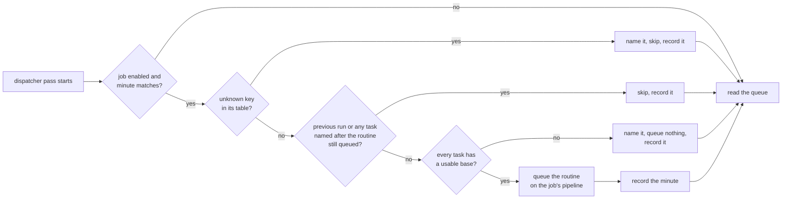
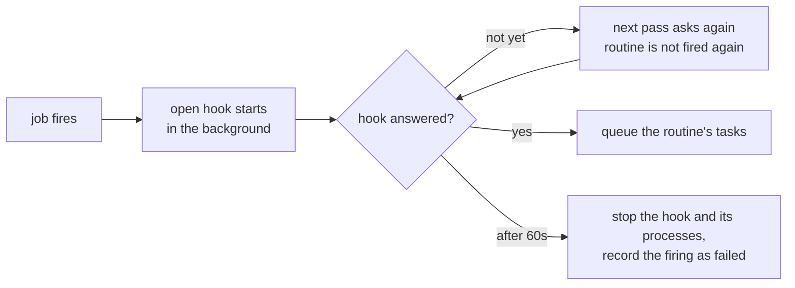

# Jobs

A job runs a routine on a schedule. It is a cron expression, a pipeline, and a routine saved
under `.spoolway/routines/`.

A job runs a whole routine, which is a top-level folder under `.spoolway/routines/`. A routine
has at most one job. A job on a task file, on a folder inside a routine, or on a routine that
another enabled job also runs never fires. The dispatcher names it once per matching minute, and
`spoolway doctor` fails a check for it. To fire again, delete or repoint the job.

## Overview

spoolway has no clock of its own. The dispatcher fires a due job at the top of its pass.
While any job is enabled, `spoolway dispatch` stays up on an empty queue, so a dispatcher left
running is all a job needs. It also stays up while a job store will not parse.

A job only queues routine tasks that already exist. It never changes them.

A job fires only on its schedule. To queue a routine now, tick it on the routines tab and press
`enter`. See [Routines](planning.md#routines).

## How it works



A routine is queued as one batch with fresh ids. The same pass dispatches what it queued.

The fired minute is written to `jobs.state.json`, so a job fires once per matching minute. If
that file cannot be written, the job still fires once per matching minute while the dispatcher
runs, and the dispatcher names the problem on every pass. A window that passes between two
passes of one running dispatcher still fires, up to one hour back. A window that passes while no dispatcher runs is not caught up when a dispatcher
starts. A disabled job skips its windows, so enabling it again does not fire the window it
was off for. A job whose previous run is still in the queue skips its window. So does a job
whose routine has any other live copy, such as one queued from the routines tab. A routine runs
one copy at a time.

The dispatcher names each such skip once per matching minute, with the step the copy is at:

```
job nightly · due now · skipped, audit is still in the queue, at step queued
```

The dispatcher names a job that cannot fire in the same way, once per matching minute:

```
job dependabot-weekly · due now · skipped, dependabot-review runs routine dependabot too; delete one on the routines tab (o → delete job)
job deps-only · due now · skipped, dependabot/review-dependabot-prs.md is a task, not a routine; pick a routine folder, or delete it, on the routines tab (o)
job nightly-old · due now · skipped, routine nightly-old is not under .spoolway/routines/; edit or delete the job on the routines tab (o)
```

A project joined to a workspace keeps its routines elsewhere. Its lines, and the details of a job's own row on the routines tab, name that directory's full path in place of `.spoolway/routines/`.

A firing that fails is recorded for its minute and is not tried again on every pass. This covers
a failing `open` hook, one that is stopped after 60 seconds, and a routine that cannot be queued, such as one with a `gate_at:` that
names no step. The dispatcher names the failure once for that minute. Only an `origin` that
cannot be reached, or a routine that is being queued at that moment, leaves the minute open.

A job also fires nothing while a file in the queue will not parse, and the dispatcher names the
file. If another submission of the same routine is being queued at that moment, the job fires
on a later pass of the same minute.

A job whose routine folder holds a `*.md` file that does not parse fires nothing. The dispatcher
names each such file once per matching minute.

A job never waits on a key. If the issue hook names a tool that is missing or too old, the
dispatcher names the tool once for that minute and queues the job's tasks with `tracking: off`.
See [Configuration](configuration.md#issue_tracking--a-hook-fired-on-four-task-events).

A job table may only hold the keys in the example under [Where a job lives](#where-a-job-lives).
A job whose table holds any other key, such as `enable = false`, never fires. The dispatcher
names the job and the key once per matching minute. Remove or correct the key and the job fires
again.

### A firing waiting on its `open` hook

A job runs the issue hook's `open` event in the background. The pass does not wait for it, so a
hook that hangs holds up only its own routine. Every other task keeps moving.



The dispatcher says `job <name> · fired · opening ticket for <task>` once, on the pass that
starts the hook. While the hook runs, `spoolway queue list` shows the task as
`opening ticket`, and the routine is not fired again for a later window. A hook that is stopped
at 60 seconds gives this line, and nothing is queued:

```
! job nightly: the open hook was still running after 1m and was stopped for `nite-1` — nothing was queued.
```

A dispatcher started after another one was killed adopts the running hook. It starts no second
`open` for that task and reads the answer of the first.

### A project job in a home-mode workspace

A project job fires once per window for the whole workspace, however many clones run a
dispatcher. The workspace keeps one `jobs.state.json` for its project jobs, next to a
`jobs.state.json.lock` file. Each clone's dispatcher takes the lock while it checks and records
a firing.

The record names the clone that holds the job's copy. While that copy is still queued in any
clone, the next window is skipped.

While one clone's firing waits on its `open` hook, the other clones skip that window and start
no second hook. The record names the waiting clone. When that clone stops asking for 2 minutes,
the other clones fire the job again.

The first time the workspace record is read, it copies each project job's latest firing from the
clones' own `jobs.state.json` files. A job that already fired in its window does not fire again.

If a dispatcher holds the lock, the other clones leave project jobs alone for that pass and try
again on the next. If the lock file cannot be written, no project job fires from that clone. The
dispatcher names the problem on every pass:

```
jobs: could not lock <workspace>/jobs.state.json.lock: <reason> — no project job fires from this clone until it can, so make the workspace folder writable by this user
```

User jobs are not affected. They keep their record in `~/.spoolway/<project>/jobs.state.json`.

### The resident dispatcher

While any job is enabled, an empty queue does not stop the run. A running `open` hook keeps it
up too, until the hook answers or is stopped. A job store that will not parse keeps the run up too, and the dispatcher names the parse error on every pass. It fires
jobs again once the file parses. The plain run prints once:

```
nothing queued
next: nightly-audit, Mon 8 Sep 03:00  (in 5h 48m)
```

The board shows the greeting and `Nothing queued`, and under them the job ledger: every enabled job and when it next fires. See
[The empty board](dispatcher.md#the-empty-board).
With no job enabled and both stores parsing, an empty queue stops the run as usual. See
[When it stops](dispatcher.md#when-it-stops).

## Writing a job

Bare `spoolway`'s routines tab is where a job is written, edited, paused or deleted. A
routine's details pane shows its job above its tasks, and the routine's options menu acts on
that job. See [Routines](planning.md#routines).

A routine's options menu offers these items for its job.

| Item | What it does |
|---|---|
| `new job` | Write a job for the routine. Offered only while the routine has no job. |
| `edit job` | Edit the routine's job. |
| `pause job` | Pause the job. A paused job shows `resume job` here instead, which resumes it. |
| `delete job` | Delete the job, after a popup that asks first. Its one answer is `delete`: `enter` deletes the job, `esc` keeps it. |

### The two choices

`new job` and `edit job` walk two panels. `esc` on either writes nothing.

1. The schedule. The field states the expression in words and shows its next three firings as
   you type. `enter` is refused until the expression parses.
2. The pipeline. The picker lists every pipeline the repo defines as answers, and narrows as
   you type. `↑` `↓` move the cursor, and `enter` saves the job with the pipeline under it.

`new job` writes a job for the routine its options menu was opened on. `edit job` opens with
the job's own schedule and pipeline filled in, and the job keeps its name, routine and store.

### A job without a routine

A job whose `routine` is not a routine the tab lists gets a row of its own at the bottom of the
routines list, under a blank line. The row is named after the job's `routine` value. It is
marked `missing` when nothing has that path, and `not a routine` when the path is a task file, a
folder inside a routine, or outside `.spoolway/routines/`. A name too long for the row is cut.

The row's details show the job's schedule, pipeline, scope, next firing, last firing and name,
then why it never fires. The row takes no tick, so `space` and `enter` do nothing on it, and
`tab` does nothing either. Its key line is `[o] options   [q] quit`.

Its options menu offers two items:

| Item | What it does |
|---|---|
| `edit job` | Open the routine picker, which lists the routine folders and nothing else. `enter` picks the folder under the cursor, then the schedule and pipeline panels follow. The save points the job at that routine and keeps its name and store. `esc` on the picker writes nothing. |
| `delete job` | Delete the job, after the same popup as a routine's `delete job`. |

### What the screen decides for you

The screen has no field for `base`. A job written on the screen has no `base` key, so add it to
the store file by hand when the routine's tasks set no `base:`. Editing a job on the screen keeps
a `base` already in the file.

A new job goes to the user store. Its name is the leaf of its routine: the folder `nightly`
gives the job `nightly`. A save is refused, with a notice naming the job, when the routine
already has a job in either store. A job in the project store is written by hand once; the
screen then edits it in place.

## The cron grammar

Five fields: minute, hour, day of month, month, day of week.

| Field | Values |
|---|---|
| minute | `0-59` |
| hour | `0-23` |
| day of month | `1-31` |
| month | `1-12` or `jan`-`dec` |
| day of week | `0-6` or `sun`-`sat`, `0` is Sunday |

Each field is a comma list of `*`, `n`, `a-b`, `*/n` or `a-b/n`. `@hourly`, `@daily`,
`@weekly` and `@monthly` are aliases for a whole expression. Times are the dispatcher
machine's local time.

## Where a job lives

| Path | Scope | Tracked |
| --- | --- | --- |
| `~/.spoolway/<project>/jobs.toml` | `user`, the default | No |
| `<checkout>/.spoolway/jobs.toml` | `project`, shared with the team | Yes |
| `~/.spoolway/<project>/jobs.state.json` | firing history of user jobs, and of project jobs outside a home-mode workspace | No |
| `<workspace>/jobs.state.json` | firing history of project jobs in a home-mode workspace | No |

A store file holds `[jobs.<name>]` tables:

```toml
[jobs.nightly-audit]
schedule = "0 3 * * 1-5"
pipeline = "impl_fast"
routine  = "nightly"     # a top-level folder under .spoolway/routines/
enabled  = true          # optional; absent means enabled
base     = "plan/demo"   # optional; the branch the routine's tasks are cut from
```

### Where a job's base comes from

A task a job queues is cut from its own `base:` when the routine task sets one. Otherwise it is
cut from the job's `base` key. The branch the main checkout has out never decides the base, and
neither does a detached HEAD.

A task with neither is a problem for the whole routine: nothing from it is queued, including a
sibling task that sets its own `base:`. A base that starts with `-`, is not a valid branch name,
or names a branch that neither the repository nor `origin` has is a problem in the same way.
The dispatcher names the job once for that minute, and tries again at the next due minute.

If `origin` cannot be reached to look up a base, nothing is recorded for that minute. The job is
tried again on the next pass.

`spoolway jobs contract` lists the `base` key.

One name in both stores is refused. A key outside this table is an unknown key.

## Usage

```
spoolway jobs                      # prints usage
spoolway jobs contract             # the job format: both stores, every key, the cron grammar
spoolway jobs contract --json      # the same facts as one object
spoolway jobs list                 # every job across both stores
spoolway jobs list --json          # the same rows as JSON
```

Bare `spoolway`'s routines tab is where a job is written, edited, paused or deleted. See
[Writing a job](#writing-a-job).

```
NAME           SCOPE    SCHEDULE      PIPELINE    NEXT        LAST
nightly-audit  user     0 3 * * 1-5   impl_fast   in 5h 48m   ok, 19h ago
weekly-deps    project  0 3 * * sun   impl        Sun 03:00   ok, 3d ago
lint-sweep     user     */30 * * * *  impl_fast   paused      -

3 jobs, 2 enabled.
  ~/.spoolway/spoolway/jobs.toml    2
  .spoolway/jobs.toml               1
```

A job with an unknown key adds a line under the table:

```
warning: job `lint-sweep` has unknown key `enable` in ~/.spoolway/spoolway/jobs.toml — it will not fire until it is removed or corrected
```

`NEXT` reads `paused` for a disabled job, `bad expr` for an expression that will not parse,
and `never` for one that never comes round.

A `--json` row carries `name`, `scope`, `schedule`, `pipeline`, `routine`, `enabled`,
`unknown_keys`, `source`, `next` and `last_fired`. `unknown_keys` is a sorted list, empty when the
table has none. `schedule_error` appears only when the expression will
not parse.

## Diagnostics

`spoolway doctor` checks every job:

| Check | Fails when |
| --- | --- |
| job `<name>` has no unknown keys | The job's table holds a key no job reads. |
| job `<name>` schedule fires | The expression will not parse, or never comes round. |
| job `<name>` routine exists | The routine path is missing or outside `.spoolway/routines/`. |
| job `<name>` routine is a whole routine folder | The routine path is a task file, a folder inside a routine, or the routines directory itself. |
| job `<name>` is the only job on its routine | Another enabled job runs the same routine. The check names that job and its store. |
| job `<name>` pipeline is defined | `pipeline` names no defined pipeline. |
| job `<name>` routine can be queued | Queueing the routine would be refused whatever the minute, such as a task with a `gate_at:` that names no step, a `*.md` file that does not parse, or a folder with no task. |
| job `<name>` base exists | `base` is set, and it starts with `-`, is not a valid branch name, or names a branch that neither the repository nor `origin` has. |
| job stores load | A name is in both stores, or a store is malformed TOML. |

The warnings the dispatcher shows before it starts run the base check without asking `origin`.
A base that is not a local branch is not judged there. They do not run the routine check.

## Reference

| Path | Responsibility |
| --- | --- |
| `src/jobs.rs` | The stores, firing due jobs, the firing history. |
| `src/cron.rs` | Parsing and matching the cron expression. |
| `src/commands/jobs.rs` | `spoolway jobs`, `jobs contract` and `jobs list`. |
| `src/commands/dispatch.rs` | The dispatcher that stays up for jobs. |
| `src/commands/doctor.rs` | The job checks. |

## Constraints

A supervisor that restarts `spoolway dispatch` on exit code 3 will wait forever once a job is
enabled or a job store will not parse, because the dispatcher stays up on an empty queue.

There is no `[jobs]` section in `config.toml`. A job is defined only in a store file.

## Related

[Planning](planning.md#routines) covers routines. [The dispatcher](dispatcher.md) covers the
pass that fires a job. [CLI reference](cli-reference.md#spoolway-jobs) lists the commands.
