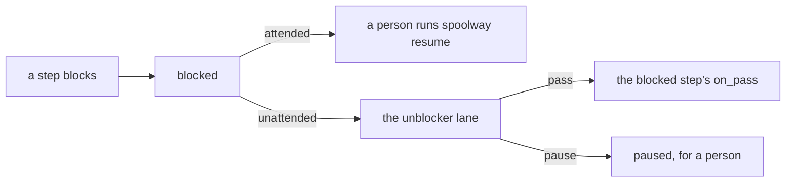
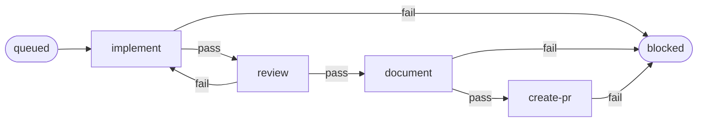
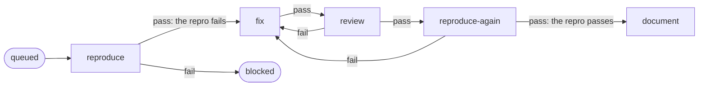

# Pipelines

A pipeline is a named list of steps. It is a YAML file in `.spoolway/pipelines/`. Changing
the flow is a file edit.

## One file each

The file name is the pipeline name. There is no `name:` key.

A UTF-8 byte order mark at the top of a pipeline file is ignored.

```
.spoolway/pipelines/
  default.yml        # implement, review, document, create-pr
  bugfix.yml         # reproduce, fix, review, reproduce again, document, create-pr
  hotfix.yml         # yours
```

A complete example pipeline:

```yaml
# .spoolway/pipelines/default.yml
description: One unit of work: implement, review, then document.

steps:
  - id: implement          # the first step is where a task starts
    agent: claude
    prompt: implementer
    model: claude-opus-5
    session: true
    loop: 2               # two arrivals at most, then blocked
    on_pass: review

  - id: review
    agent: claude
    prompt: reviewer
    model: claude-opus-5
    effort: high
    session: true
    on_pass: document
    on_fail: implement

  - id: document
    agent: claude
    prompt: archivist
    model: claude-sonnet-5
    on_pass: done
```

- A task picks its pipeline with its own `pipeline:` field. The field is required and must
  name a pipeline that exists.
- Every step runs for every task, in order. There is no condition key. A step that should only
  run sometimes belongs in a second pipeline file.
- A lane reads the pipelines on its own branch. See [Project](concepts.md#project).
- While a dispatcher runs, `report`, `resume` and `queue add` route on the pipelines it loaded
  at start. An edit to a pipeline file is used after the dispatcher restarts. See [Editing a
  pipeline while it runs](dispatcher.md#editing-a-pipeline-while-it-runs).
- Keys on a step can also be set from outside the checkout. See [The overrides
  layer](configuration.md#the-overrides-layer).
- `default` and `bugfix` ship as samples. Edit them, cut steps, or replace them. See
  [Converting a workflow you already run](#converting-a-workflow-you-already-run).

## Per-pipeline keys

| Key | Default | What it does |
|---|---|---|
| `version` | `1.0` | The pipeline's own version, in `x.y` form. Yours to raise when the pipeline changed enough to compare. spoolway only records it. |
| `description` | none | One sentence on what this pipeline is for. Shown when choosing between pipelines. |
| `task_template` | the pipeline's name, then `default` | Which task skeleton a task queued here is written from. |
| `steps` | required | The steps, in order. The first one is where a task starts. It is never `blocked`. |

## Per-step keys

| Key | Default | What it does |
|---|---|---|
| `id` | required | The step name, at most 26 characters, because herdr refuses an agent name past 32 characters and a lane's name is its step plus a short task tag. Written to the task's `stage:`. |
| `description` | none | One line, shown by `spoolway pipeline show`. |
| `agent` | none | A profile from `config.toml`. Makes this an agent step. |
| `run` | none | A shell command line. Makes this a command step. |
| `prompt` | the step id | The prompt file the step runs. It may not start with `/` or hold `..`. |
| `model` | none | The model. Required on every agent step. |
| `effort` | none | Passed to the agent kind's effort flag. Blank sends no flag. See [Effort](agents.md#effort). |
| `skills` | none | Skills the lane invokes before the task briefing, each as its own message. Comma separated, names only. See [Skills](agents.md#skills). |
| `session` | `false` | `true` resumes this prompt's earlier conversation on the task. |
| `slot` | `true` | Whether the step takes one of the profile's slots. A model's own `slots` applies either way. |
| `gate` | `false` | `true` holds the step's pass on `paused` until `spoolway resume`. See [Gates](#gates). |
| `on_pass` | none | Where a pass goes. `done` finishes the task. Required on every step except `blocked`: `spoolway pipeline check` refuses an agent or command step without it, because a task reaching it would never leave. |
| `on_fail` | `blocked` | Where a failure goes. Writing `blocked` outright is redundant; `spoolway pipeline check` warns and leaving the key absent does the same thing. |
| `loop` | unbounded | The most times a task may arrive at this step by a lane's report, a command step's exit, a walk-past or a failed launch. The next such arrival parks on `blocked`. A resume that walks past no other step is not checked against it. A written value is 1 or more. |
| `timeout` | `30m` | Command steps only. How long the command may run before it is killed. |
| `background` | `false` | Command steps only. `true` lets the task move on while the command runs. |
| `hide` | `dispatch.hide_commands` | Command steps only. `true` runs the command detached with no pane. `false` gives it a pane of its own even while `dispatch.hide_commands` hides commands. Absent follows `dispatch.hide_commands`. The older `headless:` key no longer loads; `spoolway sync` renames `headless: true` to `hide: true` and deletes `headless: false`. See [Background and headless](#background-and-headless). |
| `last` | `false` | `true` runs the step only on the last task of a chain. See [`last:`](#last--a-step-the-chain-runs-once). |
| `first` | `false` | `true` runs the step only on a chain's declared root. See [`first:`](#first--a-step-only-a-chains-root-runs). |
| `serial` | `false` | Command steps only. `true` runs it for one task at a time across every pipeline in the project, and one pipeline marking the step id is enough. Every other task waits on the step until that run exits. See [`serial:`](#serial--one-run-of-the-step-at-a-time). |

The same table is at the top of every pipeline file, between `# >>> spoolway >>>` and
`# <<< spoolway <<<`. `spoolway sync` rewrites that block when it matches an older shipped copy.
It refuses a block that matches no shipped copy, and `spoolway sync --replace <file>` swaps in
this spoolway's block. A file without the markers is never written to.

There is no `kind:` key. A step with `agent:` runs a prompt on a model. A step with `run:` runs
a command, and its exit code is the outcome. A step finishes the task with `on_pass: done`. A step stops the task for a person with `gate: true`.

Steps further down the file are scheduled first. A task on `document` gets a slot before a
task on `implement`.

### Reserved stages

Five stages belong to the dispatcher. No step may use `queued`, `done`, `paused` or `hook_failed` as its id.
Every pipeline may route to `done` and `blocked` without declaring them.

| Stage | What it means |
|---|---|
| `queued` | Where every task starts. It waits for its dependencies and a free slot. |
| `done` | The task finished. Its worktree is removed and its file is archived. |
| `blocked` | The task needs help. Attended, `spoolway resume <task>` resumes it. Unattended, a lane is started on it. See [Staffing `blocked`](#staffing-blocked). |
| `paused` | The task passed a `gate:` step and waits for `spoolway resume <task>`. See [Gates](#gates). |
| `hook_failed` | An `[issue_tracking]` hook failed on `queued`, `started` or `done`. `spoolway resume <task>` runs the hook again. `spoolway resume <task> --skip-hook`, or `k` on the board, carries the task on without it. |

`started` is not one of these five. It is an `[issue_tracking]` hook event, fired the moment a
task actually leaves `queued` for its entry step — see
[`[issue_tracking]`](configuration.md#issue_tracking--a-hook-fired-on-four-task-events). Nothing
ever writes it to a task's own `stage:`, so a step may still use `started` as its id.

## Routing

A step names where a task goes on a pass and on a fail. Prompts report an outcome and the
pipeline picks the destination.

| Target | Meaning |
|---|---|
| `<step id>` | The task moves to that step. |
| `done` | The task finishes. |
| `blocked` | The task parks for a person, or for the unblocker in an unattended run. |

A step never names its own id in `on_pass` or `on_fail` — a lap goes through another step or
not at all. `spoolway pipeline check` refuses a file that tries it, naming the step and the
key. Fix it by hand: send the failure to a step that leaves, or delete the step.

A task starts on the first step, so `blocked` may not be first. `spoolway pipeline check`
refuses the file and tells you to put a working step first.

A step that no route from the first step reaches is allowed. `spoolway pipeline check` warns
about it and still passes. A task can reach such a step only by being
resumed onto it, from the board's picker or with `spoolway resume --stage`.

```
$ spoolway pipeline check
  warning: pipeline t: step `old` is reached by no route
```

### Loops

`loop` counts arrivals at this step, by any route, the first included. Put it on the step
that is sent back to. In the shipped pipeline `review` fails back to `implement`, so
`implement` carries it.

```yaml
  - id: implement
    session: true
    loop: 3          # at most three arrivals here, then blocked
```

- A spent loop parks the task on `blocked`. The arrival count is written to `## Status Log`.
- Every way a task reaches a step counts as an arrival: a lane's report, a command's exit code,
  a walk-past by `skip:`, `first:` or `last:`, a lane that cannot start or whose pane stays
  busy. A walk-past counts one arrival at the step it lands on. It also counts one arrival at
  each step it skips that carries a `loop:`. A skipped step without a `loop:` counts none.
- A walk-past over a step whose `loop:` is spent goes to that step's loop exit, which is
  `blocked`. This stops a cycle whose only `loop:` is on a step the task skips.
- A task leaving `blocked` starts every step's count again from zero. This holds for every
  outcome the unblocker reports and for a person's `spoolway resume`.
- That reset cannot stop a command step that fails every time while an unattended unblocker
  keeps passing it. So spoolway counts those laps itself, and the count sits on the command
  that keeps failing, whatever route the unblocker takes. Each unblocker pass that sends the
  task back towards a failing command is a lap. These all count:
  - a plain `--pass`;
  - a `--pass --stage` naming the command;
  - a `--pass --stage` naming an earlier step, agent or command, whose road leads back to the
    command. Other commands on that road may pass on the way.

  A lap counts whether the task stopped at the failing command, at a command that passes
  after it, or at an agent step behind it.
  The pass after the third lap parks the task on `paused`. The unblocker lane that makes that
  pass has already run, so four unblocker lanes run in all, and no fifth starts.
  `## Status Log` names each lap on the command's failure line, and the park as its own entry:

  ```
  - 23:21 `build` exited 1 — unblocker lap 2 of 3 on `build`
  - 23:24 `build` still fails after 3 unblocker laps — parked on `paused`.
      Make `build` pass, then: spoolway resume t1
  ```

  A person's `spoolway resume` starts the count again. It sends the task back to the step it
  stopped at, which is the command step itself, or the agent step behind a gate that failed
  back to it. A command that passes ends its own count and no other. So does a pass whose
  road does not lead back to a failing command: an agent step that blocked on its own, or a
  `--stage` to a step past the command. Attended runs are not counted: a person at the board
  is the bound.
- `loop: 0` is refused, naming the step. A loop is 1 or more. A step with no `loop:` has no
  limit, so delete the line to keep the meaning 0.7 gave `loop: 0`. `loop: 1` is not the same:
  it blocks the task on its second arrival. `spoolway sync` refuses a file carrying it, and
  writes nothing to that file until it is fixed.
- The map form, keyed by the step a failure is sent back from, is refused at parse. The
  refusal names the step that should carry the limit instead: delete the map and give that
  step a bare `loop:` of its own.
- `on_loop_max:` is refused, naming the pipeline, the step and the key. A spent loop budget
  always parks on `blocked`, so the key chooses nothing; delete it.
- Every cycle needs some step along it carrying a `loop:`. `spoolway pipeline check` refuses
  the file otherwise.

### Proving the loops

`spoolway pipeline check` proves a pipeline's graph has a way out. A `cargo test` in
`src/route_sim.rs` proves the counters that walk that graph agree with it. It routes every
outcome at every step, and the walk-past and the failed launch or busy pane, to a bounded
depth. It runs over the shipped pipelines, the tracked `.spoolway/pipelines` files, and
pipelines it generates that pass `spoolway pipeline check`.
Each path it walks must reach `done` or `blocked`, keep every `loop` count rising, and start no
more lanes than a stated bound. The walk treats `blocked` as resting, so it does not walk an
unblocker's `--stage` out of `blocked`, and it does not take the unblocker laps above. Unit
tests in `src/commands/report.rs` cover those. They walk each road back to the command and
end a command's count the way the dispatcher does when that command passes.

## Unattended runs

Set `enabled = true` under `[unattended]` in `config.toml`, or pass `--unattended` to
`spoolway dispatch`. A task that blocks still lands on `blocked`. A lane is then started there
to clear it.

The run keeps that mode until a [reload](dispatcher.md#reloading), which sets it to the value of
`enabled`. A reload that turns unattended on restarts the count of `max_output_tokens` and
`max_cost_usd` at zero. A reload that turns it off stops new lanes on `blocked`. A lane already
there finishes its turn.



The unblocker lane opens its own session on the `unblocker` prompt. The lane that stopped is continued only when the task goes back to its step and that step declares `session: true`, and then with everything it had read. A `gate:` on an
agent step still waits for a person. A lane that keeps dying at launch is retried with a doubling
delay, up to an hour.

### Staffing `blocked`

`[unattended]` in `config.toml` builds a `blocked` step for every pipeline:

```toml
[unattended]
blocked_agent   = "claude"
blocked_model   = "claude-opus-5"
blocked_effort  = ""
blocked_session = true
blocked_prompt  = "unblocker"
```

A pipeline may override `agent`, `model`, `effort`, `session` and `prompt` on its own `blocked`
step. Any other key is refused. Keys left out fall back to the config.

```yaml
  - id: blocked
    model: claude-sonnet-5
    effort: high
```

`spoolway pipeline override <name> --set blocked.model=<model>` patches this step the same way,
whether or not the pipeline file declares it. The command refuses `blocked.description`. It
refuses `blocked.session=false` while `blocked_session` in `[unattended]` is `true`. To start the
lane without a session, set `blocked_session = false` in the config.

- A `--pass` carries the task past the blocked step to that step's `on_pass` for an agent step,
  and back to itself for a command step. The fourth pass in a row onto the same command step
  parks the task on `paused`. See [Loops](#loops). `--pass --stage <step>` sends it to `<step>`
  instead, bounded by the steps this task has already run.
- If the step this task blocked on is a `gate: true` agent step, a plain `--pass` lands on
  `paused` at that step's own gate, as if that step's own lane had reported the pass. A gated
  command step is handed back to itself and runs again, because its command never exited 0.
  `--stage` may not name a step past a gate this task's pass has not yet answered for. Naming the
  gate step itself, or a step before it, still works. A step is past the gate when the `on_pass`
  route from the blocked step reaches it after the gate. The order of the steps in the file does
  not matter. A step the route never reaches counts as past the gate when the file lists it after
  both the gate and the blocked step. See [Gates](#gates).
- A `--pause`, `--fail` or `--block` parks the task on `paused`. `spoolway resume` then hands it
  back to the step it blocked on.
- A task blocked at a step its pipeline no longer defines gets no unblocker lane. The dispatcher
  parks it on `paused` and logs the step with the command that sends it on:

  ```
  t1: stopped at `document`, which pipeline `p` no longer defines — parked on `paused`.
      Send it on with: spoolway resume t1 --stage <step>
  ```

  An unblocker lane already running for that task keeps it. Its `--pass` is refused, and its
  `--block` parks the task on that step. `spoolway restart` refuses such a task too.
- `spoolway resume` and `spoolway queue resume` refuse a `blocked` task while its unblocker lane is live
  or starting. Run `spoolway queue pause <task>` first to take the task from the unblocker, then
  `spoolway resume <task> --stage <step>` with the step it blocked on. A resume without `--stage`
  puts the task back on `blocked` and starts another unblocker. `spoolway resume <task> --stage
  done` is the exception: it stops the unblocker lane and closes the task.
- An unblocker cannot close a task. `spoolway report --pass --stage done` from its lane exits 1.
  Only a person closes a task, as described in
  [Closing a stuck task](tasks.md#closing-a-stuck-task).
- `spoolway dispatch` refuses an unattended run with a blank `blocked_model`.
- `spoolway doctor` and `spoolway pipeline check` judge the `blocked` step only while unattended
  is on. That means `enabled = true`, or a run started with `spoolway dispatch --unattended`.
  While it is off, the step's compaction pairing and its unblocker prompt raise no `FAIL`. A
  project made with `spoolway init --no-examples` and command-only steps then passes both.
- `spoolway pipeline show` marks where each pipeline's `blocked` step comes from.

The shipped `unblocker` prompt clears whatever is in the way. It never merges, stops the
dispatcher, or destroys work. See [Prompts](prompts.md).

### The brake

An unattended run stops when it reaches a ceiling in output tokens or in dollars. `0` means no
ceiling.

```toml
[unattended]
enabled = true
max_output_tokens = 2_000_000
max_cost_usd = 20.0
```

Reaching either starts no further lane. Live lanes finish, then the dispatcher stops. Tasks
stay where they are, and the next `spoolway dispatch` picks them up.

The spend counted is the ledger plus every lane the current pass has just finished. The
pass that finishes a lane over the ceiling therefore starts no other lane. The stop message
prints the spend and the ceiling as they are, for example `this run has spent $0.020002
against a max_cost_usd of $0.015`.

The brake is not what ends a command step that keeps failing under an unblocker that keeps
passing. Spoolway's own count of those laps does, and parks the task on `paused` on the
fourth unblocker pass whatever the ceilings are. See [Loops](#loops).

## Command steps

A build, a test suite, a formatter or a deploy script is a command step.

```yaml
  - id: build
    description: Build the release binary before anything reviews it.
    run: cargo build --release
    timeout: 45m          # 30m when absent
    on_pass: review
    on_fail: fix
```

- `run:` goes to the shell whole, via `sh -c`. Pipes, `&&` and
  globs work. There is no `shell:` key.
- The line runs in a child shell. A line that starts with `exec` still has its exit code
  recorded and routed.
- It runs in the task's worktree with `SPOOLWAY_TASK`, `SPOOLWAY_STEP`, `SPOOLWAY_REPO`,
  `SPOOLWAY_WORKTREE` and `SPOOLWAY_TASK_FILE` set, and with the privileges of whoever started
  the dispatcher.
- Exit code zero takes `on_pass`. Anything else takes `on_fail`. Running out of `timeout` is a
  failure, and the whole process group is killed. `timeout: 0s` is refused.
- A `run:` means one thing by each exit code. A command that answers the same code for two
  different outcomes cannot be routed on, and fixing that is the command's job, not spoolway's.
- `prompt`, `model`, `effort` and `session` are refused. The step takes no slot.
- `gate: true` holds a passing exit on `paused`. See [Gates](#gates). A `background: true` step
  passes when it starts, so it has no exit to hold, and `gate` is refused there. So is
  `on_fail`, because a background run is a sidecar and its exit never moves the task.
- Output goes to `<task> · <step>.log` under the project's home.
- Other tasks keep moving while the command runs.
- Every arrival at a command step runs the command in full. The move onto the step stops any old
  run still going, with every process it started, and deletes its exit code, pid, group record
  and kill count. The log stays. This holds for
  every way a task reaches the step, including a lane's report and a resume.
- A dispatcher restart is not an arrival. The restarted dispatcher adopts the run it finds on
  the step, or routes on the exit code that run wrote. If the step has become an agent step in
  the meantime, the dispatcher stops the run and starts the agent lane. If an agent lane is
  still on a step that has become a command step, the dispatcher stops the lane, counts its
  usage and starts the command. Only one of the two runs on the task at a time.
- The run's pid file holds the pid, the process start time, and a `started` line the command's
  shell adds as the command begins. On Linux the shell writes the start time. On macOS spoolway
  fills it in once the `started` line is there. After a reboot, a live process
  with the same pid but a different start time is not the run. The step reads as interrupted and
  runs again, and neither the timeout nor a cleanup signals that process. A pid file with no
  start time is read as the pid alone.
- A run killed without writing an exit code runs again. spoolway first stops every process the
  killed run left running, so two runs of a command are never alive at once. A run killed three
  times in a row blocks the task. The task's `## Status Log` names the run's log.
- A signal that ends the wrapper before the command exits leaves no exit code, so a stopped run
  never reads as passed. The one exception is a `TERM` that reaches the wrapper after the
  command started and exited 0. The step keeps that 0 and routes on it. A `TERM` sent to the
  whole process group from outside spoolway, such as a machine shutdown, keeps a 0 the same
  way when the command catches it and exits 0. A `HUP` or `INT`, from a closed pane or a
  Ctrl-C, never keeps a code. The run reads as interrupted and runs again.
- A process a blocking `run:` line starts in the background, such as `(sleep 98 &) ; true`,
  keeps running after the command exits. A `<task> · <step>.group` record under `commands/`
  names its process group. The next arrival at the step stops it. So does cleanup, which
  stops it before the worktree is deleted. `spoolway queue unqueue --force` stops it too.
- A blocking command whose task leaves the step by another road, such as a `spoolway report`
  typed by hand or a `last:` walk-past, is stopped on the dispatcher's next pass. Its run files
  are deleted and its exit code never moves the task. Its pane, if it has one, closes.
- The exit code stays on disk until the pass that read it has written the task's move to the
  destination step. A pass that cannot place that destination, for want of a free slot, leaves
  the task on the command step and routes on the same code next time, instead of running the
  command again.

### Background and headless

| | Blocking (default) | `background: true` |
|---|---|---|
| Next step | starts when the command exits | starts at once |
| Routing | exit 0 takes `on_pass`, else `on_fail` | `on_pass` at once. The exit is never read to route. |
| `on_fail` | allowed | refused when the pipeline loads |
| `timeout` | routes to `on_fail` | stops the run and writes a Status Log line, nothing routes |

A background step is a sidecar with no verdict. Its run never moves the task, however it ends:
a non-zero exit, a timeout and a pass all leave the task where it is. A task that reaches `done`
is archived without waiting for the run, and a run still going is stopped when the task is
cleaned up. A run that ends is counted once in the ledger. If it has a pane, the pane closes
unless the step shows its command.

A run that exits non-zero, or is stopped at its `timeout:`, leaves one line in the task's
`## Status Log`. The line is saved even though the task does not move. A run that exits 0 leaves
no line.

```
- 2026-10-12 21:40 `observe` (background) exited 3 — the task did not move; log: ~/.spoolway/demo/commands/demo · observe.log
- 2026-10-12 21:41 `observe` (background) ran past its timeout of 3s and was stopped — the task did not move; log: ~/.spoolway/demo/commands/demo · observe.log
```

A pipeline that gives a background step an `on_fail` does not load. The message names both
fixes. Delete `on_fail:` to keep the step a sidecar. Delete `background:` to make it a check:
the task then waits for the command, and its exit picks `on_pass` or `on_fail`.

A command step runs in a pane of its own by default, and its output also goes to the log file
under `commands/`. Set `dispatch.hide_commands = true` and every command step runs detached with
no pane instead. The `hide:` key overrides that project setting for one step in either direction.
`hide: false` gives the step a pane while the project hides commands. `hide: true` keeps the step
detached while the project shows them. Without `hide:`, the step follows `dispatch.hide_commands`.

The older `headless:` key no longer loads. A step that still carries it, with any value, is refused
by name. The message says to run `spoolway sync`, or to write `hide: true` in place of
`headless: true` and delete `headless: false`.
`spoolway sync` fixes the key on every step in three places: the checkout's pipeline files, the
private patches under `overrides/pipelines/`, and the private pipelines under `local/pipelines/`.
It renames `headless: true` to `hide: true`. It deletes `headless: false` and writes no `hide:`,
because `hide: false` forces a pane even while `dispatch.hide_commands` is true, and `headless: false`
only followed that setting. `sync` prints a `wrote` line for each file with a note naming the
pipeline and the steps it renamed or cleared. It changes no other line. This is the one edit `sync`
makes to a step.

A patch's `headless: false` could override the tracked step's `headless: true`. Once both are
synced, the tracked step's `hide: true` wins, so the step runs without a pane. The note under the
patch says so. Set `hide: false` in the patch to keep the pane.

A step that carries both `headless:` and `hide:` cannot be fixed without losing one of them. `sync`
refuses that file, names the step and leaves the file as it was. Keep only `hide:` there and run
`sync` again.

A file whose key block `sync` refuses as hand-edited is not fixed either. `spoolway sync --replace
<file>`, which that refusal names, swaps the block and fixes `headless:` together.

`sync` cannot fix a `headless:` written in flow style, such as `- {id: a, headless: true}`, with
a quoted key, with a `-` on a line of its own, or as the only key of its step. It refuses that file
and tells you to write `hide:` by hand, or to delete the key if it is `false`. The same holds for a patch or a private pipeline.

`spoolway pipeline override <name> --set <step>.headless=<value>` and `spoolway override promote`
of a patch that sets `headless:` are refused. Use `--set <step>.hide=<value>` for the first. For the second, run `sync` to fix the key in the
patch, then promote again.

A shown command behaves the same whichever setting showed it. The pane stays open after the
command exits, counts toward `dispatch.visible_lanes`, and closes with the task or when the limit
pushes it out. So a `hide: false` step in a project that hides commands takes a lane slot and
keeps its pane, even though every other command there is hidden. See [Commands are shown by
default](dispatcher.md#commands-are-shown-by-default). `hide:` is separate from the internal
test-only dispatcher backend, which has no panes and runs every command detached.

A paned step's script is written to `<task> · <step>.sh` beside the log, readable by you alone,
because it holds the step's environment. The pane is typed one short line that runs that file.
The `run:` line itself is never typed. Spoolway types nothing over 512 bytes into any pane and
refuses longer text with an error naming the pane and the byte count.

### `last:` — a step the chain runs once

The highest task of a chain that has a `last:` step carries every change beneath it, so a suite
the whole stack must pass runs once, there. A task is last when no unfinished task in its own
group depends on it and runs a `last:` step of its own. A task that depends on it counts only
when its pipeline has a `last:` step that its `skip:` does not name. Any other task walks past
the step to its `on_pass`. Each group gets its own `last:` run, whatever stacks on top of it.
`last:` is allowed on any step, and a task walked past an agent step starts no lane there.

If the top task of a chain uses a pipeline with no `last:` step, the next task down that has
one runs it, once.

### `first:` — a step only a chain's root runs

The root task of a chain carries no declared dependency, so setup that a whole stack needs
runs only once, there. A task is the root when its own `depends_on` is empty. `depends_on`
is read from the task's own file, and archiving what it names does not empty it, so a task
naming an archived dependency is still not the root. Any other task walks past the step to
its `on_pass`. In a fan, every independent root runs it. `first:` is allowed on any step, and a
task walked past an agent step starts no lane there. It is refused together with `last:` on the
same step.

### Steps a task walks past

A step is hidden for a task when its own `skip:` names it, when it is a `last:` step and
an open task above it in the task's group runs a `last:` step, or when it is a `first:` step and the
task is not its chain's root. These moves follow `on_pass` past hidden steps and write the
first step the task runs as its stage: a lane's report, a command step's exit,
`spoolway resume`, a cleared block, and a task's start off `queued`. The walk stops after as
many hops as the pipeline has steps. A hidden step with no `on_pass` is where the task lands.

The step the task lands on spends one `loop:` arrival. Each hidden step that carries a `loop:`
spends one as well, and a spent one sends the task to `blocked`. A task's start off `queued`
spends none at the hidden steps. The task's `## Status Log` names each hidden step in order,
with its rule, on the line for the step it landed on, after any message the move carries:

```
- 2026-10-08 14:09 → `document`: walked past `suite` (not last in its chain)
```

The dispatcher also walks a task past a hidden step it finds the task sitting on. These tasks
reach it:

- A task that was waiting its `serial:` turn when a dependent was queued above it.
- A task sent to a step by a failed lane start's `on_fail`, a resume of a parked task, or an
  unattended self-resume after an escalation.

The dispatcher does not walk a task past a step while the task's own lane or foreground command
run is still working on it. The lane or run finishes and reports first.

### `serial:` — one run of the step at a time

```yaml
  - id: setup
    description: Create the task's own database.
    run: scripts/setup-db.sh
    serial: true
    on_pass: implement
```

Only one task's run of a `serial: true` step goes at a time, counting a `background: true` run
until it exits. A task that reaches the step while another task's run of it is going waits there
unstarted: no pane, no run files, no timeout clock. Its own run starts on the first pass after
the earlier run exits. `spoolway queue list` and the board show it as `○ waiting` with
`serial: after <task>`.

The hold is per step id across the whole project: two pipelines with a command step of the same
id hold each other. One pipeline marking the id `serial: true` is enough, so the same step in a
pipeline that does not mark it waits its turn too. Another project's dispatcher holds nothing
here, and an agent step that shares the id is never held. `serial:` is allowed on command steps only.
`spoolway pipeline check` refuses it on any step with an `agent:`.

### `skip:` — walking past a step

A task's own `skip:` field walks the named steps to their `on_pass` without starting a lane.
The step it lands on spends its `loop:` budget, and so does each named step that carries a
`loop:`. A task over a limit lands on `blocked`.
The queue screen's `trial` menu item writes it for the steps you tick to skip in a trial. See
[Runs](eval.md#runs).

## Gates

`gate: true` on a step holds its pass for a person. Do not name a step `gate`. A task's own `gate_at:` field gates one step for that task alone. See [Tasks](tasks.md).

The lane runs and reports as usual. On its pass the task lands on `paused` and its pane stays
open. A command step has no lane to report: `gate: true` holds its passing exit the same way,
and a task's `gate_at:` holds a command step's exit whatever it was. A `background: true` step
passes as soon as it starts, so `gate: true` is refused there.

On the board, press `r` on the paused row. After a caught pass, the picker preselects the
`on_pass` route, so `enter` lets the task past. Pick another step to send the task there
instead.

- A plain resume takes `on_pass` after a caught pass, whatever `on_fail` a step declares or does
  not. After a task's `gate_at:` caught a `--fail` or a failing command exit, a plain resume
  takes the step's `on_fail`, the route the failure chose.
- Picking another step in the picker reroutes the task to that step, whatever the gate would
  otherwise have done.
- A gated step with no `on_fail` still parks a *failed report* on `blocked` — that is about
  `spoolway report --fail` at the step itself, not about resuming it. `spoolway pipeline check`
  warns about it. Writing `on_fail: blocked` outright silences that warning without changing
  where the fail goes, so `pipeline check` warns about the redundant key instead.
- A gate waits for a person in an unattended run too.
- A gate holds an unblocker's `--pass` from `blocked` too when the blocked step is a gated agent
  step. The task waits at that step's own gate, not at `blocked`, and `spoolway resume` takes
  that step's `on_pass`. A gated command step is not held: the pass sends the task back to the
  command, which runs again. `--pass --stage <step>` off `blocked` may not name a step past a
  gate it has not answered for. Naming the gate step itself, or a step before it, still works.
  See [Staffing `blocked`](#staffing-blocked).
- No shipped step is gated. A pull request is already a checkpoint. Gate a step that changes
  something without leaving a pull request behind, such as a deploy.

### Holding only when something goes wrong

Put the check in a command step. Put the gate on the step its `on_fail` sends the task to. A
clean exit never reaches the gate.

```yaml
  - id: rebase
    run: git fetch origin && git rebase origin/main
    on_pass: create-pr
    on_fail: resolve-conflicts

  - id: resolve-conflicts
    agent: claude
    model: claude-sonnet-5-5
    gate: true
    on_pass: create-pr
```

The exit code decides, not the lane. An agent step cannot do this on its own: a lane that
resolves a conflict reports `--pass`.

The `resolve-conflicts` step starts in the worktree the failed rebase left behind.
`spoolway pipeline check` warns that it has no `on_fail`. The recipe keeps it that way, so a
lane that cannot resolve the conflict goes to `blocked`. A task's `gate_at:` field still holds
any outcome for a single task.

## The agent path in the shipped `default` pipeline



| Step | Runs |
|---|---|
| `implement` | the `implementer` prompt, session kept. Arrivals here are bounded at two, from any route. |
| `review` | the `reviewer` prompt, session kept. A fail goes back to `implement`. |
| `document` | the `archivist` prompt, on this task's diff |
| `create-pr` | the `create-pr` prompt: pushes the branch and opens its pull request, then the task is `done`. A fail goes to `blocked`. |
| `blocked` | the unblocker, in an unattended run |

Every agent step ships with a blank `model` and `effort`. `spoolway init` rewrites `agent:
claude` to the profile you pick. Fill in the models before the first run.

This repository's own `.spoolway/pipelines/impl.yml` adds an end-to-end step, a `test` command
step, a `suite` step with `last: true` and a `screenshots` step that files screen captures into
`docs/screenshots/`. No pipeline waits on a pull request's hosted checks; the `create-pr` step
opens it and the task is done. See
[Local gates and daily CI](testing.md#local-gates-and-daily-ci).

`.spoolway/pipelines/impl_lite.yml` sits between `impl` and `impl_fast`: it keeps `review`,
`test` and `suite`, but `test` runs `scripts/gate-quick.sh` instead of `scripts/gate.sh`, and
`suite` runs the `smoke` tier instead of `pr`.

`.spoolway/pipelines/skill.yml` edits a skill that spoolway ships. Its `edit` step uses the
`skill-editor` prompt, and its `review-prose` step uses the `prose-reviewer` prompt to hold
every added line to plain English. A `check` command step rebuilds and reinstalls the skill
copies and fails on any difference between them. Tasks queued on it use the `default` task
template.

## The agent path in the shipped `bugfix` pipeline



Both `reproduce` steps run the same `reproducer` prompt. Before the fix, a failing repro is the
pass. After the fix, a passing repro is the pass. Its agent path joins `default` at `document`.

| Step | Runs |
|---|---|
| `reproduce` | the `reproducer`: write the repro and see it fail |
| `fix` | the `implementer`, session kept. Arrivals here are bounded at two, from any route. |
| `review` | the `reviewer`. A fail goes back to `fix`. |
| `reproduce-again` | the `reproducer`. A fail goes back to `fix`. |

## Whose worktree

Every lane runs in a git worktree. A branch cannot be checked out twice.

| The task's branch is | The lane |
|---|---|
| checked out in the main checkout | does not start; the task is blocked with the remedy in its Status Log |
| checked out in another checkout | borrows that checkout and leaves it alone |
| nowhere | gets a fresh worktree, removed at `done` |

A lane never runs in the main checkout. The start fails, is retried, and then the task moves to
`blocked`. The message names the branch and the main checkout's path. Switch that checkout to
another branch, such as `git switch main`, then resume the task.

The task file records which it was as `borrowed:`. A borrowed checkout and its branch are never
removed.

A checkout in spoolway's own `worktrees/` folder is never borrowed by a task that has started
before. It is that task's own cut. See [A cut that was stopped part
way](dispatcher.md#a-cut-that-was-stopped-part-way).

## Working with pipelines

```
spoolway pipeline show      # every pipeline, with defaults resolved
spoolway pipeline check     # validate against the config they will run with
spoolway pipeline contract  # every key, every rule, and a blank to copy
```

`pipeline check` validates the graph, the agent profiles, the prompts, every `loop`, and every
queued task's `skip:` list. It refuses an agent step with no `model:`, and a step whose agent profile
names a `kind` spoolway cannot launch.

The `spoolway-config` skill writes and edits pipelines with you, starting from the blank that
`spoolway pipeline contract` prints.

## Converting a workflow you already run

| Your workflow has | It becomes |
|---|---|
| A stage where somebody uses judgement | An agent step: a `prompt:` on a `model:` |
| A stage that is a command with an exit code | A `run:` step |
| "If that fails, go back and fix it" | `on_fail` pointing back, plus a `loop` |
| "Check with me before this one" | `gate: true`, then `spoolway resume` |
| "Check with me only if it goes wrong" | A `run:` step whose `on_fail` points at a `gate: true` step |
| A handoff that only tells a person the last stage finished | Nothing. Delete it. |

There is no nesting. A stage with three parts is three steps, or one step whose prompt
describes all three. A pipeline says nothing about what a lane may reach. See [What confines
a profile](agents.md#what-confines-a-profile).

The `spoolway-config` skill does the conversion with you and writes the prompts the steps need.
See [Writing your own](prompts.md#writing-your-own).

## Moving a pipeline between projects

```
cp .spoolway/pipelines/default.yml ../other-project/.spoolway/pipelines/
cp -r .spoolway/prompts/reviewer ../other-project/.spoolway/prompts/   # each prompt its steps name
cd ../other-project && spoolway pipeline check
```

`pipeline check` names every prompt and agent profile the other project lacks.

## Private pipelines

A private pipeline lives outside the checkout, under the project's own home, and is never
tracked by git:

```
~/.spoolway/<label>-<id>/local/
  pipelines/<name>.yml           # a private pipeline, the same shape as a tracked one
  prompts/<name>/PROMPT.md       # a private prompt, see Prompts
  templates/tasks/<name>.md      # a private task skeleton, see Documentation and templates
```

A private pipeline loads beside the tracked ones. A task names it with the same `pipeline:`
field it would use for a tracked pipeline. The file name is the pipeline name, and it may end
in `.yml` or `.yaml`. This works in repo mode only; home mode has no private layer of its own,
because a home-mode project's whole setup is already private to the machine it runs on.

- `spoolway pipeline copy <from> <to>` writes a new private pipeline and, when `from` names no
  `task_template:` of its own, a task skeleton to go with it; when `from` does name one, the
  copy shares that same skeleton instead of writing a new one. `spoolway prompt copy <from>
  <to>` writes a new private prompt, copying the whole prompt folder `from` names, `assets/`
  included; a source folder holding a symlinked directory is refused outright, naming it. Both
  require `<from>` and `<to>` to be one plain name each: not empty, not absolute, and holding
  none of `/`, `\` or `..`. Both also refuse a `<to>` that already exists, tracked or private;
  `pipeline copy` also refuses a `<to>` whose skeleton already exists on its own. Run from a
  linked worktree, those checks also cover the main checkout's tracked files, naming the
  clashing file, since the main checkout and the dispatcher load those files even when the
  worktree's own checkout has never picked up the commit that added them. In home mode they
  write into the workspace's own `config/` instead, since there is no private layer to add
  there. Both copy commands are refused in a dispatcher lane's worktree. `spoolway pipeline promote <name>` moves a private pipeline, the private prompts it
  names and the skeleton its `task_template:` names (the pipeline's own name when it sets
  none) into `.spoolway/`, then
  deletes the private files. Run in a linked worktree on its own branch, it writes that
  worktree's `.spoolway/` and leaves the main checkout alone, so the main checkout runs without
  the pipeline until the branch merges. It refuses a borrowed worktree, a dispatcher lane's
  worktree and a detached HEAD, refuses any clash with a tracked file in the worktree or the
  main checkout, refuses a step's prompt name or the pipeline's `task_template:` that is not
  one plain name, refuses when another private pipeline names the same skeleton, and is refused
  outright in home mode. See [`pipeline copy`](cli-reference.md#spoolway-pipeline-copy-from-to),
  [`prompt copy`](cli-reference.md#spoolway-prompt-copy-from-to) and [`pipeline
  promote`](cli-reference.md#spoolway-pipeline-promote-name).
- A private pipeline whose name matches a tracked one is a name clash. Neither file runs. A
  task on that name is held and shows as `held` in `queue list` and on the board. Every other
  pipeline loads and every other task runs. `spoolway pipeline rename <old> <new>` renames the
  private pipeline and moves what names it onto the new name. `doctor` and `pipeline check`
  report the clash, naming both files. See [`pipeline
  rename`](cli-reference.md#spoolway-pipeline-rename-old-new). Two private files of the same
  name but different extensions, `foo.yml` beside `foo.yaml`, are refused, naming both private
  files. This is never reported as a clash with a tracked file.
- A private pipeline may name a tracked prompt or a private one. A tracked pipeline whose step
  names a prompt that exists only privately is refused, because that pipeline would break the
  moment it ran on a machine with no copy of the private prompt. A prompt name holding `/` is
  never resolved in the private layer, so a step naming one is treated as missing even when a
  file sits where the name would otherwise point.
- `spoolway pipeline list` and `spoolway pipeline show` print `private · <file>` after a private
  pipeline's name, naming the file it came from. A tracked pipeline prints nothing extra. See
  [`spoolway pipeline list`](cli-reference.md#spoolway-pipeline-list).
- `spoolway pipeline check` validates a private pipeline the same way it validates a tracked
  one. A private pipeline that fails validation is named by its own file, not only by its name.
- `spoolway pipeline override` and `spoolway prompt override` find a private pipeline or prompt
  the same way `list` and `show` do, and write a patch or fork for it. That patch or fork only
  starts applying once `spoolway pipeline promote` makes the target tracked; until then it sits
  in the overrides layer, named as waiting on the promote rather than reported as a missing
  name. `spoolway pipeline promote <name>` itself names any override file — for the pipeline or
  for a prompt it carries — that starts applying because of the move. See [The overrides
  layer](configuration.md#the-overrides-layer).
- A lane running in a worktree reads the same `local/` the main checkout does.

## Adding a step

A new step is two files: the prompt, and the step that runs it.

```yaml
  - id: audit
    agent: claude
    prompt: auditor
    model: claude-opus-5
    on_pass: document
    on_fail: implement
```

See [Prompts](prompts.md) for what goes in the file. `spoolway prompt contract --step audit`
prints what that lane is handed.
