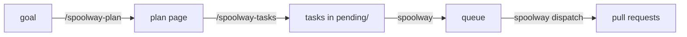

# Planning

A plan is a group of related tasks. All of them are queued from one branch, and each task
depends on the one before it. This page covers writing a plan, cutting it into tasks, queueing
them, and finishing the plan.



## Why a plan is a branch

Each task's `base:` is the branch the plan lands in, such as `main` or a release branch.
`/spoolway-tasks` writes it for you, from `spoolway task contract`'s own `base`: the branch
your checkout has out. It stops instead of guessing when that checkout is detached.

`/spoolway-tasks` recommends an open, same-repository pull request as a chain's base on the
split ballot when that chain's work needs the pull request's change. The recommended option's
`base` line shows the pull request; another option on the same ballot keeps step 1's own
branch. The person's pick decides it.

A chain's base can also be set with a note on the split ballot's answer, such as `1 from #412`
or `cart-empty from main`: a branch is taken as written, and a pull request number resolves to
that pull request's own branch. A task can still name its own `base:` by hand, or the whole
submission can share one with `spoolway queue add --base`.

Several plans can be queued from one checkout. They all share one queue and one dispatcher.

## Two skills, cut at approval

`/spoolway-plan` talks the goal through with you and writes a plan page. It names no task and
no pipeline. When you approve the shape, it calls `/spoolway-tasks`.

`/spoolway-plan` asks its questions as a batch of options. You can answer one with free text
instead of picking an option. If your text is a question or shows doubt, the skill explains the
topic in the session output and asks the same question again, with the options revised if the
explanation changed them. The answers you picked for the other questions in the batch stay. If
your text is a statement, the skill replies with one line saying how it read you and what that
changes.

`/spoolway-tasks` cuts the shape into tasks. It picks a pipeline per task, sizes each
task, chooses ids, and writes the dependency order. You can also run it directly when the
shape is already agreed.

`/spoolway-tasks` first decides how many groups the shape needs. It leans towards fewer. It
offers that count and up to three counts below it, largest first, with the recommended count
marked. The question names every count, such as `Split checkout into groups: 1, 2 or 3`. Each
smaller count merges neighbouring groups of the larger split. When one group is enough, it
says `Keeping one group.` and asks nothing.

Each option draws its groups numbered, in dependency order:

```
1  checkout-pricing           base  main
   Cart totals and the discount rules
   that change them.
   holds    cart totals, discount rules
   touches  src/cart/, src/pricing/

2  checkout-empty             after checkout-pricing
   The empty-cart screen and its
   redirect.
   holds    empty-cart screen
   touches  src/ui/cart/
```

`holds` names the subjects in the group. `touches` names the areas of code it changes. Claude
asks with a question and a preview per option. Codex and pi print each option as a lettered
section and wait for your letter.

Pick any count a ballot drew and the tasks are taken as picked, with no second question. Ask for
a split no ballot drew and the ballot is drawn again. That means typing a count into Other,
asking for one in a note on any option, or asking in Other to re-route a task. The new ballot
marks your count `(chosen)`, with one count above it and two below. Codex shows one below,
because its ballots hold three options. The answer to it stands, unless it asks for yet another
unseen split.

A note on the task ballot can still set a chain's base, as in `3 from #412`. That is not a new
split, so it does not redraw for a count.

When the goal names an issue, both skills read it with `spoolway issue show <ref>`. The issue's
URL goes into each task's `source:`. The plan page's absolute path goes into each task's
`plan:` whenever a page exists, with or without an issue.

Both skills are optional. The queue screen reads tasks, so any script or tool that
writes a task into the pending directory works too.

## The plan file


The plan page is one self-contained HTML file. A person reads it once to approve the shape.
The binary never reads it. It lives outside the checkout, in the `plans:` folder that
`spoolway config path` prints, in repo mode and in home mode alike. A page is at
`<plans>/<YYYY-MM-DD>-<slug>.html`, where `<plans>` is that `plans:` line. In home mode the folder
is the workspace's own `plans/`, shared by every clone of the workspace.

Every page has three sections in this order: Context, Decisions and Mockup. Context is one block of
at most three sentences. It opens on the outcome a person can approve or reject, then says what is
true today. A list of every path the plan touches follows it. The template is
`assets/skills/claude/spoolway-plan/assets/template.html`.

The page rail shows the plan name. A small copy icon sits right after it. Clicking the icon
copies the name to the clipboard, and the icon shows a check mark for about 1.5 seconds. Beside the `Switch theme` button, a `Reload`
button reads the page from disk again. The page ends at the Mockup, with no Next step box.

The page also carries a machine copy of its own words, in a `<script type="text/markdown"
id="plan">` block at the foot of the page that a browser never shows. `/spoolway-plan` writes
that block; `/spoolway-tasks` reads it instead of the page around it.

## Writing a good breakdown

`/spoolway-tasks` applies these rules. They apply whether or not you use the skill.

| Rule | What it means |
|---|---|
| Size for a lane | A task is what one agent in a fresh worktree can finish. `spoolway task contract` prints the project's sizing guidance. Keep each task's criteria under five bullets. |
| Checkable criteria | Write `GET /health returns 200`, not `works well`. The review step judges against these. |
| Non-goals | Name the tempting wrong thing next door: the refactor, the extra endpoint, the framework swap. |
| Reference paths | Point at files and examples. Do not paste prose that will go stale. |
| Mockups from real output | Draw a panel from a real screenshot or real command output. A panel for something that does not exist yet names the bound it was drawn to. |
| Link a mockup, never redraw it | A task's `## Mockup` links each plan step and decision record it builds, by id. A source file from outside the project home is copied into `<plans>/<group>/` first, where `<plans>` is the `plans:` line of `spoolway config path`, and the task links the copy. |
| Pipeline per task | A bug wants `bugfix`, a feature wants `default`. `spoolway pipeline show` prints each pipeline's description. |
| Independent, or ordered | Judge from what each task changes whether two tasks may run side by side. A shared file alone is no reason to chain them. Work that does not chain goes in a group of its own. |

## Queueing a plan

`/spoolway-tasks` writes each task as its own file into
`~/.spoolway/<label>-<id>/pending/<task-id>.md`. Every task names the same `group:`. It then
runs `spoolway task contract --from` over the directory to check the set.


Bare `spoolway` opens the screen, on the queue tab. The left pane, titled `groups`, lists one
row per group in the pending directory, and one per plan page no task names yet. The right
pane, titled `tasks`, lists the highlighted group's tasks and what each waits on.

A plan page that no task names yet gets a row of its own, so a plan waiting to be cut is not
forgotten. A page counts as named once any pending, queued or archived task points at it in
`plan:`. In home mode a task in any clone of the workspace counts, so a page leaves every
clone's list once one clone cuts it. Plan rows sit right under the queueable groups, newest first, and above the done
groups. A plan row shows only its name, without the date in front of it, with no checkbox and
no tail. With a plan row highlighted, the tasks pane says only `use /spoolway-tasks`:

```
╭─ groups ───────────────┬─ tasks ────────────────────────────────────────────╮
│   [ ] checkout         │                                                    │
│   [ ] cart             │   use /spoolway-tasks                              │
│ >     search           │                                                    │
│       onboarding       │                                                    │
╰────────────────────────┴────────────────────────────────────────────────────╯
```

`space` and `enter` do nothing on a plan row. `h` never hides one, and `f` finds one by its
name. Once `/spoolway-tasks` cuts the plan, the next reload shows it as a queueable group
instead. Only pages written after the time kept in the `plans-since` file beside `plans/` are
shown. In home mode that file is the workspace's, so every clone uses the same cutoff. Older
pages stay off the screen.

When the plan list cannot be read, the screen lists the groups without plan rows and shows a
notice titled `plans not listed`. The cause is the `plans/` folder. In home mode it is also
another clone's pending, queue or archive folder, or the workspace's `project.toml`. The notice
names the read error. It appears once per error, and the plan rows return on the next reload
after the path reads again.

| Key | What it does |
|---|---|
| `tab` | Switch focus between the groups and tasks panes. |
| `esc` | With the tasks pane focused, return focus to the groups pane. |
| `space` | Select a group. |
| `enter` | Check the selection and queue it. |
| `o` | Open the options menu of the row the focused pane highlights. See [Options menu](#options-menu). |
| `f` | Filter the group list. `enter` keeps the filter, `esc` clears it. |
| `h` | Show or hide done groups. A queued group never appears. |
| `ctrl-c` | Leave the screen. |

Queueing deletes the group's pending tasks from the pending directory. A sibling task
already in the queue or the archive is left exactly where it is. A
group with a validation error is refused and nothing is deleted. A task whose start branch does
not exist is left in the pending directory with the tasks that depend on it, and the rest is
queued. See [A start branch that does not exist](tasks.md#a-start-branch-that-does-not-exist). If a dispatcher already holds
the queue, that dispatcher picks the tasks up on its next pass.

`spoolway queue add --from <dir>` queues every task in a directory without the screen. A
task under this project's own pending directory is deleted once the batch is written. A
task anywhere else is left alone.

One more command:

```
spoolway group list         # every group with open tasks, and which tasks are open
```

After the groups it prints one line for each plan page that no task with a `group:` names, newest first:

```
payments                      2 open — payments-refunds, payments-webhooks
search                        0 open — plan /home/you/.spoolway/shop-4k2p9x/plans/2026-10-21-search.html
```

A plan line always reads `0 open — plan <path>`, so a script that counts groups can tell it apart.

### Options menu

`o` opens a menu for the row the focused pane highlights, titled with that row's name. With
the tasks pane focused it acts on the highlighted task. With the groups pane focused it acts
on the highlighted group, even though the tasks pane shows that group's tasks too. To reach a
group's actions from the tasks pane, press `tab` first. The cursor opens on the first item:

```
╭─ cart-totals ───────────────────╮
│  > open task                    │
│    open plan                    │
│    gate                         │
│    delete                       │
│                                 │
│  [enter] confirm   [esc] close  │
╰─────────────────────────────────╯
```

| Item | Listed on | What it does |
|---|---|---|
| `open task` | A task. | Open the task in your editor. |
| `open plan` | A task whose `plan:` is set and not empty, or a plan row. | Open the plan page `plan:` names, or the plan row's page, in your default browser. See [Options menu](dispatcher.md#options-menu). |
| `gate` | A task. | Open the gate picker on the task. `enter` gates it at the step under the cursor, `enter` on the step already gated clears it, and `esc` closes the picker. |
| `trial` | A group with tasks. | Fork the group as a trial. See [Trials](#trials). |
| `save as routine` | A group with tasks. | Save the group as a routine. See [Routines](#routines). |
| `delete` | A group with a pending task, a pending task, or a plan row. | Delete pending files. See [Deleting pending tasks](#deleting-pending-tasks). On a plan row, delete the plan page. See [Deleting a plan page](#deleting-a-plan-page). |

A plan row opens the menu with `open plan` and then `delete`. A group with no tasks and no plan
page opens the menu with `nothing to do here` over `[esc] close`. `enter`
runs the item under the cursor, and `esc` closes the menu having done nothing. If a fresh read
of the pending directory moves another row under the cursor while the menu is open, `enter`
closes the menu and does nothing.

### Deleting pending tasks

`delete` is the last item of the menu. A group lists it when the group has a pending task. A task
lists it when the task itself is pending. It removes pending files only. Queued and archived
tasks stay where they are.

The delete takes the picked tasks and every pending task that depends on one of them, even in
another group. One popup lists them all, titled `delete group <name>` for a group and
`delete <task-id>` for a task. A task that depends on another task in the list has
`(depends on <ids>)` after its id.

```
╭─ delete group cart ─────────────────────────────╮
│                                                 │
│  delete 4 pending tasks:                        │
│                                                 │
│  cart                                           │
│    cart-empty-state                             │
│    cart-totals                                  │
│    cart-discounts     (depends on cart-totals)  │
│  checkout                                       │
│    checkout-total     (depends on cart-totals)  │
│                                                 │
│  > delete                                       │
│                                                 │
│  [enter] confirm   [esc] close                  │
╰─────────────────────────────────────────────────╯
```

`enter` deletes the listed files and closes the popup. The groups are read again, and a deleted
group leaves the selection. `esc` closes the popup and deletes nothing. Any other key leaves the
popup open. A long list scrolls under a `↓ n more` row.

Some outcomes open a notice instead of closing the popup:

| Title | When | What it says |
|---|---|---|
| `not deleted` | The pending tasks changed after the popup opened. | `nothing was deleted.` and `pick delete again to see the current list.` |
| `tasks not fully deleted` | A file could not be removed. | The error, the `removed:` and `left:` lists, and the remedy. A permission error says `fix the file's permissions, then pick delete again.` Any other error says `fix the error above, then pick delete again.` |
| `tasks deleted` | The delete finished, but the pending directory would not read again. | The read error. |

### Deleting a plan page

`delete` on a plan row removes the plan's `.html` page from `plans/`, so a plan nobody will cut
leaves the list. It removes that one file. A folder under `plans/` stays. In home mode a
clone cannot delete a page that a task in another clone names. The popup is titled
`delete plan <name>` and names the page:

```
╭─ delete plan search ─────────────╮
│                                  │
│  delete 1 plan page:             │
│                                  │
│    plans/2026-10-21-search.html  │
│                                  │
│  > delete                        │
│                                  │
│  [enter] confirm   [esc] close   │
╰──────────────────────────────────╯
```

`enter` removes the page, and the row is gone after the screen reads the groups again. `esc`
closes the popup and removes nothing.

Two outcomes open a notice instead:

| Title | When | What it says |
|---|---|---|
| `not deleted` | A task, in home mode in any clone, names the page in `plan:` by the time you press `enter`. | `a task names plans/<file> in plan: now.` and `nothing was deleted.` |
| `plan not deleted` | The page could not be removed. | The error, the file, and the remedy. A permission error says `fix the file's permissions, then pick delete again.` Any other error says `fix the error above, then pick delete again.` In home mode, another clone's pending, queue or archive folder that cannot be read is also such an error, and it names the folder. Only `esc` closes it. |

### Trials

A trial runs the same group under several pipelines to compare them. With the groups pane
focused, press `o` on a group and pick `trial`.

1. The first screen lists every project pipeline with a tick. Pipelines the group's own tasks
   already name start ticked. `space` ticks or unticks the highlighted pipeline. A line under
   the list reads `N pipelines × M tasks = K arms`. `enter` continues once at least one pipeline
   is ticked. With none ticked, `enter` does nothing. The list scrolls when the project has more
   pipelines than the popup has rows.
2. The second screen shows one ticked pipeline at a time, its steps one per row. The title row
   reads `skip steps   ←  <pipeline>  n of N  →   k skipped`. `←`/`→` turn the page to another
   ticked pipeline, wrapping from the last back to the first. `space` ticks the highlighted step
   to skip on that pipeline. The list scrolls so the cursor is always visible, with `↑ n more`
   and `↓ n more` rows where steps are hidden. `esc` goes back to the first screen and keeps
   every pipeline's skips; unticking a pipeline there drops its own skips. `enter` runs the
   trial. The popup never grows taller than the terminal.

Running the trial queues one full copy of the whole group per ticked pipeline. Each copy runs in
its own group, named `<group>-<pipeline>`, or `<group>-<pipeline>-2` (then `-3`, and so on) when
that name is already in the queue or the archive. Copies are minted in the order the pipeline
list ticks them, and each task keeps its own id across copies: a task `alpha` becomes `alpha-1`
in the first ticked pipeline's copy, `alpha-2` in the second's, and so on. A number whose id is held by a queue file, an archive file, a `task/<id>` branch, a fetched remote-tracking `task/<id>` branch or a routine name is passed over. A copy keeps the
source chain: a task's `depends_on` on another task in the group points at that task's own
minted id in the same copy. All arms, across every copy, share one trial id. A step ticked to
skip on the second screen is skipped by every arm of that pipeline's own copy. The source tasks
stay in the pending directory. Any refusal writes nothing at all. A trial refuses a group that
fails validation, a task still holding its skeleton's `[[…]]` placeholder text, and a task whose
`gate_at:` names a step that a ticked pipeline lacks or runs as a command. The `gate_at:` refusal names the task and
tells you to untick that pipeline or to change `gate_at:` in the task to an agent step.

A trial also refuses a task whose `gate_at:` names a step its copy would never run. That happens
when the step is ticked to skip, when it is the `last:` step and another task in the copy depends
on the task, or when it is the `first:` step and the task has `depends_on`. See [Steps a task walks
past](pipelines.md#steps-a-task-walks-past). The refusal names the source file. For a skipped step
it tells you to untick that step. For the other two it tells you to untick the pipeline. In both
cases it also offers to change or drop `gate_at:` in the task.

An arm runs every step you leave in. A step that pushes or opens a pull request,
such as `create-pr`, does so for the arm too: tick it to skip it. Compare the arms with
`spoolway eval --by task --trial <id>`. When the last arm finishes, every arm's copy is removed.
Only the source group and the ledger rows remain. `spoolway eval --discard <id>` removes a
trial early. See [Trial arms](dispatcher.md#trial-arms).

### Routines

A routine is one folder directly under `.spoolway/routines/`, tracked in git. A task in a
subfolder still belongs to the routine above it: it shows and queues with that routine.
Nothing creates the directory for you. `spoolway task contract` prints this shape and this
project's own routines directory, for a producer writing a routine by hand. A routine is
never a task template: it holds finished tasks, not a skeleton with a placeholder in it.

Bare `spoolway` has a routines tab, between the queue and eval tabs. Its left pane,
titled `routines`, lists one row per routine, with a tick box and the routine's name. Its right
pane, titled `details`, shows the highlighted routine's job, then its tasks under a `tasks` line.

```
┌ routines ────────────────┬ details ──────────────────────────────────────────────────────────────┐
│ > [ ] dependabot         │                                                                       │
│   [ ] release-spoolway   │   schedule:    0 */2 * * *                                            │
│                          │   pipeline:    dependabot                                             │
│                          │   scope:       project                                                │
│                          │   next:        Fri 23 Oct 18:00                                       │
│                          │   last:        Fri 23 Oct 16:00  ok                                   │
│                          │   job:         dependabot-review                                      │
│                          │                                                                       │
│                          │   tasks                                                               │
│                          │     review-dependabot-prs                                             │
│                          │       pipeline:    dependabot                                         │
│                          │       depends on:  -                                                  │
│                          │       description: chore(deps): review and merge open Dependabot pull │
│                          │                    requests                                           │
└──────────────────────────┴───────────────────────────────────────────────────────────────────────┘
 [space] select   [enter] queue   [o] options   [tab] details   [q] quit
```

What the job rows say depends on how many jobs point at the routine:

| Jobs on the routine | What the pane shows |
|---|---|
| None | One row, `schedule:    none`. |
| One | `schedule:`, `pipeline:`, `scope:`, `next:`, `last:` and `job:` rows. |
| Two or more | A `jobs:` row that says which job fires, then every job by name with its scope, `inactive` on an inactive one, and a line saying which to deactivate or activate. |
| A job store that will not load | A `jobs:` row, `will not load:` and the error. The tasks are still drawn. |

Two enabled jobs on one routine fire neither. The `jobs:` row then reads
`2 run this routine, so neither fires`. With one enabled and one inactive job it reads
`2 run this routine; only <name> fires`. Deactivating all but one job settles the clash, and
`activate job` on a job beside an active one is refused, writing nothing.

A job whose routine is not a routine the list shows gets a row of its own at the bottom of the
list, under a blank line, where `edit schedule` can point it at a routine. See
[A job without a routine](jobs.md#a-job-without-a-routine).

The pane reads both job stores again while the list sits idle, so a job edited by hand shows
without a key.

| Key | What it does |
|---|---|
| `space` | Over the list, tick a routine. Over a single task on the right, queue that one task alone. |
| `enter` | Queue every task under every ticked routine as one batch. |
| `o` | Open the options menu of the row the focused pane highlights. |
| `tab` | Switch focus between the routine list and the details pane. |
| `esc` | Over the details pane, return focus to the list. Over the list, do nothing. |

The options menu follows focus the same way it does on the queue screen, and is titled with the
highlighted row's name:

| Item | Listed on | What it does |
|---|---|---|
| `edit schedule` | A routine with no job, or with one job. | Make a job from the routine, or change the job's schedule and pipeline. See [Jobs](jobs.md). |
| `deactivate job` | A routine with one enabled job. | Deactivate the job. |
| `activate job` | A routine with one inactive job. | Activate the job, unless another job on the routine is active. |
| `deactivate job <name>` | A routine with two or more jobs, for each enabled job. One item per job, sorted by name. | Deactivate that job. |
| `activate job <name>` | A routine with two or more jobs, for each inactive job. One item per job, sorted by name. | Activate that job, unless another job on the routine is active. |
| `delete routine` | A routine. | Delete the routine and every job that points into it, after a popup. |
| `open task` | A task in the details pane. | Open the task in your editor. |

A routine with a job store that will not load offers only `delete routine`.

A task `id:` is unique across all routine folders. When two routine files hold one id, the
routines tab shows a `problem:` row beside the task. The row names both files and an id to give
one of them. `spoolway doctor` and `spoolway pipeline check` fail with the same text. Give one of
the files another `id:` to clear it.

A routine folder that holds a `*.md` file that does not parse is not queued. The popup names each
such file with a `spoolway task contract --from "<file>"` command that prints the reason, and
nothing from the folder is queued.

A routine runs one copy at a time. A routine is refused while any task in the queue carries its
name in `routine:` or has its name as its id. Paused and blocked tasks count. For a folder, one
such task refuses the whole batch. Nothing is queued, and the `not queued` popup names each live
task and the step it is at:

```
not queued

  release-spoolway is still in the queue, at step ship.

  a routine runs one copy at a time. let it finish, resume or
  restart it from the board if it has stopped, or unqueue it
  if it has not started. then queue the routine again.

  [enter] close
```

`enter` closes the popup. A routine is also refused while any file in the queue will not parse,
because a live copy could be hiding in it. The popup names each such file and its reason.

The tab reads the routine folders again each time you switch to it, so a routine saved with
`save as routine` a moment ago is already listed. It starts each visit fresh, with nothing ticked.

Every queued copy gets a fresh id, so a routine can run again. The id is the lowest `<id>-N` that no queue file, archive file, `task/<id>-N` branch or routine name holds. A `depends_on` on a sibling in
the same batch is rewritten to the sibling's new id. The saved files are never changed.

Each copy also carries `routine: <id>`, the `id:` of the routine file it was copied from. The
board's TASK column and the `queued` popup show that name in place of the numbered id. A copy
whose `routine:` line is removed shows its id and still runs. `spoolway queue list` always prints
the numbered id.

Unqueuing a copy that has not started deletes it, from the board or with `spoolway queue
unqueue`. `spoolway queue unqueue --force` deletes a copy that has started, after it tears the
checkout down. The routine is still in `.spoolway/routines/`, so a draft in the pending directory would
only duplicate it. The copy goes to the pending directory instead, with its `routine:` line
removed, when no routine file has that `id:` any more. It is then the only record of the task.
It also goes to the pending directory when a task that goes there in the same batch depends on it,
so the two queue again together.

A group with a live copy of a routine draws only its live copies. Earlier runs of the routine do
not come back onto the board, so the group's total line is the cost of the run in flight.

Pick `save as routine` from a pending group's options menu to save it as a routine. The panel is prefilled with the group's
name, and `enter` copies the tasks into `.spoolway/routines/<name>/`. Keys from an earlier
run are removed on the way. A folder that already holds tasks is refused.

Pick `delete routine` from a routine's options menu to delete it. The popup names the routine, its task count, and every
job whose routine path is that folder or a task inside it. Each job is listed beside its
store, `user` or `project`. Its one answer is `delete`: `enter` deletes those jobs first, then
the folder. `esc` keeps everything. The folder leaves disk without touching git, so only git can bring it back. A job
store that will not read refuses the delete before anything is removed, naming the store and
`spoolway doctor`.

A job queues a routine on a cron schedule. Pick `edit schedule` from a routine's options menu to make
one: it opens the schedule and pipeline panels for that routine, and `enter` on
the pipeline panel saves it. On a routine that has a job, the same two panels open filled with
the job's own values, and the job is saved back to the store it came from. `esc` on either panel cancels and writes
nothing. See [Jobs](jobs.md).

`deactivate job` and `activate job` write the job back to its own store with the schedule unchanged.
No menu deletes a job: `delete routine` deletes the jobs on the routine it removes.

`activate job` on a job whose routine has another active job writes nothing. It opens a popup
titled `activate job` that reads `<name> also runs <routine> and is active. deactivate it first,
then activate this one.` With two or more active, it names them all and reads `… also run
<routine> and are active. deactivate them first, …`. `enter` closes it.

## Closing a plan out

spoolway does not prescribe how a finished task is published. The shipped pipelines end at a
`create-pr` agent step that opens the pull request, and your own pipelines can end anywhere.

A step with `last:` runs once for the chain. See
[`last:`](pipelines.md#last--a-step-the-chain-runs-once).

## Why a plan is a chain

A dependent task's worktree is cut from its dependency's branch. That is what makes a stack of
pull requests possible. A group is one chain: `queue add` and `task contract` refuse a group
with two roots, with a fan, or with a join, naming the group and the tasks at fault.

Work that would not chain goes in a group of its own. A group's first task may name one other
group's own last task in `depends_on`, stacking the two groups' pull requests into one line.
See [Stacking one group on another](tasks.md#stacking-one-group-on-another).
