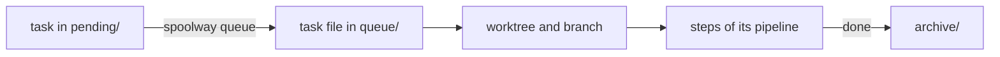
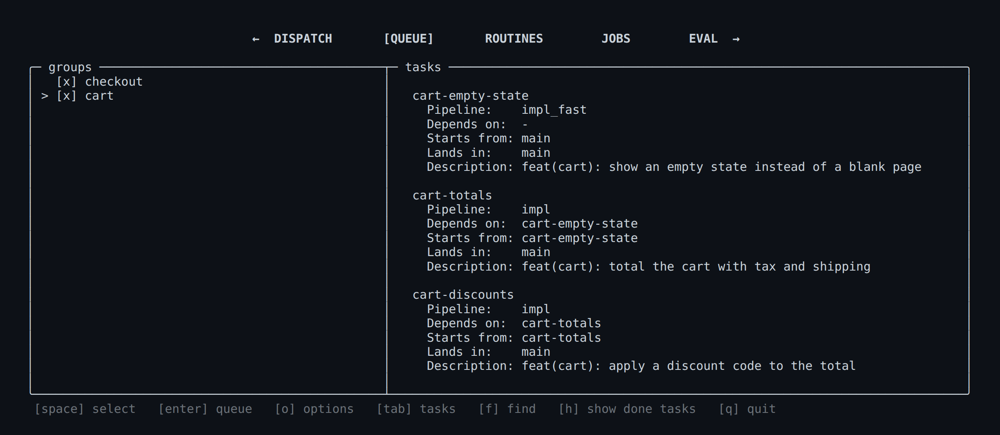

# Tasks and the queue

A task is one unit of work, small enough for one agent to finish in one sitting. This page
covers the task file, queueing it, ordering tasks, and getting a stuck task moving again.



## The task file

A task is a Markdown file with YAML frontmatter. It lives in `~/.spoolway/<project>/queue/`,
outside the checkout.

```markdown
---
id: sessions
title: "feat(auth): add session tokens on top of login"
group: auth
depends_on:
  - login
---
## Context
## Intend
## Non-goals
## Acceptance criteria
## References
```

A `title:` that holds `: `, such as `feat(auth): …`, must be in quotes, or YAML refuses the file. A
UTF-8 byte order mark at the top of a task file is ignored.

### The frontmatter is spoolway's

Every dispatch decision reads a field here. `spoolway task contract` prints the same contract
as JSON.

| Field | Set by | Meaning |
|---|---|---|
| `id` | you | The task's name, at most 100 characters. Also the file name and the branch suffix. Required. |
| `title` | you | One Conventional Commits line, such as `feat(queue): add a --dry-run flag`. Becomes the squashed commit subject and the pull request title. Required. |
| `group` | you | The group of work this task belongs to. Required. |
| `pipeline` | you | The pipeline this task runs on. Required, and must name a pipeline that exists. |
| `depends_on` | you | Task ids that must finish (reach `done`, be cleaned up and be archived) before this one starts. See [Expressing order](#expressing-order). |
| `gate_at` | you | An agent step id, or `blocked`. The task pauses after that step reports, once, whatever it reports. See [Paused is the other one, and it is not a block](#paused-is-the-other-one-and-it-is-not-a-block). |
| `base` | `spoolway-tasks`, or you | The branch the group lands in. `spoolway-tasks` writes it from `spoolway task contract`'s own `base`, the branch your checkout has out. Otherwise required, here or with `spoolway queue add --base`. Must exist locally or on `origin`. |
| `source` | you | The URL of the tracker item the task came from: an issue, a pull request or a Jira item. Never parsed. |
| `plan` | you | The plan page's absolute path, whenever a page exists, with or without an issue. The `o` menu's `open plan` opens it in your default browser, on a board row and on a queue screen group. Never parsed. |
| `group_description` | you | The group's own words for its tracker issue. See [Issue tracking](configuration.md#open--a-fifth-event-run-by-queue-add-itself). |
| `labels` | you | Plain words for a hook to put on this task's own tracker issue and its group's. A label may hold no whitespace and no comma. |
| `complexity` | the planner, or you | Experimental. The planner's estimate of how complex the task is, a whole number from 1 to 100, where 100 is extremely complex. Every ledger line the task banks carries it, and `spoolway eval --by task` shows it. Optional. See [A complexity outside 1 to 100](#a-complexity-outside-1-to-100). |
| `epic`, `ticket` | the `open` hook, or you | Tracker references. A task that sets `ticket:` itself skips the hook. See [Issue tracking](configuration.md#open--a-fifth-event-run-by-queue-add-itself). |
| `tracking` | the queue screen's checklist, `queue add --no-tracking`, or you | `off` is the only value accepted. Fires no `[issue_tracking]` hook event for this task and never holds it waiting on one. See [Issue tracking](configuration.md#issue_tracking--a-hook-fired-on-four-task-events). |
| `stage` | the pipeline | The step the task is on. |
| `routine` | the routines tab, or a job | The `id:` of the routine file this task is a queued copy of. The board and the `queued` popup show it in place of the numbered id. See [Routines](planning.md#routines). |
| `branch` | the dispatcher | `task/<id>`, or `task/<slug>-<id>` with `issue_tracking.key_in_names`. A group whose every task in the batch sets `tracking: off` keeps `task/<id>`. |
| `starts_from` | the dispatcher, or you | The branch the worktree is cut from: the first dependency's branch, else `base`. A task cut from `base` starts at `origin/<base>` when `origin` has it, so your unpushed commits stay out of its pull request, and at the local branch otherwise. A dependency [closed without a pull request](#a-dependency-closed-without-a-pull-request) hands on the branch it started from instead. Set it yourself before the task starts to cut from another branch. The pull request opens against it. A branch only `origin` has is fetched for at most 10 seconds, then cut from directly, with no local branch made for it. See [Where work happens on disk](dispatcher.md#where-work-happens-on-disk) and [A start branch that does not exist](#a-start-branch-that-does-not-exist). |
| `base_commit` | the dispatcher | The commit `starts_from` pointed at when the worktree was cut. |
| `run` | the dispatcher | The run id. `spoolway eval --by task` groups ledger lines by it. |
| `patch` | the dispatcher | Files, insertions and deletions of the branch, measured at cleanup. |
| `worktree_path`, `workspace_id`, `pane_id`, `tab_id` | the dispatcher | Where the work happens on this machine. |
| `spare_pane` | the dispatcher | The workspace's first pane, when a step's launch failed or a hidden command healed a lost workspace, until a step runs in it. See [Herdr](dispatcher.md#herdr). |
| `attempts`, `launched_at`, `steps`, `rounds`, `arrivals`, `arrived_from`, `launch_failures` | the dispatcher | Launch and loop counters. The board and the ledger read them. |
| `unblock_laps` | the dispatcher | In an unattended run, how many times an unblocker's pass has sent the task back towards each command step, by a plain pass or by `--stage`. Three laps is the limit. See [Loops](pipelines.md#loops). `spoolway queue add` clears it. |
| `last_report` | `spoolway report` | The last outcome a lane reported. |
| `blocked_from`, `parked_from`, `escalated`, `paused_at`, `paused_by`, `resume` | the dispatcher | Where a stopped task continues from, and for a pause which road caught it — `gate` for a step's own `gate:`, `schedule` for the task's own `gate_at:`, absent for a `--pause` raised from `blocked`. `spoolway resume` reads them. |
| `held_pass_to` | the dispatcher | The step an unblocker's `--pass` was sending the task to when a `gate_at: blocked` held it on `paused`: the step named by `--stage`, else the step the pass leads to. `spoolway resume` sends the task there and clears the key. `spoolway queue add` clears it. |
| `unblocked_from` | the dispatcher | The step an unblocker's pass stood in for, kept when that pass sent the task to `done`. If the task is then held on `blocked` for work spoolway could not commit, the key becomes `blocked_from`, so the next unblocker is told the step the task stopped at. `spoolway queue add` clears it. |
| `restart` | `spoolway restart` | The step to start over on, for one launch. The lane opens a new conversation even where the step has `session: true`, and its briefing says an earlier attempt's changes are still in the worktree. The launch clears the key. |
| `missing_start_branch` | the dispatcher | The start branch that did not exist when the dispatcher paused the task. `spoolway resume` clears it. |
| `hook_paused` | the dispatcher | `queued`, `started` or `done`: which one's issue-tracking hook failed and stopped the task on `hook_failed`. `spoolway resume` reads and clears it, forgetting that hook run so it fires again. `spoolway resume --skip-hook` clears it and records the event as passed. A task file on `paused` with this key set is read as `hook_failed`. |
| `hook_error` | the dispatcher | The reason the hook failed, such as `issue_tracking hook exited 1`. The board's RECENT line and `spoolway queue route` print it. `spoolway resume`, with or without `--skip-hook`, clears it. |
| `hook_skipped` | the dispatcher | `queued`, `started` or `done`: the hook event `spoolway resume --skip-hook` or the board's `k` last carried the task past. The board reads it to word RECENT as `skipped <event> hook`. The task's first stage move after it starts on a step clears it. Nothing routes on it. |
| `parked_by_stop` | the dispatcher | Set when the dispatch tab's stop popup's `interrupt them now` answer is what parked this task. The next start resumes it on its own and clears the flag; `spoolway resume` and `r` clear it too. |
| `skip`, `trial`, `trial_group` | the queue screen's `trial` menu item | Steps to pass without a lane, the trial this task is an arm of, and the source group a person tried. See [Trials](planning.md#trials). |
| `borrowed` | the dispatcher | The checkout already existed and is not removed at cleanup. |

Keys not in this table are kept as they are, so a project can add its own metadata. A key that
is a field of this table spelt in another case or with `-` for `_`, such as `gate-at`,
`depends-on` or `ID`, is refused. The message names the field it means.

### What a task may set

`id`, `title` and `group` are required. The other keys marked "you" are optional. A task
with an empty body is refused.

Eight keys are refused in a task: `stage`, `run`, `attempts`, `base_commit`, `trial`, `trial_group`, `branch` and `routine`.

```
$ spoolway queue add --from mine.md
mine.md sets `run:`, which spoolway sets on every task itself — remove it from the task
```

Every other dispatcher field in a task is dropped, including `hook_paused`, `hook_error` and
`missing_start_branch`.

A label in `labels:` holding whitespace or a comma is refused, naming the task and the label,
since a hook reads the whole list comma-joined.

```
$ spoolway queue add --from mine.md
mine.md: label `has space` may not hold whitespace or a comma — a hook reads every label
comma-joined in SPOOLWAY_LABELS, and Jira's own labels cannot hold a space at all. Join the
words with a hyphen instead, for example `needs-triage`.
```

### A complexity outside 1 to 100

`spoolway queue add` and `spoolway task contract --from` refuse a `complexity:` that is not a whole
number from 1 to 100. A quoted number, a fraction and a word are refused too. The message names the
task and the value. A task without the key is accepted.

```
$ spoolway queue add --from mine.md
mine.md sets `complexity: 250`, which is not a whole number from 1 to 100. Set it to a whole number in that range, 100 being extremely complex, or remove the key.
```

### One constraint no key can express

`gate_at` must name an agent step of the task's pipeline that the task runs, or `blocked`. `done`
is not a step, and a step that runs a command cannot be held for a person.
`spoolway queue add` and `spoolway task contract --from` refuse any other value, naming the task
and the steps it may name. For a step that runs a command the refusal reads:

```
task `t2` has `gate_at: publish`, which runs a command in pipeline `release` — only an agent step can be held for a person. Change `gate_at:` to an agent step, or delete it.
```

`spoolway task contract` lists the agent steps of each pipeline under
`.pipelines.<name>.gate_at`.
A trial refuses a task whose `gate_at:` names a step that a ticked pipeline lacks or runs as a
command. It also refuses a copy that would never run the gated step. See [Trials](planning.md#trials).

A `gate_at` can stop naming an agent step after the task is queued, when an edit to the pipeline
renames or removes that step, or turns it into a command step. The dispatcher then parks the task
on `paused` before its first step and logs the gate with the fix:

```
t2: queued task `t2` has `gate_at: review`, which pipeline `default` does not define. Change `gate_at:` in the task to a step `default` has.
```

For a step that runs a command, the line reads `queued task `t2` has `gate_at: publish`, which runs a command in pipeline `release` — only an agent step can be held for a person. Its exit is not held.` and the fix is to change `gate_at:` to an agent step or delete it.

`spoolway pipeline check`, `spoolway doctor` and the task's row on the board and in
`spoolway queue list` report the same line. A task at `done` is not reported. Resuming the task
sends it back to `queued`, and the dispatcher parks it again until `gate_at:` names an agent step
the pipeline has. A task already running with such a `gate_at` is reported, and its command's exit
is not held.

`spoolway queue add` also refuses a `gate_at` on a step the task [walks
past](pipelines.md#steps-a-task-walks-past), because that gate would never fire. An example is the
`last:` step of a task that has another task above it in its group. The refusal names the task,
the step, the rule and the steps the task does run. It applies to the tasks in the batch. It also
applies to a task already queued when the batch adds a dependent above it. The refusal then
names the queued task, its step and the new dependent.

A body may not still hold the `[[…]]` placeholder text of its skeleton. `spoolway queue add`,
the queue screen, `spoolway task contract --from` and a trial refuse such a task. The refusal
names the section the placeholder sits under:

```
$ spoolway queue add --from mine.md
mine.md: the section `Context` still holds the skeleton's `[[…]]` placeholder text. Replace it
with the task's own words, or delete the section if the task has nothing to say there, then add
it again.
```

An id follows the same path-safe rule as every other id on this project: lowercase letters,
digits and hyphens, starting with a letter. A task id may be at most 100 characters, because
spoolway builds file names from it and a name past 255 bytes fails. A step id may be at most 26,
because a lane's herdr name is its step plus a short task tag and herdr refuses a name past 32
characters. `spoolway task contract --from`, `spoolway queue add --dry-run` and `spoolway queue add`
refuse a longer id, naming it and the limit. A task id's length does not matter to herdr, since
its lanes are named by step and a three-character tag of the task id. See [How a lane is named in
herdr](dispatcher.md#how-a-lane-is-named-in-herdr).

### What only holds across a set

`depends_on` is checked over the whole submission. It must name a task in the queue, in the
archive, or in the same batch. It must not name the task itself or close a cycle. A dependency
and its dependent must share the same `base`. They must also share the same `group`, unless the
dependent is its own group's first task naming the other group's own last task. See [Stacking
one group on another](#stacking-one-group-on-another).

`spoolway dispatch` checks the same base rule again, since a task file can be edited by hand, or a
base branch deleted, after the batch was sent. A dependent whose `base:` no longer agrees with its
dependency's is held on every pass, starting with the first. Only that task is held, the way a task
with no `base:` at all is held, and the other tasks run. A task still waiting to be cut whose base
exists neither locally nor on `origin` refuses the whole start, checked locally first; a task
already cut is not asked. Each question to `origin` is given up after 10 seconds. An `origin` that
cannot be asked does not refuse the start. See [`spoolway dispatch`](cli-reference.md#spoolway-dispatch).
While a dispatcher is already running, a base that exists nowhere holds only the task it is found
on. A task whose base is not a local branch and whose `origin` cannot be asked is held too, with a
reason that says `origin` could not be asked. Its hold lifts on the first pass `origin` answers.

When `depends_on` names more than one id, the first must be the one whose branch already
contains the others. `queue add` reorders the list to put it first. A list with no such id is
refused.

When `issue_tracking.hook` is set, one task in a group must set `group_description:`. A
task already queued in the same group also satisfies it. A submission is refused, naming
the group, when none does. A group whose tasks in the submission all set `tracking: off` and
name no `ticket:` needs none.

### The body is the project's

spoolway never reads the body. It is written once, from the skeleton in
`.spoolway/templates/tasks/`, and read by the agent. The shipped skeleton has these sections:

| Section | What goes there |
|---|---|
| `## Context` | Three to five facts about the system today and the decision this task implements. |
| `## Intend` | What the task achieves, in one or two sentences. |
| `## Mockup` | What the result looks like, linked to the plan step or file that draws it, never redrawn. Delete the heading when nothing a person opens changes. The reviewer checks the change against it. |
| `## Non-goals` | What the task must not do. |
| `## Risks` | What could go wrong with the change, and the mitigation the task applies to each. The heading is dropped when the task carries no risk. |
| `## Acceptance criteria` | Statements that are true or false when the task is done. |
| `## End-to-end coverage` | The end-to-end test the change adds or updates, or "none" and why. |
| `## References` | Paths to read before starting. |

Four sections are appended as the task runs. spoolway creates them if they are missing.

| Section | Who writes it |
|---|---|
| `## Status Log` | Every step. One timestamped line per transition. |
| `## Handoff` | Any step, with `spoolway report --handoff`. What the next step should know. |
| `## Blocker` | The dispatcher. Why the task needs a person. When the task is put back, spoolway adds a dated `- Cleared` line below the entries. |
| `## Hook error` | The dispatcher, on a failing `[issue_tracking]` hook. The run's own last output. |

The wording under each heading is fixed and built into spoolway. It is sent to the lane as
the `WHAT YOU WRITE DOWN` block of its system prompt. See
[What a lane is handed](prompts.md#what-a-lane-is-handed).

At lane start the dispatcher also tells the lane which tasks it waited on, with a pointer to
their `## Handoff`, and the scratch directory.

## Queueing a task

### Get the skeleton

```
spoolway queue add                 # prints a task skeleton with a `pipeline:` row to fill in
```

The skeleton's `pipeline:` row names the first pipeline alphabetically and lists every other
choice in a trailing comment. Body skeletons live in `.spoolway/templates/tasks/`, one per
pipeline. `bugfix.md` serves the `bugfix` pipeline. `default.md` serves every pipeline without
a file of its own.

### Add it

`spoolway queue add --from` is the only way into the queue. The queue screen uses it too. All
tasks in one call are checked together and written all or none. The queue screen leaves out a
task whose start branch does not exist and queues the rest. See [A start branch that does not
exist](#a-start-branch-that-does-not-exist). A task id that is already in the queue or the
archive is refused, as is a task id that is the name of a routine, also when several adds of that id run at once. See [`spoolway queue
add`](cli-reference.md#spoolway-queue-add).

```
spoolway queue add --from task.md               # one file
spoolway queue add --from a.md --from b.md      # several
spoolway queue add --from tasks/                # every *.md in a directory, except dotfiles and broken links
spoolway queue add --from -                     # a `---`-separated stream on stdin
```

Producers write tasks to `~/.spoolway/<project>/pending/`. The queue screen lists that
directory and `.spoolway/routines/`. See [Queueing a plan](planning.md#queueing-a-plan).



A directory skips each editor leftover, such as `.pa.md` or an Emacs lock link `.#pa.md` that
points nowhere, and names it on standard error. The queue screen does not list these files
either.

A task file's body may contain a line that is exactly `---`. Only a stream on standard input
(`--from -`) may not, because `---` is what separates its tasks. The task starts on its
pipeline's first step.

### Read the queue

| Command | What it does |
|---|---|
| `spoolway queue list` | Whether a dispatcher runs, and where every task is. |
| `spoolway queue show <task>` | Prints one task file. |
| `spoolway queue route <task>` | Prints the steps of the task's pipeline that it runs, with its step marked, and where resuming it sends it. |
| `spoolway queue add --from <path>` | Queues tasks. |
| `spoolway queue pause <task>` | Stops the task's lane and parks it on `paused`. |
| `spoolway queue resume <task>` | Same as `r` on the board. |
| `spoolway queue unqueue <task>` | Moves a not-started task back to the pending directory. A copy of a routine is deleted instead, and the command names the routine file, when that file still exists. `--all` and `--force` reach the rest. |

A queue file that does not parse is skipped. A queue file that holds an id another file holds is
skipped too, as is a queue file whose id is already in the archive. The file whose name is the id
runs, and the other is left untouched. The board names a skipped file in amber, `spoolway queue
list` names it with its reason, `spoolway doctor` fails a duplicate, and the dispatcher keeps
running while it is in the queue. A pending file
that does not parse is named on the queue screen. See [`spoolway queue list`](cli-reference.md#spoolway-queue-list).

## Expressing order

A group is one chain: each task depends on the one before it. There is one root, with no
`depends_on`, and one tail, that nothing depends on. `queue add` and `task contract` refuse
any other shape, over the queue, the archive and the batch being added together, so a group
split across two `queue add` calls is still caught. Adds into one group at the same moment take
turns. The first queues its root. The others are refused, naming the group and both roots.

```
TASK       STEP       NOTE
login      implement  writes the code
sessions   queued     waiting on: login
profile    queued     waiting on: sessions
```

```
$ spoolway task contract --from pending/
group `cart` has two tasks with no dependency in it: cart-totals and cart-empty — a group is
one chain. Give one a `depends_on`, or move it to a group of its own.
```

A task stays `queued` until every task it names has finished. A dependency has finished once it
has reached `done`, been cleaned up and been archived. Reaching `done` is not enough: if cleanup
or the `done` hook holds the dependency on `blocked`, `paused` or `hook_failed`, every task behind it stays
`queued`. A dependency is refused when it names a task that does not exist, names itself, closes
a cycle, or crosses two bases.

A queued task whose dependency has no task in the queue and none in the archive stays `queued`.
Its row reads ``` `<id>` is not a task — fix `depends_on` ```, and each dispatcher pass names it as a
problem. See [A dependency with no task](dispatcher.md#a-dependency-with-no-task).

Work that has nothing to do with another task goes in a group of its own, not a second root of
the same group.

## Stacking one group on another

A group's first task, the one with no dependency inside its own group, may name one other
group's own last task in `depends_on`. That is the only edge allowed between two groups, and a
group may stack on at most one other group.

```
id: auth-form
group: auth-ui
depends_on:
  - auth-sessions    # auth-api's own last task
```

The stacked group's first task is cut from the named task's branch, the same way an in-group
dependent is cut from its dependency's branch. Any other cross-group edge is refused: naming a
task that is not the other group's own last task, naming more than one other group, or naming
a cross-group task alongside an in-group one. Queueing a group while the group it names is
still in the pending directory is refused too, naming that group.

The board reads a stacked group's line as `after <group>`. See [Rows are grouped by
`group:`](dispatcher.md#reading-the-state).

## When a task needs a person

A task moves to `blocked` when a step reports `block`, when a step spends its `loop` budget
and routes to `blocked`, or when a lane fails to start three times. The reason a lane gives with
`report --block -m …` is written to the `→ blocked` entry of `## Status Log`, not to `## Blocker`.
The reason for a lane that fails to start, or for a spent `loop:`, is the `## Status Log` entry just
above that one. The dispatcher writes `## Blocker` when it
escalates a task, whether it stopped a lane or its launch guard gave up, and, when it stopped a
lane, adds that lane's last output. A lane may add its own notes there. Putting the task back adds the
`- Cleared` line described below. The board pins the task at the top of its group.

A person puts the task back with `spoolway resume`, with `r` or restart on the board, or by answering a gate. Each adds one line under the entries in `## Blocker`:

```
- Cleared 2026-10-09 22:31: the task was put back; the entries above are past.
```

Entries above a `Cleared` line belong to a stop that is over. A later stop appends its entry
below the line, so the last entry with no `Cleared` line under it is the current one. A task
that goes back onto `blocked` gets no line.

Press `r` on the blocked row. The picker preselects the step the task stopped on, and `enter`
continues the blocked lane's own session there, if the step declares
[`session: true`](dispatcher.md#a-step-that-carries-its-own-session) and that session's last reply
is within the model's [`prompt_cache_ttl`](agents.md#cache-warmth-is-a-models-fact). Past it,
`enter` opens a fresh session at the same step. A step with no `session:` key, or
`session: false`, always opens a fresh session on a resume, and its lane is told the worktree
already holds earlier work. The same rules apply to a task that comes back from a park or a
gate. Pick another step and `enter` starts a fresh session at that step. A task that leaves
`blocked` by any road starts every
step's [`loop:`](pipelines.md#loops) count again from zero.

To throw the step's conversation away and brief the step from scratch, run
[`spoolway restart <task>`](cli-reference.md#spoolway-restart-task).

### Paused is the other one, and it is not a block

A task that reports the outcome a step's [`gate:`](pipelines.md#gates) holds stops on `paused`. So does a
task whose own `gate_at:` names the step it is reporting from, whatever that step reports. Only an
agent step can be held. A command step's exit is never held.
Nothing went wrong. You decide whether it goes on.

Press `r` on the paused row. The picker preselects the step a plain resume lands on, and
`enter` sends the task there. After a caught pass, that is the step the pass leads to. Pick
another step to send the task to that step instead.

A `gate_at` that caught a block, or a loop-max bound for `blocked`, sends a plain resume to
`blocked` instead of `on_pass` — the same place it would have reached unheld. The board's NEXT
column names the outcome a scheduled pause caught, such as `review failed → implement`, when it was
not a plain pass.

A `gate_at: blocked` that caught the unblocker's pass sends a plain resume to the step the
unblocker named with `--stage`. Without `--stage`, it sends the task to the `on_pass` of the step
the task stopped at, which is where an unheld pass would have gone. A command step it stopped
at runs again. The board's resume picker says the block was cleared. When the stopped step has
`gate: on_pass` or `gate: always`, the task waits at that step's gate instead, and the `gate_at` is spent.

A `gate_at` that caught a `--fail` sends a plain
resume down that step's `on_fail`, the route the failure chose. The picker preselects that
step. A step with no `on_fail` sends the task to `blocked`. To wave the failure through
instead, pick the step's `on_pass` step in the picker. To close the task instead, pick the
`done` row. See [Closing a stuck task](#closing-a-stuck-task).

A failing [issue-tracking hook](configuration.md#issue_tracking--a-hook-fired-on-four-task-events)
also stops the task, on `queued`, on `started` or on `done`. The task moves to `hook_failed`,
and no hook event fires for that stage. `spoolway resume` forgets the hook's failed run, so the
hook fires again. A task stopped by its `queued` or `started` hook resumes back to `queued`. A
task stopped by its `done` hook resumes straight back to `done` instead, since a plain resume
only knows pipeline steps and `queued`.

A hook that cannot pass for this task can be skipped. `spoolway resume <task> --skip-hook`
carries the task past the failed hook without running it:

```
$ spoolway resume rel --skip-hook
skipped the done hook for rel
archived rel; ticket https://github.com/acme/app/issues/1025 left as it was
```

A task stopped at `done` goes back to `done`, and the dispatcher's next pass archives it and
removes its worktree. A task stopped at `queued` or `started` goes back to `queued` and on to its
first step. Only the failed event is skipped. The task's later hook events still fire, and the
task file does not gain `tracking: off`. The first line of output names the event. The second line
shows the ticket only when the task has one.

The task's `## Status Log` gets a line naming the skipped event. `-m` adds a note:

```
→ `done`: skipped done hook by `spoolway resume --skip-hook`, archiving. Note: release has no ticket
```

### Closing a stuck task

A task whose last step can never pass can be closed as `done` by hand. Close a `blocked`, `paused` or
`hook_failed` task with the `done` row at the end of the board's resume picker, or with a command:

```
$ spoolway resume cart-totals --stage done -m "work already on main (#71)"
cart-totals: -> done (skipped: handover)
```

The output names every step the task skips, or `none`. The task's `## Status Log` gets one
line, with `-m` as its Note:

```
→ `done`: resumed from `blocked` at `handover` with --stage done; skipped: handover. Note: work already on main (#71)
```

A lane still working on the task is stopped first. The task is then torn down and archived like
any task that reaches `done`, and the tasks that depend on it go on.

A task closed this way with no pull request has no branch worth building on. Its dependents start
from, and open their pull requests against, the branch that task itself started from. See
[A dependency closed without a pull request](#a-dependency-closed-without-a-pull-request).

Only a person closes a task. `spoolway report --pass --stage done` from an unblocker lane exits 1
and says so. The close is refused while a task in `depends_on` has not finished, and while the
dispatcher is starting a lane for the task. In the second case, run the command again in a
moment.

### A dependency closed without a pull request

A dependency counts as closed without a pull request when it is in the archive at `done` and one
of these holds:

- its recorded patch has no files
- GitHub lists no pull request, in any state, with its branch as the head

Its dependents are then cut from, and open their pull requests against, the branch that
dependency started from. That is its own `starts_from:`, else its first dependency's branch,
else its `base:`. A dependency whose pull request exists, or whose pull request GitHub cannot be
asked about, keeps its own branch as the start.

A dependent whose own `starts_from:` you set is left alone. A dependent already cut from the
closed branch has its `starts_from:` moved to the new branch before its next step. Its worktree
stays as it is.

`spoolway queue list` names the branch in the NEXT column of such a queued dependent:

```
based on `main`: `a-noop` closed without a pull request
```

### A start branch that does not exist

A dependent is cut from its first dependency's branch. GitHub deletes that branch when the
dependency's pull request merges. A task not yet cut whose start branch exists nowhere is not
started. The dispatcher moves it to `paused`, writes `missing_start_branch: <branch>` and prints
one line:

```
! paused `cart-totals`: it starts from `task/gh-412-checkout`, which doesn't exist. Set `starts_from:` in the task front matter and resume.
```

This applies to a task that sets `starts_from:` or names a `depends_on`. The start branch is its
own `starts_from:`, else its first dependency's branch once that dependency has finished, or the
branch a dependency closed without a pull request started from. A branch
counts as existing when it is a local branch, a remote-tracking branch or a branch on `origin`.
When `origin` cannot be reached, the task is not paused.

Queueing checks the same branch. `spoolway queue add` refuses the whole batch when a task's start
branch exists neither locally nor on `origin`. It prints, for each such task:

```
cart-totals starts from task/gh-412-checkout, which doesn't exist. Set starts_from: in the task front matter and requeue.
```

`spoolway task contract --from` prints the same line for such a task.

The queue screen queues the rest of the selection. It leaves the task and every selected task that
depends on it in the pending directory, and lists them in its popup. Once `starts_from:` names a
branch that exists, sending the task again queues it. A dependency that is not yet `done` has no
branch to check, so a dependent of it is queued.

To carry on, add `starts_from:` to the task file's front matter, naming a branch that exists.
Then resume the task:

```
spoolway resume cart-totals
```

`resume`, and `r` on the board, clear `missing_start_branch:` and put the task back on `queued`.
It prints `cart-totals: -> queued`. A pass that still finds no start branch pauses it again.

Once a task is cut, its `starts_from:` holds the branch it was cut from. `spoolway queue unqueue
--force` removes that value, so a task sent again is cut again from its start branch. A
`starts_from:` you set before the cut stays.

`unqueue --force` keeps the task's branch when it has commits no remote has. In a repo with no
remote, it keeps the branch when the task's base branch does not contain it. Sending the task
again with that branch in place is refused by `queue add`, because its first cut never uses a
branch that already exists. Nothing is queued. Rename the branch with `git branch -m task/<id>
<name>` and set `starts_from: <name>` to keep the work, or run `git branch -D task/<id>` to drop
it. Then send the task again. See [Where work happens on
disk](dispatcher.md#where-work-happens-on-disk).

A started copy of a routine is handled differently. `unqueue --force` tears its checkout down, then
deletes the copy, because the routine is still under `.spoolway/routines/` to queue again. It
writes nothing to the pending directory and names the routine file. If the copy's branch has
commits no remote has, the branch is kept and the command prints its name. In a repo with no
remote, the branch is kept when the copy's base branch does not contain it. Nothing sends that
branch back to a draft, so merge or push it, or run `git branch -D` on it. A copy whose routine
file is gone is carried to pending as any other task.

Deleting a running task's queue file takes the task off the board and leaves its worktree and
`task/<id>` branch behind. Nothing removes them, and a command step already running in that
worktree keeps running. `spoolway doctor` fails the row `no deleted task left a
worktree or branch` and names both. `spoolway queue add` refuses that id until they are gone,
and the message gives the `git worktree remove --force` and `git branch -D` commands, or the
`git branch -m` rename that keeps the work.

### The stop is yours to work in

The pane a stop left open is still there. Type into it, and the lane does what you ask,
including work its own step would otherwise leave to another. The lane writes each change you
ask for into the task, so later steps see it. It tells you where resuming sends the task, the
same route `spoolway queue route <task>` shows. Only resuming stays a person's: a lane cannot
call `spoolway resume` on its own task.

`spoolway task edit` rewrites one section of the task while it sits on `paused`,
`blocked` or `hook_failed`, under the same task lock `spoolway report` takes.

```
spoolway task edit <task> --section Mockup --from mockup.md
spoolway task edit <task> --section Mockup --from -   # read the new content from stdin
```

`--section` names a `##` heading without its `##`. The heading must already exist in the body.
The whole section's content is replaced, the way editing the file by hand would. Run against a
task that is neither `paused` nor `blocked`, it is refused.

A `##` line inside a fenced code block stays part of the section. A `##` line outside a fence
in the new content is written as `\## …`, so it stays text and does not start a section. New
content that opens a fence and does not close it is refused. The file keeps its line endings:
a task saved with CRLF stays CRLF, frontmatter included.

Every choice a stop offers is printed key first, then the command that does the same thing:

```
demo-gate2: `## Mockup` rewritten, 14 lines

  resuming it is still a person's:
  resume   [r]   spoolway resume demo-gate2
```

## Reporting an outcome

Prompts call this when their work is done. You rarely run it yourself.

```
spoolway report --pass -m "implemented and tests pass"
spoolway report --fail -m "acceptance criterion 2 is not met"
spoolway report --block -m "needs a credential I do not have"
spoolway report --pause -m "needs a decision from a person"   # only on `blocked`
spoolway report --pass --stage implement -m "done"           # only on `blocked`
```

`--stage <step>` sends a pass from `blocked` to a named step instead of the step's own default.
It only works on `blocked`, and only names a step this task has already run.

The task id defaults to `$SPOOLWAY_TASK`, which every lane has set.

`--handoff` leaves a note for the next step, one per thing to say:

```
spoolway report --pass -m "shipped" \
  --handoff "the migration script wants a dry run before the next deploy"
```

Each note is written to `## Handoff` as `` - `<step>` — <text> ``. A dependent task's reading
list points at it. A report that a gate holds needs at least one note. See
[`spoolway report`](cli-reference.md#spoolway-report-task).

## Archiving

On `done` the dispatcher removes the worktree and the branch and moves the task file to the
archive directory. The branch is kept while a remote still lacks one of its commits. The usage
ledger keeps its lines after the task is archived.

A task with a step that runs the deprecated stack command keeps its pull request and predicted
conflicts in the archived file, under `## Handover`:

```
## Handover
- conflicts   none open
- pull req    #42 — https://github.com/acme/shop/pull/42
```
