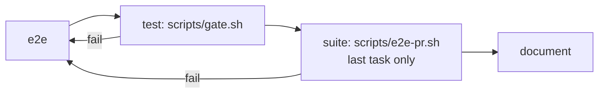
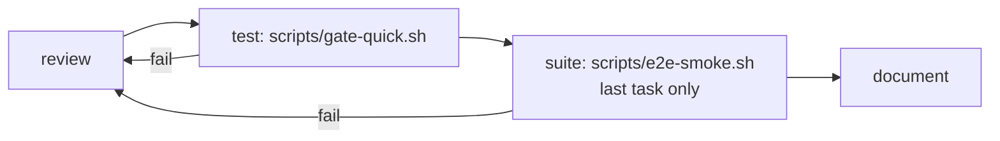

# Testing

The tests are split by the question they answer.

| Kind | Where | Answers | Needs a model? | Command |
|---|---|---|---|---|
| Unit tests | `src/**`, `#[cfg(test)]` | Does each piece decide correctly? | No | `cargo test` |
| Suites | `scripts/e2e/suites/` | Does it work with real processes, git and a forge? | No | `scripts/e2e/run.sh` |
| Plans | `scripts/e2e/plans/` | What does a real run do on screen: panes, gates, focus? | Yes | You queue one |

Anything decidable from files and exit codes is a unit test. A suite needs a real git
repository, a real detached process or a real forge. Anything only a screen can show is a plan.

## Skill commands

`cargo test` checks every `spoolway` command that a shipped skill names. The test is
`install::tests::skills_name_real_commands` in `src/install.rs`. It reads the skill files of all
three providers, `claude`, `codex` and `pi`.

The test reads only code spans and fenced blocks. For each `spoolway` command it checks the
subcommand path and the long flags against the CLI's own command tree. It does not check short
flags, flag values or the prose around a command. A placeholder such as `<step>`, a pipe or a
description after a run of spaces in a fenced block ends the command.

A name the CLI lacks fails the test. The failure gives the file, the line and the name:

```
assets/skills/pi/spoolway-calibrate/SKILL.md:25
  names `spoolway eval --every`, and `spoolway eval` has no `--every`.
  Use a flag `spoolway eval --help` lists, or add the flag to the CLI
  before the skill names it.
```

A skill that names a missing command on purpose goes in the `ALLOWED` list in the test, with
the reason.

## Running the suites

```sh
scripts/e2e/run.sh                        # the pr tier
scripts/e2e/run.sh --tier smoke           # the fast signal
scripts/e2e/run.sh --suite flow           # one suite
scripts/e2e/run.sh --jobs 1               # one suite at a time, output live
scripts/e2e/run.sh --list                 # every suite, and which setting each case covers
```

To run against a fresh build:

```sh
cargo build --release
SPOOLWAY="$PWD/target/release/spoolway" scripts/e2e/run.sh --tier nightly
```

| Flag | Default | What it does |
|---|---|---|
| `--tier smoke\|pr\|nightly\|cloud\|live` | `pr` | Run a named set of suites |
| `--suite <name>` | | Run one suite. Repeatable. Overrides `--tier`. |
| `--jobs <n>` | `4` | How many suites run at once. `JOBS=<n>` does the same. `--jobs 1` runs them one at a time and streams each suite's output live; anything higher captures it and prints it under the suite's row. A value that is not a positive integer is refused. |
| `--keep` | off | Keep each suite's scratch tree on disk. `KEEP=1` does the same. |
| `--list` | | Print the suites and the setting-to-case map |

Every lane runs a stand-in agent script from `scripts/e2e/agents/`. The harness needs `git`,
`bash`, `curl`, `setsid`, `flock` and `script` (util-linux). Only the `cloud` and `live` tiers
run a real agent binary. On a machine with no `setsid` or `flock`, such as macOS,
`scripts/e2e/portable.sh` appends perl stand-ins from `scripts/e2e/portable/` to `PATH`. A
machine with the real commands keeps using them.

### On macOS

Only `command-steps` runs on a Mac, in CI's `verify / test-macos` job. It is the suite that
starts real processes, sessions and process groups, which is where macOS differs. The other
suites drive git, the queue and the TUI the same way on any Unix. Nobody who works on this
repo has a Mac, so the runner is the only place this suite runs on macOS.

The job runs before a release, not on every pull request. The release workflow runs it on
the rehearsal and on the tag, so a red Mac stops the release. Pull requests and the daily
run skip it, because at about fifteen minutes it is the slowest job in CI.

The suites also need GNU `sed`, GNU `coreutils` and a current `bash`. They use `sed -i` with
no suffix, `0,/re/` addresses, `timeout`, `date +%N` and `wait -n`, and the macOS versions
of those tools support none of them. The job installs them with Homebrew and puts their
unprefixed names on `PATH` ahead of the system ones. There is no stand-in for `script`: only
the suites that drive a screen over a pty call it, and `command-steps` does not.

`spoolway dispatch` refuses `backend = headless` unless `SPOOLWAY_TEST_BACKEND` is set in the
environment. `fixture.sh` and `scaffold.sh` export it for every suite and scaffolded project
that runs on that backend.

### Killing the dispatcher at a named point

`SPOOLWAY_TEST_KILL_AT=<point>` makes `spoolway dispatch` kill itself with `SIGKILL` at one
named moment. It does nothing unless `SPOOLWAY_TEST_BACKEND` is also set. No command other than
`spoolway dispatch` reads it. A point fires once. It leaves a marker file in the repository's
`.git` directory, so a restarted dispatcher carries on. A repository whose `.git` is a file, such
as a linked worktree, has no hook. With the backend set, an unknown point name makes
`spoolway dispatch` refuse to start and list the valid points.

| Point | The dispatcher dies |
|---|---|
| `cut-before-add` | After the task file records `run` and `base_commit`, before the worktree is cut |
| `cut-during-add` | While `git worktree add` is still writing the checkout. The cut's process group is killed first, then the dispatcher |
| `cut-after-add` | After the worktree is cut, before the task file records `workspace_id` |
| `teardown-after-commit` | After the final commit, before the checkout is torn down |
| `teardown-during-remove` | While `git worktree remove` is still deleting the checkout |
| `teardown-before-archive` | After the checkout is torn down, before the task file moves to `archive/` |

At a `during` point, the dispatcher also kills the whole process group of the `git` command, so
the checkout stays half written or half deleted.

A suite marks a case whose fix is not on `main` yet with `expect_fail <finding> <task>` before
its checks and `expect_fail_end` after them. A failing check inside the mark prints `xfail` and
does not fail the suite. When every check inside the mark passes, the suite prints a line saying
the mark can come off.

Each run's scratch root lives under `/tmp` and is removed on exit. A kept tree carries a
`.keep` marker, and the next run sweeps any other run's root whose process is gone.

### Coverage

`--list` reads every key in `.spoolway/config.toml` and in `assets/pipelines/default.yml`, and
matches each against the cases that claim it. A suite claims a setting with a
`# covers: <setting> — <what the case is>` line, a plan in its coverage block, and a unit test
with a `// covers:` line.

| Reading | Meaning |
|---|---|
| a case | A suite fails when the setting stops working |
| `no case — plans/x` | Only a plan run can see it |
| `no case — unit <path>` | A unit test in that file covers it |
| `no case` | A gap |

## Tiers

| Tier | Suites | Used by |
|---|---|---|
| `smoke` | flow | A person, by hand |
| `pr` | flow, commands, command-steps, issue-tracking, stacking, stack, conflicts, forge, disaster, lock, trials, routines, jobs, jobs-screen, screen, board-pause, queue-unqueue, restart, overrides, upgrade, herdr-bind, remote-base, home-mode, kept-panes, lane-tabs, lane-orphans | The `suite` step of the pipelines, on the last task of a chain |
| `nightly` | the `pr` suites plus `faults` and `footprint` | Daily CI and the release workflow |
| `cloud` | warmth | Nothing automatic. Runs only with `SPOOLWAY_E2E_CLOUD=1`. |
| `live` | live | Nothing automatic. Runs only with `SPOOLWAY_E2E_CODEX_MODEL=<model>`. |

## The suites

| Suite | Covers |
|---|---|
| `flow` | A task's whole life: queued, agent steps, command steps, archived; copying a pipeline and a prompt into the private layer from a real linked worktree, then promoting the pipeline from the worktree into its own `.spoolway/` and from the main checkout into the checkout |
| `commands` | CLI behaviour that belongs to no domain of its own: `init` and `sync`, the three contracts, the queue tab of bare `spoolway` driven over a real pty, the archive's rows, `config`'s checkout/project asymmetry, `config set` refusing an unknown backend and a hook that is not a bare filename and warning on a missing agent or hook script, the overrides layer through a linked worktree, housekeeping's retention sweep, a behind checkout staying silent over a real pty, `spoolway sync`'s confirm panel over a real pty with esc after its title, checking the panel reaches the terminal, no alternate screen, and the cancel message |
| `command-steps` | A `run:` step's own mechanics: exit-code routing, `background:`, `timeout:`, `loop:`, hidden and paned steps, a step's `hide:` overriding `dispatch.hide_commands` both ways, the environment a step is handed, nothing over 512 bytes typed into a pane, an unattended unblocker that answers `--stage` parking the task after three laps |
| `issue-tracking` | `[issue_tracking]`'s hook on `queued`, `started`, `blocked`, `paused`, `done` and `open`, the shipped `github.sh` against the `gh` double and `jira.sh` against the `acli` double, both opening a ticket titled with its commit prefix stripped and a body built from the task's own `## Context` and `## Acceptance criteria`, never `## Intend`, `jira.sh`'s body read back as real ADF, a failing `queued`, `started` or `done` hook landing the task on `hook_failed` with no hook event fired for it and `queue list --json` naming that state, `spoolway resume --skip-hook` archiving a task whose `done` hook failed with no second hook run, `github.sh`'s `done` on a branch with no pull request closing the ticket as completed with no review label, `jira.sh`'s `done` on a branch with no pull request moving the Sub-task to `Done` with a comment, and the Story too only when no other Sub-task is open, a failing hook's own trace landing in `## Hook error`, a hook saved with CRLF line endings failing with exit 127 and one with mode 644 failing with exit 126, each failed by `doctor` and passed once fixed, `key_in_names`, `labels:` reaching the hook as `SPOOLWAY_LABELS`, `queue add` refusing a label with a space, `queue add` running no `open` hook for a `tracking: off` task, a `queue add` stopped while its `open` hook runs, whose hook the next `queue add` of the same id adopts and starts once, and `queue add --from` queueing with `tracking: off` and opening no ticket when the `acli` double answers `jira auth status` as unauthorized |
| `stacking` | Three chained tasks, each pull request on the branch it is cut from |
| `stack` | the deprecated stack command: the squash, a refused lease, an empty diff, a bad `branch:`, a refusal from the main checkout, a side worktree, another task's worktree, a detached HEAD and a task with no `branch:`, with nothing committed or pushed, the body from the task file, the title prefixed with a bare `ticket:` key and left alone for a GitHub `ticket:` URL, a base branch that exists locally and nowhere else, a deleted `starts_from` followed to its merged pull request's base, also when a stale local branch or `origin/` ref survives, a base nobody has published still pushed, one closed without merging named instead, one with no pull request at all, and an `origin` behind an SSH host alias still registering the stack for its owner and repo |
| `conflicts` | A base that moves under a waiting branch, and the rebase |
| `remote-base` | A base branch only `origin` has: a task cut straight from `origin/<base>`, a start branch that exists nowhere pausing its dependent, and a `git fetch` that hangs being stopped while an unrelated task still starts |
| `forge` | The `gh` test double, including an empty change |
| `disaster` | A hard kill with lanes live, a kill during a worktree cut, a kill during a worktree removal, a stale lock, a `dispatch.pid` deleted under a live dispatcher and taken by a second one, a restart over a running lane, a stop with live lanes, retention |
| `lock` | A second `--tier pr` run waits for the first |
| `trials` | The `trial` item of the queue screen's options menu, the arms it queues, and their cleanup |
| `routines` | The routines tab, and the `save as routine` panel on the queue screen |
| `jobs` | A cron job fired by a real dispatcher pass, and what `spoolway doctor` says about a bad job |
| `jobs-screen` | Bare `spoolway`'s jobs tab writing, pausing and deleting a job |
| `screen` | Bare `spoolway`: the five-label strip, opening on the queue tab, `←` reaching the dispatch tab, `enter` there starting a dispatcher, the warnings popup naming the prompt of a pipeline added after the screen opened, `enter` there stopping the dispatcher with no stop popup drawn on an empty queue, `enter` with a task queued opening the stop popup that names it, with `esc` keeping the dispatcher running and `enter` on `stop dispatching` stopping it, the problem log holding the stop line `enter` asked for and no `ctrl-c` line from the board's dispatcher, `→` from the queue tab reaching the routines tab, a second `spoolway` or `spoolway dispatch` refusing while a screen holds `spoolway.pid`, the grouped help off a terminal, its raw output opening and closing on the alternate screen, a full board in a 30-row pane scrolling its task table under a marker row and keeping its key line, a full board in a 120-column pty leaving column 0 and the last column empty, a walk through all five tabs and back that draws no frame with a full-screen erase, and `delete` on the queue tab's options menu with `esc` keeping every pending file and `enter` removing the group and its dependents |
| `board-pause` | The board's options menu over a live lane: its `pause`, `restart` and `unqueue` items and the confirm panels they open, among them the `unqueue` panel for a routine copy, plus the dispatch tab's stop popup's `interrupt them now` answer. `U` doing nothing on the board, with `spoolway queue unqueue --all` doing the job from a shell. `spoolway restart` over a live blocked lane |
| `queue-unqueue` | `spoolway queue unqueue`: its `--help`, the refusal and the two routes out of it, `--force` over a live lane, `--force` on a started task whose branch was never made printing no kept-branch line, `--force` on a started copy of a routine deleting it and naming the branch it kept, a `hook_failed` task unqueued and queued again with no old hook state left and both hooks fired anew, and the tool-requirements gate over `queue add --from` on a real pty, checking no alternate screen and the task left in pending |
| `restart` | A second `spoolway dispatch` against a held lock, refused the same way every time, and an empty queue never refused at all |
| `overrides` | The override commands: fork a setting out of the checkout, list it, promote it back, and skip a stale one. Also `config set` beside an active config layer |
| `home-mode` | A checkout with no `.spoolway/`, run in a workspace under `~/.spoolway/`. It also covers the clone's id: a superproject moved on disk that finds its queue again, an `init` cancelled at its first question that leaves `.git` and `~/.spoolway/` as they were (needs util-linux `script`), and several first commands started at once in a fresh clone that agree on one home. It also runs a dispatcher in each of two clones over one shared project job and checks the job fires once for the workspace |
| `kept-panes` | A two-step task driven through the herdr double: `spoolway lane` still lists the first step's lane while the second step runs, and both lanes are gone once the task is done. A second task with `dispatch.visible_lanes` set to `1` lists only the second step's lane while it runs. A four-step task with `dispatch.visible_lanes` set to `3` has closed the first lane once the fourth starts, and with `all` it closes none. A one-step command task opens a pane by default and opens none with `dispatch.hide_commands` set to `true`, and both runs write the same log file. A task held at a gate and resumed onto its first step has closed that step's old lane and still lists the gated step's lane |
| `lane-tabs` | With `dispatch.lane_layout` set to `tabs`, a four-step task driven through the herdr double opens each step in a tab labelled with the step. The first step takes the workspace's first tab and its pane is not renamed. At `dispatch.visible_lanes` 3 the fourth step closes the first step's tab. A step that fails back reuses its own tab and its new pane replaces the old one, also after the first tab has closed. At a limit of 1 the workspace survives every swap. A lane whose agent is removed from the double's agent list is found on a later pass and its task is blocked |
| `lane-names` | Two tasks whose ids share a tag are driven through the same step on the herdr double, which refuses a name over 32 characters and a name a live agent holds. The first task's lane is `<step>-<tag>`. The second task's lane takes a four-character tag. A step that runs again keeps its three-character tag. When another task's agent holds that name, the agent keeps it and the step's tag grows to five characters. Archiving the first task removes its records from `lane_aliases.json` and leaves the second task's |
| `lane-orphans` | A suite that ends or forgets a lane leaves none of that lane's processes running. The `forget` helpers of `disaster` and `faults` stop the lane's agent and not only its shell. The exit trap in `lib.sh` stops every lane under `headless/`, and never signals a pid file that holds `0`, a non-number or nothing |
| `faults` | Faults injected where the stress test found bugs by hand. `SPOOLWAY_TEST_KILL_AT` makes a test dispatcher kill the cut's process group and then itself inside `git worktree add`, and kill itself inside `git worktree remove` in a repository of ten thousand files. The suite also covers a command step's wrapper killed alone by `SIGKILL` and by `SIGTERM`, a dispatcher on a terminal while a cron job fires under an issue hook whose tool is missing, a base ask to `origin` over a stalled ssh transport, eight `config set` calls at once, and `resume` under a live unblocker. A case whose fix is not on `main` yet is marked expected-fail, and the suite prints a line once it passes. It takes about three and a half minutes, so it runs in `nightly` only |
| `footprint` | The memory and process budget of the screen and the dispatcher, with five lanes held on the herdr double. The budget is a block of named constants at the top of the suite: the screen gets 30 MB plus 2 MB per lane, and the dispatcher gets 20 MB plus 1 MB per lane. Peak memory is `VmHWM` in `/proc`, so the suite runs on Linux only. Shims for `git`, `herdr`, `gh` and `tmux` log every call and run the real tool. An idle dispatcher pass starts no `git` and at most one herdr call, and an idle second of the screen starts no process. The suite then repeats the run with 5,000 transcripts for each agent kind and a 40 MB ledger. Peak memory and the processes per idle pass must each stay within 10% of the small run. The screen must also be back under its budget within 5 s of leaving the Eval tab. Each failed check prints what to look at next. It takes about three and a half minutes, so it runs in `nightly` only |
| `upgrade` | Whether this binary still reads what the 0.6.0 release wrote. The 0.6.0 `.spoolway/` tree under `scripts/e2e/fixtures/` goes through a real `spoolway sync`: its `housekeeping.retention_days` survives, the prose around the pipeline file's key block comes back byte for byte, `spoolway pipeline check` loads the result, and a task queues against it. A dry run changes no file, and the files it lists are the files a real run reports and changes on disk. A sync that cannot remove one file writes nothing, `config.toml` included. Every other release's `.spoolway/` tree under `scripts/e2e/fixtures/` goes through `spoolway sync` too: none of its files comes back refused, and a second sync has nothing to do. After its sync, every release's `[dispatch]` table holds `priority`, `lane_child_ceiling`, `visible_lanes`, `hide_commands` and `lane_layout` |
| `warmth` | `cloud` tier. Real `claude-haiku-4-5` lanes, to check session reuse against a real transcript. It ages sessions by waiting, so a run takes about ten minutes. |
| `live` | `live` tier. The real `codex` binary through `agent verify codex --live`. |

Each suite runs in its own process and scratch tree under `/tmp`, with its own prompts, so no
suite depends on the shipped prompt text. That isolation is what lets four of them run at
once, which is the default — see `--jobs`.

When a suite exits, its exit trap in `scripts/e2e/lib.sh` stops the screen and the dispatcher.
It then stops the whole process group of every lane whose pid file is under `headless/`, and
waits for the group to go. A lane a suite kept running on purpose, or left behind after a
failed check, does not outlive the suite. The `forget` helpers in `disaster` and `faults` stop a
lane's group the same way.

## The one suite that spends money

```sh
SPOOLWAY_E2E_CLOUD=1 scripts/e2e/run.sh --tier cloud
```

`warmth` runs five turns of `claude-haiku-4-5` against a two-file repo, and waits real minutes
to age its sessions, so a run takes about ten minutes. It uses your real `$HOME` and the real
`claude`. Put the build under test on `PATH`, because the prompt runs
`spoolway report`.

## The suite that runs the real binaries

```sh
SPOOLWAY_E2E_CODEX_MODEL=<model> scripts/e2e/run.sh --tier live
```

`live` runs `spoolway agent verify codex --live`: one turn, then one resume, on the installed
`codex`. A model served by a local endpoint (`wire_api = "responses"` in codex's provider
config) costs nothing.

## Plan runs

Panes, focus, gates and notifications can only be checked by a person. Queue a plan into a
throwaway project:

```sh
scripts/e2e/scaffold.sh --list                    # the plans
scripts/e2e/scaffold.sh --plan gates              # build a project for one
cd ~/dev/project/spoolway-e2e-gates
# in claude: open scripts/e2e/plans/gates.html, approve it, let /spoolway-plan cut the tasks
spoolway queue                                    # submit them
spoolway dispatch                                 # watch
scripts/e2e/scaffold.sh --plan gates --clean      # when done
```

`scaffold.sh` seeds a repo, builds a local forge from `scripts/e2e-fake-gh.sh`, and installs
`scripts/e2e/runtime/end-to-end.yml` with every step on `pi`. It needs `pi` on `PATH` and a
model server that knows the model.

| Plan | What it is for |
|---|---|
| `escalation` | A block, a review that runs out of loops, a lane that goes quiet |
| `gates` | A gated step stopping in its pane, and the notification |
| `workspace` | Two lanes, two worktrees, one shared file, an interrupted run |
| `observer` | The backgrounded observer and its `observations.md` |

The observer is `scripts/e2e/observe.sh`. It polls `spoolway lane` and appends what it sees
to `observations.md` in the project root.

## Local gates and daily CI



`impl`'s `test` step runs `scripts/gate.sh` for every task:

```sh
cargo fmt --check
cargo deny check advisories
cargo clippy --all-targets --locked -- -D warnings
cargo test --all-targets --locked
cargo build --release
./target/release/spoolway pipeline check
```

`impl`'s `suite` step runs `scripts/e2e-pr.sh` on the last task of a chain, through `last:`
(see [`last:`](pipelines.md#last--a-step-the-chain-runs-once)):

```sh
SPOOLWAY="$PWD/target/release/spoolway" scripts/e2e/run.sh --tier pr
```

`impl_lite` runs the same two steps against lighter scripts:



`test` runs `scripts/gate-quick.sh`, `scripts/gate.sh`'s six commands minus `cargo deny check
advisories`. `suite` runs `scripts/e2e-smoke.sh`, which runs the `smoke` tier instead of `pr`:

```sh
SPOOLWAY="$PWD/target/release/spoolway" scripts/e2e/run.sh --tier smoke
```

A failure sends the task back to the step before `test` (`e2e` in `impl`, `reproduce-again`
in `bugfix`), at most twice, then the task parks on `blocked`. The gate needs `cargo-deny`
installed.

`.github/workflows/ci.yml` runs daily on `main` at 03:17 UTC, and on every pull request.
Pushes do not trigger it. The scheduled run's Linux job runs the same gate plus the
`nightly` tier; a pull request runs the `pr` tier instead. A commit that already has a
successful scheduled run is skipped, and so is a pull request whose changed files are all
under `docs/` or `site/`, or are `README.md`, `DOCS.md` or `log.md`.

`verify.yml` also has a `verify / test-macos` job on `macos-latest`. It runs
`cargo test --all-targets --locked`, then the `command-steps` suite from a release build. A
failed run uploads the suite's scratch tree as an artifact on the run page. Only the release
workflow runs it by default. `ci.yml` skips it unless a manual dispatch passes `-f macos=true`.
`main` still requires this job together with `verify / test` and `verify / audit`. A skipped
job counts as passing there, so pull requests do not wait for it.

Run it by hand before a release or to check a fix:

```sh
gh workflow run ci --ref main -f tier=nightly
gh workflow run ci --ref <branch> -f macos=true    # include the macOS job
gh run list --workflow ci --limit 5
gh run view <run-id> --json headSha,conclusion,jobs
```

Daily CI and the release workflow share `.github/workflows/verify.yml`. See
[Releasing spoolway](releasing.md). No pipeline waits on those runs: a task reaches `done`
once `handover` has opened its pull request, so a red check afterwards is yours to pick up
from the pull request itself. Daily CI checks the integrated tree.

`verify.yml`'s `test` job also fails when [`herdr-plugin.toml`](../herdr-plugin.toml)'s
`version` differs from `Cargo.toml`'s. See [Installation and setup](installation.md).
